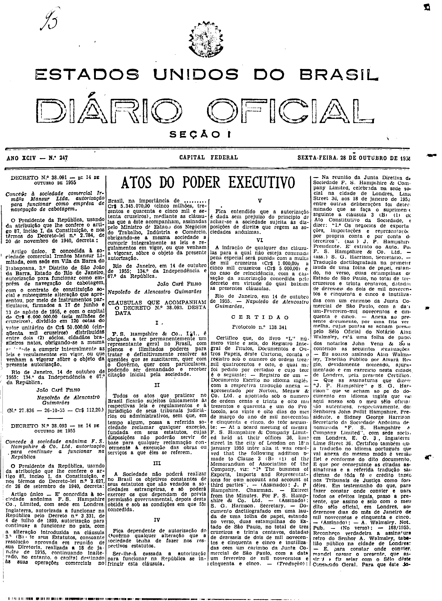

###DEC-038093-0-000-14-10-1955@@@

<strong>DECRETO Nº 38.093, DE 14 DE OUTUBRO DE 1955.</strong>

<em><strong>Concede à sociedade anônima F. S Hampshire & CO. Ltd. autorização para continuar a funcionar na República.</strong></em>

<strong>O PRESIDENTE DA REPÚBLICA</strong>, usando da atribuição que lhe confere o artigo 87, inciso I da Constitução, e nos têrmos do Decreto-lei nº 2.627,.de 26 de setembro de 1940,

<strong>DECRETA:</strong>

Artigo único - É concedida à sociedade anônima F. S Hampshire CO.Limited, com sede em Londres, Inglaterra, autorizada a funcionar na República pelo Decreto nº 3.331, de 4 de julho de 1899, autorização para continuar no país, com com a alteração intruduzida na cláusula 3ª (B) de seus Estatutos, consonate resolução aprovada em reunião de sua Diretoria, realizada a 18 de janeiro de 1955, continuando inalterado, no entanto, o capital destinado às suas operações comerciais no Brasil, na importância de Cr$5.345.070,00 (cinco milhões, trezentos e quarenta e cinco mil e setenta cruzeiros), mediante as cláusulas que a êste acompanham, assinadas pelo Ministro de Estado dos Negócios do Trabalho, Indústria e Comércio, obrigando-se a mesma sociedade a cumprir as leis e regulamento em vigor, ou que venham a vigorar, sôbre o objeto da presente autorização.

Rio de Janeiro, em 14 de outubro de 1955; 134º da Independência e 67º da república.

<strong>JOAO CAFÉ FILHO</strong>

Napoleão de Alencastro Guimarães

<!-- fac-simile-oficial:inicio -->

## Fac-símile oficial: clausulas

A peça vinculada ao Decreto nº 38.093 é reproduzida nas imagens abaixo, a partir da publicação oficial da Imprensa Nacional. A reprodução é em fac-símile, sem transcrição por OCR nem reconstrução do conteúdo.

As imagens mostram páginas inteiras do Diário Oficial da União e podem conter outras matérias. Essas matérias vizinhas não são atribuídas a este decreto. A peça é identificada pelo seu título e pela referência ao ato nas páginas indicadas.

SHA-256 desta imagem: `a739adb913b1a72ec4e4e4cf17299c2c801659dc929f60f217723a2bff2777f9`.

Fontes oficiais da publicação:

- [DO_1_19551028_247.PDF](https://biblioteca.in.gov.br/documents/271518/581356/DO_1_19551028_247.PDF/cf6ea7a4-a87a-f78e-60bc-8fc589de2743?t=1574964049787&download=true) — SHA-256 do PDF: `cbb8e013150e1aff6c8d3f06ffd6e96889c17a2ce7f93a7ae25ac4cc85922670`.

<!-- fac-simile-oficial:fim -->
