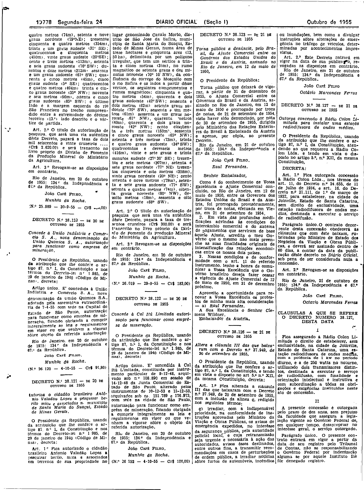
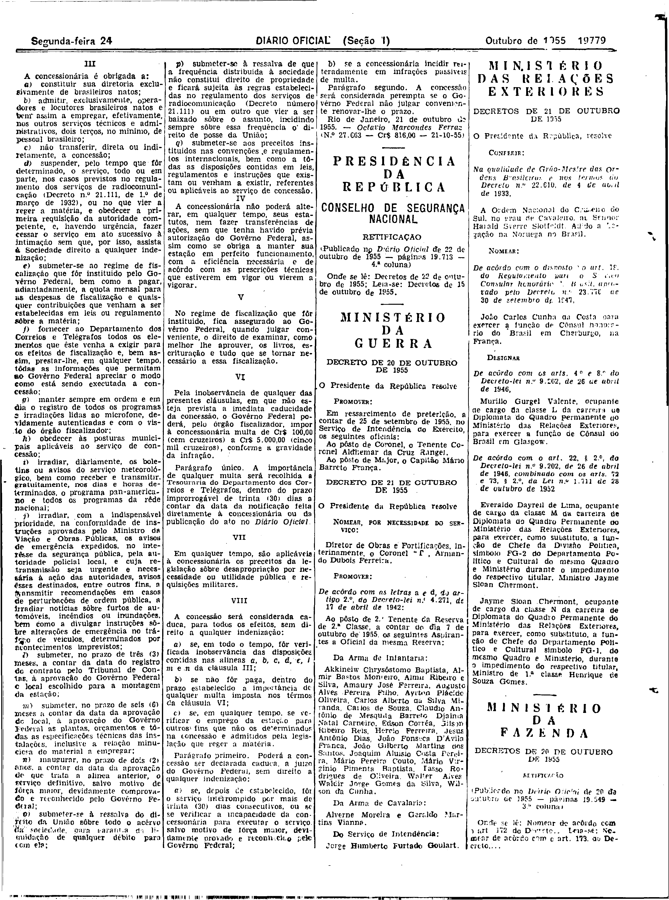

###DEC-038127-0-000-21-10-1955@@@

<strong>DECRETO Nº 38.127, DE 21 DE OUTUBRO DE 1955.</strong>

<em><strong>Outorga concessão à Rádio Colon Limitada para instalar uma estação radiofusora de ondas médias.</strong></em>

<strong>O PRESIDENTE DA REPÚBLICA</strong>, usando da atribuição que lhe confere o artigo 87, nº I, da Constituição, atendendo ao que se requereu a Rádio do Colon Ltda. e tendo em vista o disposto no artigo 5º, nº XXI, da mesma Constituição,

<strong>DECRETA:</strong>

<strong>Art</strong>. 1º Fica outorgada concessão à Rádio Colon Ltda., nos têrmos do art. 11, do Decreto nº 24.655, de 11 de de julho de 1934, e art. 16 do Decreto nº 21.111, de 1º de março de 1932, para estabelecer, na cidade de Joinville, Estado de Santa Catarina, sem direito de exclusividade, uma estação radiofusora de ondas médias de serviço de radiofusão.

Parágrafo único. O contrato decorrente desta concessão obedecerá as cláusulas que com êste baixam, rubricada pelo o Ministro de Estado dos Negócios da Viação e Obras Públicas, e deverá ser assinado dentro de 60 dias, a contar da data publicação dêste decreto no <em>Diário</em> <em>Oficial</em>, sob pena de ser considerada nula a concessão.

<strong>Art</strong>. 2º Revogam-se as disposições em contrário.

Rio de Janeiro, 21 de outubro de 1955; 134º da Independência e 67º da República.

<strong>JOSÉ CAFÉ FILHO</strong>

Octavio Marcondes Ferraz

<!-- fac-simile-oficial:inicio -->

## Fac-símile oficial: cláusulas

O texto acima não inclui as cláusulas a que se refere este decreto. A publicação oficial do anexo está em imagem, nas páginas do _Diário Oficial da União_ (Seção I) de 24 de outubro de 1955: página 10 do PDF (a partir de «CLÁUSULAS A QUE SE REFERE O DECRETO NÚMERO 38.127, DESTA DATA»); página 11 do PDF (até «N.º 27.063 — Cr$ 816,00 — 21-10-55»).

As imagens são as páginas inteiras, tal como digitalizadas pela Imprensa Nacional, sem recorte, sem redesenho e sem transcrição. Cada página traz também outros atos do mesmo dia; a peça deste decreto está apenas no trecho indicado, e o texto do anexo só existe na imagem. Não há OCR validado.

Fonte: Imprensa Nacional, Biblioteca Machado de Assis, arquivo `DO_1_19551024_243.PDF` (SHA-256 `589b6c9db9eca0b820901b7c235302f29d1ef013dad940b35185d6afdd034052`), páginas 10, 11 do PDF. SHA-256 das imagens, na ordem: `20018295f3876508c532bbce499f64983df8f4396a4a4e6d708349bf26e3c43a`, `0aa9ddee5eec30807ced25b8f7f6ad38aec5405c2aa4e1537a14b1d3fe938ef3`.

<!-- fac-simile-oficial:fim -->
