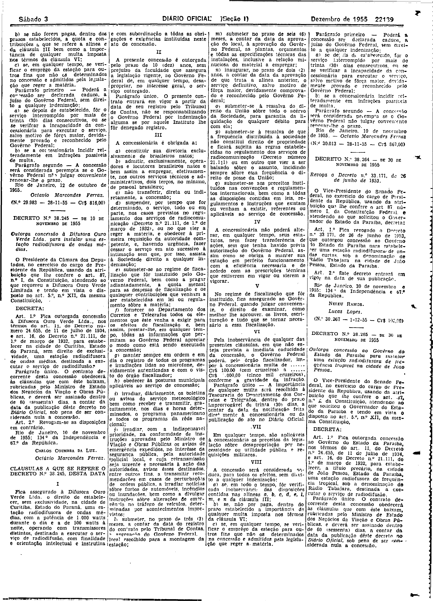

###DEC-038245-0-000-10-11-1955@@@

<strong>DECRETO Nº 38.245, DE 10 DE NOVEMBRO DE 1955.</strong>

<em><strong>Outorga concessão á difusora ouro verde ltda , para instalar uma estação radiodifusora de ondas medias.</strong></em>

<strong>O PRESIDENTE DA CÂMARA</strong> <strong>DOS DEPUTADO</strong>, no exercício do cargo de PRESIDENTE DA REPUBLICA, usando da atribuição que lhe confere o art 87º, nº I, da constituição atendendo ao que requereu a difusão de ouro verde limitando e tendo em vista o disposto no art. 5º, nºXII, da mesma constituição,

<strong>DECRETA:</strong>

<strong>Art</strong>. 1º Fica outorgada concessão à difusão ouro verde ltda. ,nos têrmos do art.11, do decreto numero 24.655 de 14 de julho de 1934e art. 16, do decreto nº 21.111, de 1º de março de 1932, para estabelecer na cidade de Curitiba, estado do Paraná sem direito de exclusividade uma radiodifusora de ondas medias, destinada a executar o serviço de radiodifusoras

Parágrafo único. O contrato decorrente desta desta concessão abedecerá as cláusulas que com êste baixam rubricadas pelo Ministro de Estados e Negócios das Viação e Obras Publicas e deverá ser assinadas dentro de sessenta (60) dias a contar data de publicação dêste decreto no <em>Diário</em> <em>Oficial</em> ,sob pena de ser considerado nula a concessão .

<strong>Art</strong>. 2<strong>º</strong> Revogam-se as disposição em contrário.

<strong>CARLOS COIMBRA DA LUZ</strong>

Octávio Marcondes Ferras

<!-- fac-simile-oficial:inicio -->

## Fac-símile oficial: cláusulas

O texto acima não inclui as cláusulas a que se refere este decreto. A publicação oficial do anexo está em imagem, nas páginas do _Diário Oficial da União_ (Seção I) de 3 de dezembro de 1955: página 3 do PDF (a partir de «CLÁUSULAS A QUE SE REFERE O DECRETO N.º 38.245, DESTA DATA», até «N.º 30.013 — 28-11-55 — Cr$ 867,00»).

As imagens são as páginas inteiras, tal como digitalizadas pela Imprensa Nacional, sem recorte, sem redesenho e sem transcrição. Cada página traz também outros atos do mesmo dia; a peça deste decreto está apenas no trecho indicado, e o texto do anexo só existe na imagem. Não há OCR validado.

Fonte: Imprensa Nacional, Biblioteca Machado de Assis, arquivo `DO_1_19551203_276.PDF` (SHA-256 `6da98ba9b337f94c8072335cab4687f1e300e12ec175c910c7d24f132495c032`), páginas 3 do PDF. SHA-256 das imagens, na ordem: `bfd91d57504e4053ea9a6f549c5f844150be491a216ba7ba76a31e75f7d990cf`.

<!-- fac-simile-oficial:fim -->
