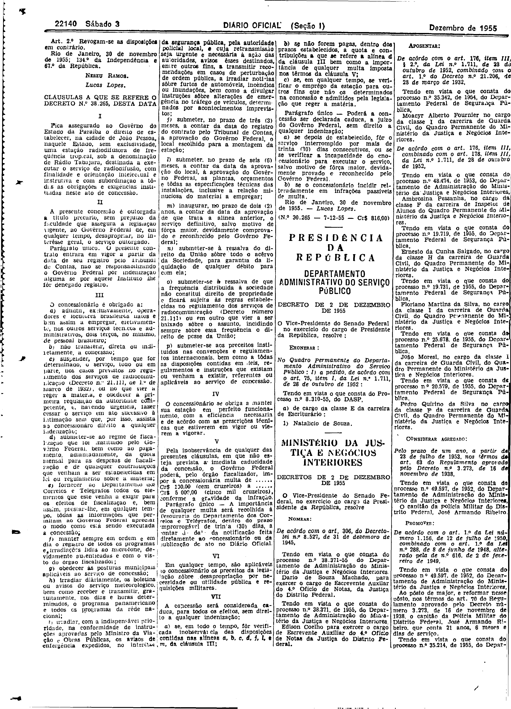

###DEC-038265-0-000-30-11-1955@@@

<strong>DECRETO Nº 38.265, DE 30 DE NOVEMBRO DE 1955.</strong>

<em><strong>Outorga concessão ao Govêrno do Estado da Paraíba para instalar uma estação radiodifusora de frequência tropical na cidade de João Pessoa.</strong></em>

<strong>O VICE-PRESIDENTE DO SENADO FEDERAL</strong>, no exercício do cargo de PRESIDENTE DA REPÚBLICA, usando da atribuição que lhe confere o art. 87, nº I, da Constituição, atendendo ao que solicitou o Governador do Estado da Paraíba e tendo em vista o disposto no art. 5º, nº XII, da mesma Constituição,

<strong>DECRETA:</strong>

<strong>Art</strong>. 1º Fica outorgada concessão ao Govêrno do Estado da Paraíba, nº 24.655, de 11 de julho de 1934, e art. 16, do Decreto nº 21.111, de 1º de março de 1932, para estabelecer, a título precário, na cidade de João Pessoa, Estado da Paraíba, uma estação radiodifusora de frequência tropical, sob a denominação de Rádio Tabajara, destinada a executar o serviço de radiodifusão.

Parágrafo único. O contrato decorrente desta concessão obedecerá às cláusulas que com êste baixam, rubricadas pelo Ministro de Estado dos Negócios da Viação e Obras Públicas, e deverá ser assinado dentro de 60 (sessenta) dias, a contar da data da publicação dêste decreto no <em>Diário Oficial,</em> sob pena de ser considerada nula a concessão.

<strong>Art</strong>. 2º Revogam-se as disposições em contrário.

Rio de Janeiro, 30 de novembro de 1955; 134º da independência e 67º da República.

<strong>NEREU RAMOS</strong>

Lucas Lopes

<!-- fac-simile-oficial:inicio -->

## Fac-símile oficial: cláusulas

O texto acima não inclui as cláusulas a que se refere este decreto. A publicação oficial do anexo está em imagem, nas páginas do _Diário Oficial da União_ (Seção I) de 3 de dezembro de 1955: p. 22140 (a partir de «CLÁUSULAS A QUE SE REFERE O DECRETO N.º 38.265, DESTA DATA», até «N.º 30.265 — 7-12-55 — Cr$ 816,00»).

As imagens são as páginas inteiras, tal como digitalizadas pela Imprensa Nacional, sem recorte, sem redesenho e sem transcrição. Cada página traz também outros atos do mesmo dia; a peça deste decreto está apenas nas colunas indicadas, e o texto do anexo só existe na imagem. Não há OCR validado.

Fonte: Imprensa Nacional, Biblioteca Machado de Assis, arquivo `DO_1_19551203_276.PDF` (SHA-256 `6da98ba9b337f94c8072335cab4687f1e300e12ec175c910c7d24f132495c032`), páginas 4 do PDF. SHA-256 das imagens, na ordem: `ef0dde5ae36d3a6176aad70fe4071295bdfae62b0c859336b427878dd1000dea`.

<!-- fac-simile-oficial:fim -->
