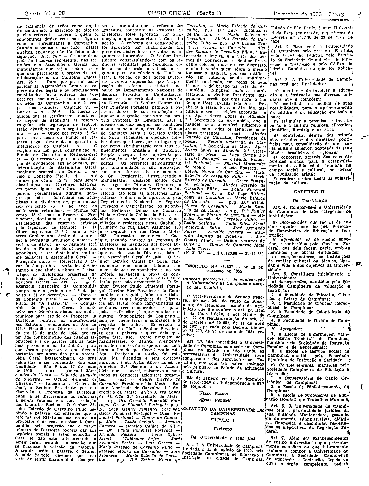
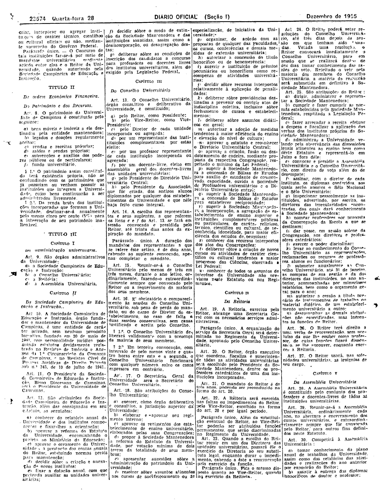
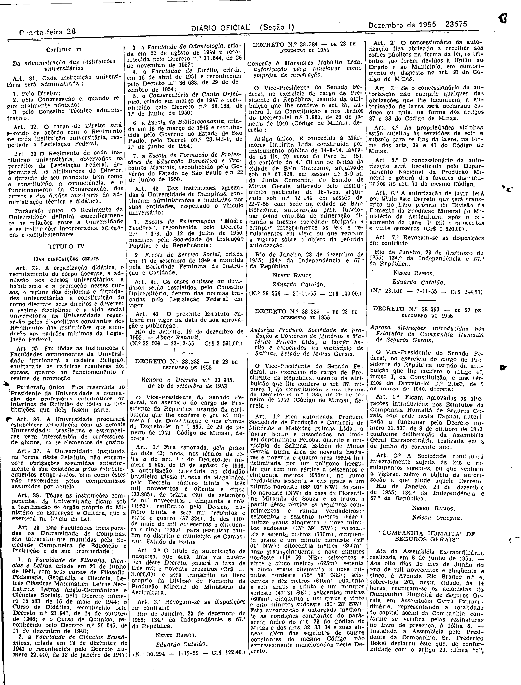

###DEC-038327-0-000-19-12-1955@@@

<strong>DECRETO Nº 38.327, DE 19 DE DEZEMBRO DE 1955.</strong>

<em><strong>Concede prerrogativa de equiparação à Universidade de Campinas e aprova seu Estatuto.</strong></em>

<strong>O VICE-PRESIDENTE DO SENADO FEDERAL</strong>, no exercício de PRESIDENTE DA REPÚBLICA, usando da atribuição que lhe confere o art. 87, item I, da Constituição, e nos têrmos do art. 29 da regulamentação do art. 3º do Decreto nº 19.851, de 11 abril de 1931 aprovada pelo Decreto número 24.279, de 22 de maio de 1934,

<strong>RESOLVE:</strong>

<strong>Art</strong>. 1º São concedidas à Universidade de Campinas, com sede em Campinas, no Estado de São Paulo, as prerrogativas de Universidade livre equiparada e fica aprovado o seu Estatuto, que com êste baixa, assinado pelo Ministro da Educação e Cultura.

Rio de janeiro, em 19 de dezembro de 1955; 134º da Independência e 67º da República.

<strong>NEREU RAMOS</strong>

Abgar Renault

<!-- fac-simile-oficial:inicio -->

## Fac-símile oficial: instrumento

O texto acima não inclui o instrumento a que se refere este decreto. A publicação oficial do anexo está em imagem, nas páginas do _Diário Oficial da União_ (Seção I) de 28 de dezembro de 1955: página 9 do PDF (a partir de «ESTATUTO DA UNIVERSIDADE DE CAMPINAS», Título I, art. 1.º); página 10 do PDF (continuação do estatuto); página 11 do PDF (até «Rio de Janeiro, 19 de dezembro de 1955. — Abgar Renault»).

As imagens são as páginas inteiras, tal como digitalizadas pela Imprensa Nacional, sem recorte, sem redesenho e sem transcrição. Cada página traz também outros atos do mesmo dia; a peça deste decreto está apenas no trecho indicado, e o texto do anexo só existe na imagem. Não há OCR validado.

Fonte: Imprensa Nacional, Biblioteca Machado de Assis, arquivo `DO_1_19551228_296.PDF` (SHA-256 `974c5d783d8e2940725043c77f2c8e17121d5cef1ae385b7f5fc3c3293b232bb`), páginas 9, 10, 11 do PDF. SHA-256 das imagens, na ordem: `3f654fcebf64d31b452bb0c392e866ed22665a4b20becfff56529596396de4fe`, `837f737855ffe50599d12b6186e2602edeec221cf6416e48280e6fe871e3b6ae`, `74287ac12c9e03eddb3f2c88480408e495c56e2f1934714254c5c62de143818f`.

<!-- fac-simile-oficial:fim -->
