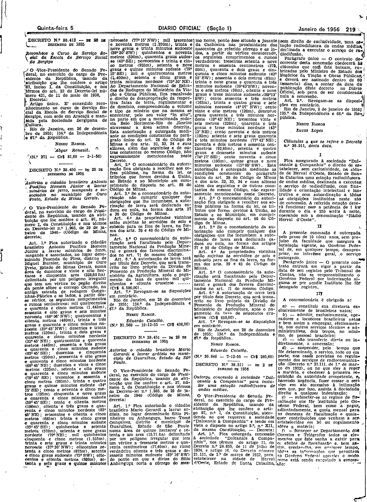
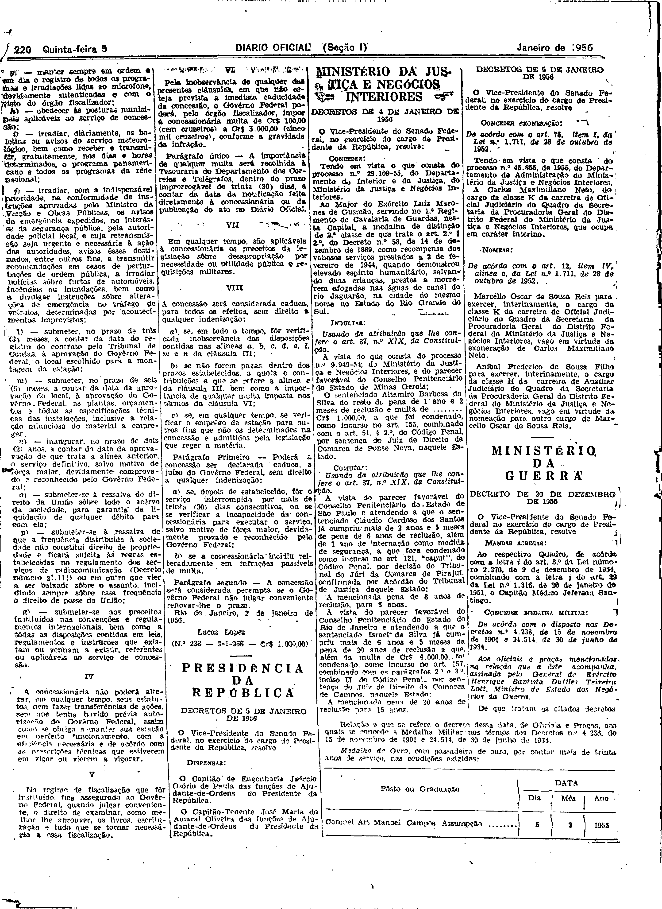

###DEC-038511-0-000-02-01-1956@@@

<strong>DECRETO Nº 38.511, DE 2 DE JANEIRO DE 1956</strong>

<em><strong>Outorga concessão à sociedade “Dalcane & Companhia” para instalar uma estação radiodifusora de ondas médias.</strong></em>

<strong>O VICE-PRESIDENTE</strong> <strong>DO SENADO FEDERAL</strong>, no exercício do cargo de PRESIDENTE DA REPÚBLICA, usando das atribuições que lhe confere o artigo 87, n.° 1, da Constituição atendendo ao que requereu a sociedade “Dalcane & Companhia” e tendo em vista o disposto no artigo 5.° n° XII, da mesma Constituição,

<strong>DECRETA:</strong>

<strong>Art</strong>. 1º Fica outorgada concessão à sociedade “Dalcanale & Companhia”, nos têrmos do artigo 11, do Decreto n.° 24.655, de 11 de junho de 1934, e artigo 16, do Decreto n.° 21.111, de 1º de março de 1932, para estabelecer na cidade de Herval d’Oeste, Estado de Santa Catarina, sem direito exclusividade, uma estação radiodifusora de ondas médias, de nada a executar o serviço de radiodifusão.

Parágrafo único. O contrato decorrente desta concessão obedecerá às cláusulas que com êste baixam, rubricadas pelo Ministro de Estado dos Negócios de Viação e Obras Públicas, e deverá ser assinado dentro de 60 (sessenta) dias, a contar da data da publicação dêste decreto no Diário Oficial, sob pena de ser considerada nula a concessão.

<strong>Art</strong>. 2º Revogam-se as disposições em contrário.

Rio de Janeiro, 2 de fevereiro de 1956; 135. da Independência e 68 da República.

<strong>NEREU RAMOS</strong>

Lucas Lopes

<!-- fac-simile-oficial:inicio -->

## Fac-símile oficial: cláusulas

O texto acima não inclui as cláusulas a que se refere este decreto. A publicação oficial do anexo está em imagem, nas páginas do _Diário Oficial da União_ (Seção I) de 5 de janeiro de 1956: p. 219 (a partir de «Cláusulas a que se refere o Decreto n.º 38.511, desta data»); p. 220 (até «N.º 233 — 3-1-956 — Cr$ 1.030,00»).

As imagens são as páginas inteiras, tal como digitalizadas pela Imprensa Nacional, sem recorte, sem redesenho e sem transcrição. Cada página traz também outros atos do mesmo dia; a peça deste decreto está apenas nas colunas indicadas, e o texto do anexo só existe na imagem. Não há OCR validado.

Fonte: Imprensa Nacional, Biblioteca Machado de Assis, arquivo `DO_1_19560105_004.PDF` (SHA-256 `50e07eed4e316722704320346853d7a0ef6d926c70f4a01827eea2376b489fb4`), páginas 19, 20 do PDF. SHA-256 das imagens, na ordem: `b921fdbb63d40ea97d3cc3671a4269a3ebc303d6756a643520b07d57b9e6967c`, `e98465172634e004b4c7a32f8f5726f00aef7c35629a15ebf41fc8586f4dee36`.

<!-- fac-simile-oficial:fim -->
