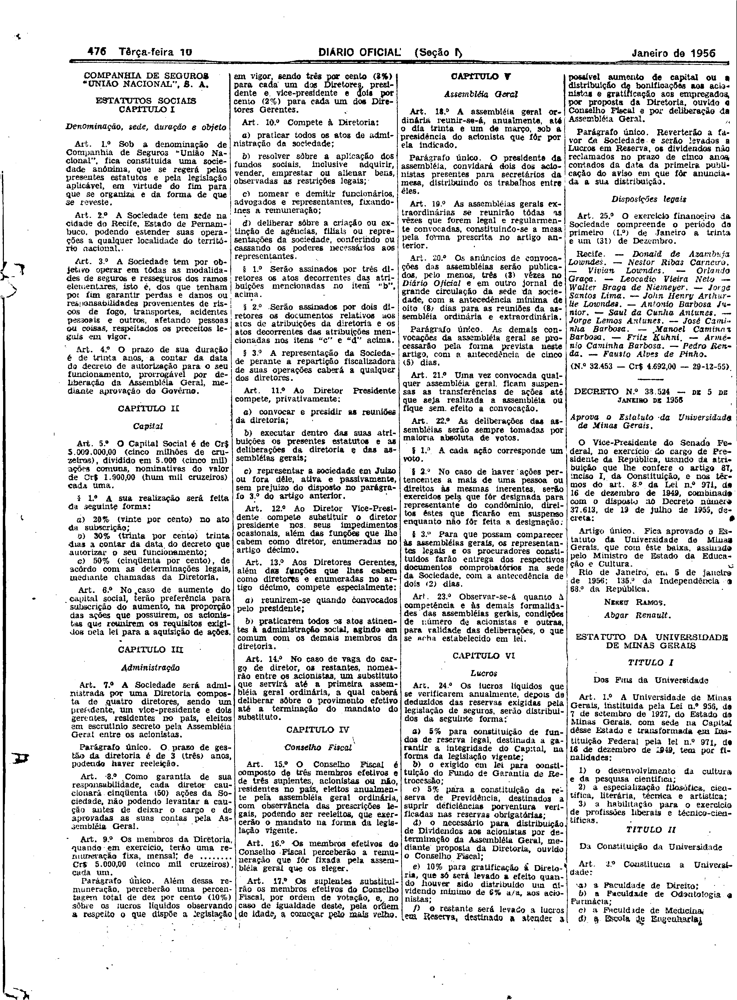
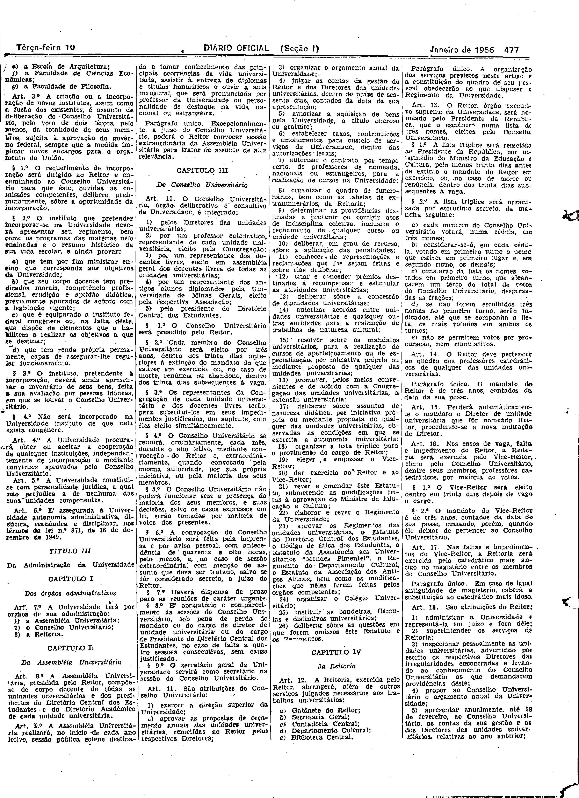
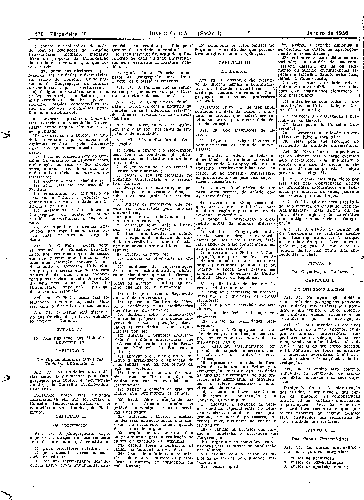
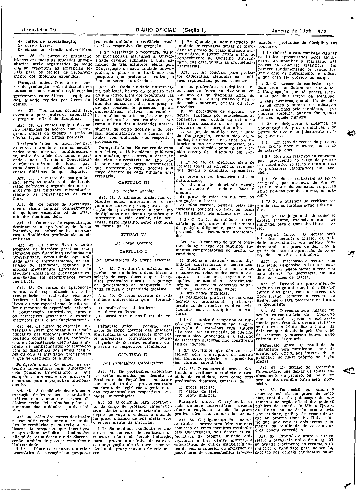
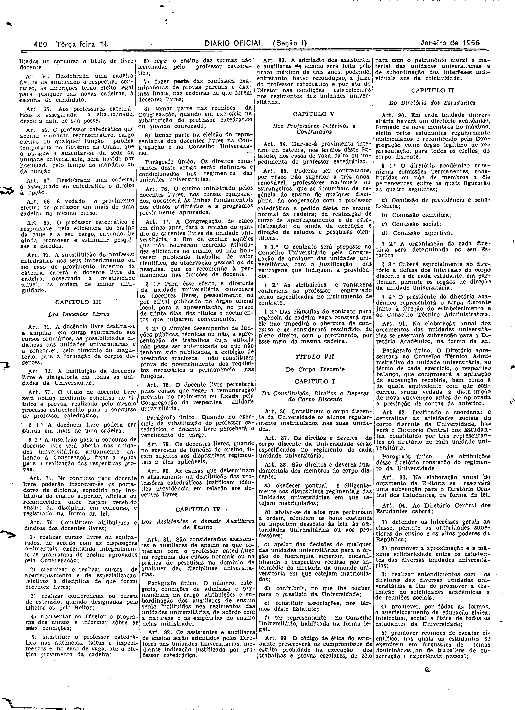
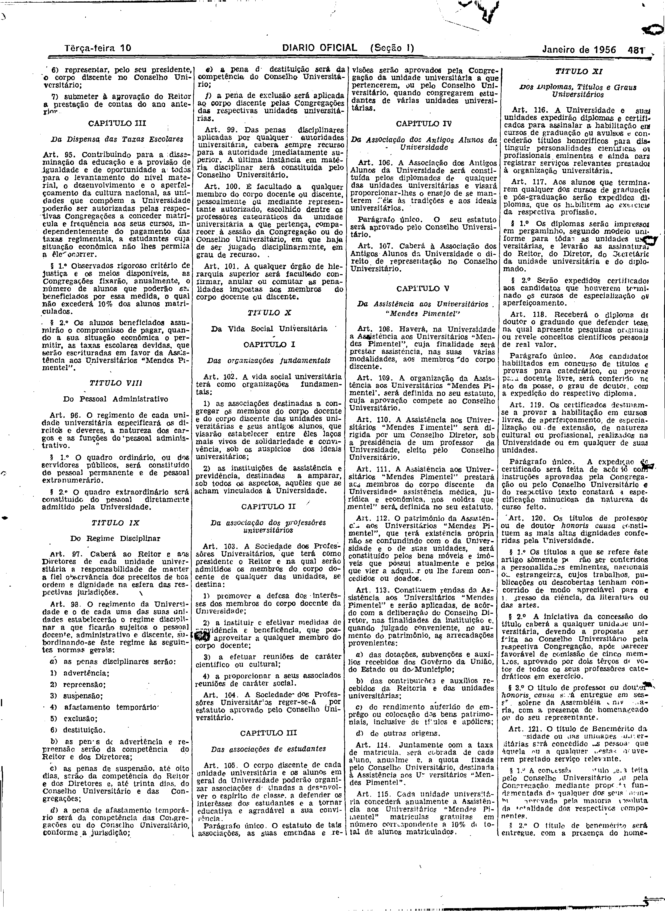
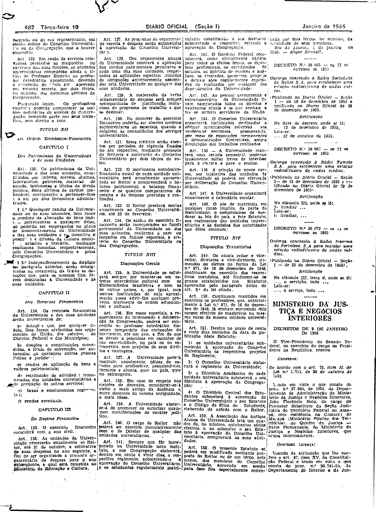

###DEC-038524-0-000-05-01-1956@@@

<strong>DECRETO Nº 38.524, DE 5 DE JANEIRO DE 1956</strong>

<!-- fac-simile-oficial:inicio -->

## Fac-símile oficial: ato e estatuto em fac-símile

A peça vinculada ao Decreto nº 38.524 é reproduzida nas imagens abaixo, a partir da publicação oficial da Imprensa Nacional. A reprodução é em fac-símile, sem transcrição por OCR nem reconstrução do conteúdo.

As imagens mostram páginas inteiras do Diário Oficial da União e podem conter outras matérias. Essas matérias vizinhas não são atribuídas a este decreto. A peça é identificada pelo seu título e pela referência ao ato nas páginas indicadas.

SHA-256 desta imagem: `46b57b74329f3f59c122d10428883e08bf3de0a6e29ddfe105c55b4dc48f61fd`.

SHA-256 desta imagem: `1471cf06f32aeadcaffbbeb0c827749bd54fc174e33d5b368b8fd2cba34e63de`.

SHA-256 desta imagem: `7cb6dfdc1f2e68138b380a42950ae83c144a81ecb51b50f5f3b26a3d38c2ee2d`.

SHA-256 desta imagem: `a25088d5db16b48d344c1ba3896075214e8b6f54ac7df09748564e73139f2109`.

SHA-256 desta imagem: `8b2340acfdcd0316722440069f24fd95507b79fd2c73202bada9c71613de4c59`.

SHA-256 desta imagem: `d65936e4944c81ed5416283595ed2077b55f02915288db1e17f0cdf6ed493dfb`.

SHA-256 desta imagem: `5f53e278c72fc43acb2c6f71eae2c033cedb3d22f59e241c83058259ec22a098`.

Fontes oficiais da publicação:

- [DO_1_19560110_008.PDF](https://biblioteca.in.gov.br/documents/271518/581375/DO_1_19560110_008.PDF/91fd36ff-4843-74fd-1ccc-3a3a4beb4b83?t=1574964939357&download=true) — SHA-256 do PDF: `6f71bc8d9edec2b58f3145ea818203bedd7909b0222d5bbcb3aef9d327ba4cb8`.

<!-- fac-simile-oficial:fim -->
