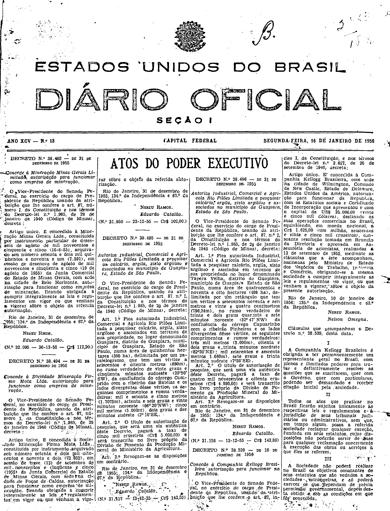
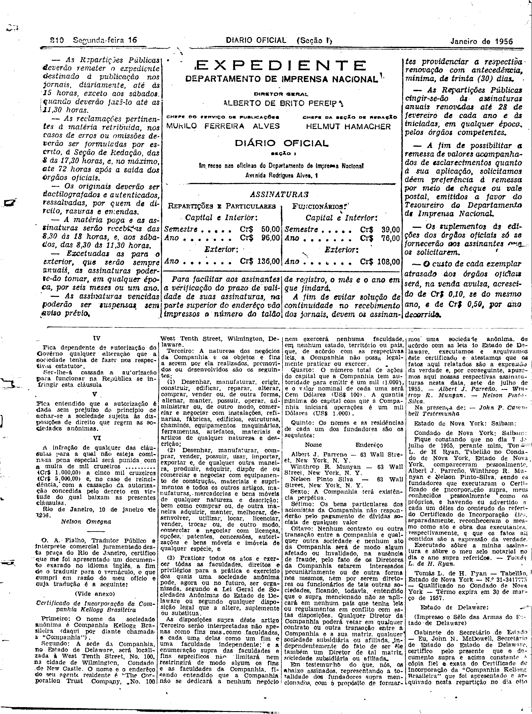
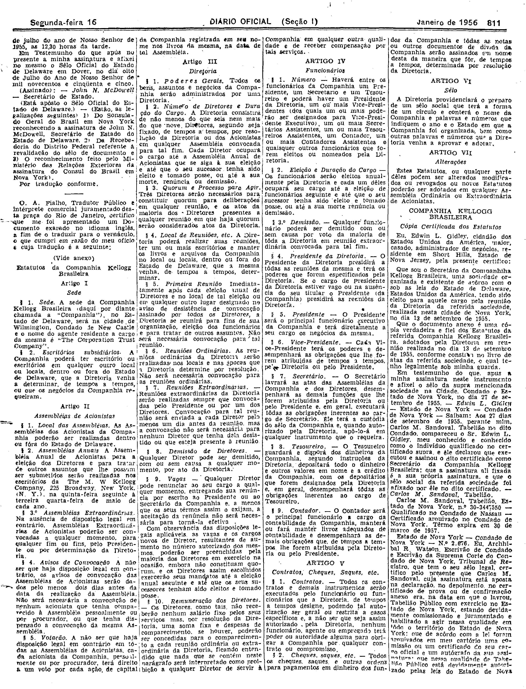
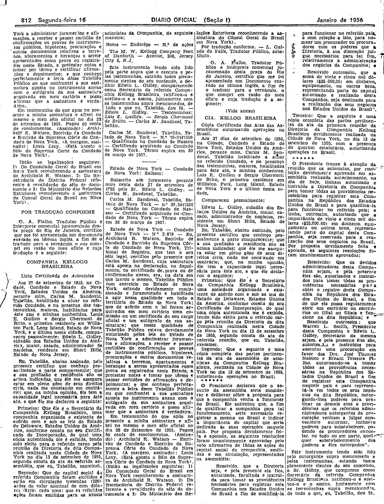
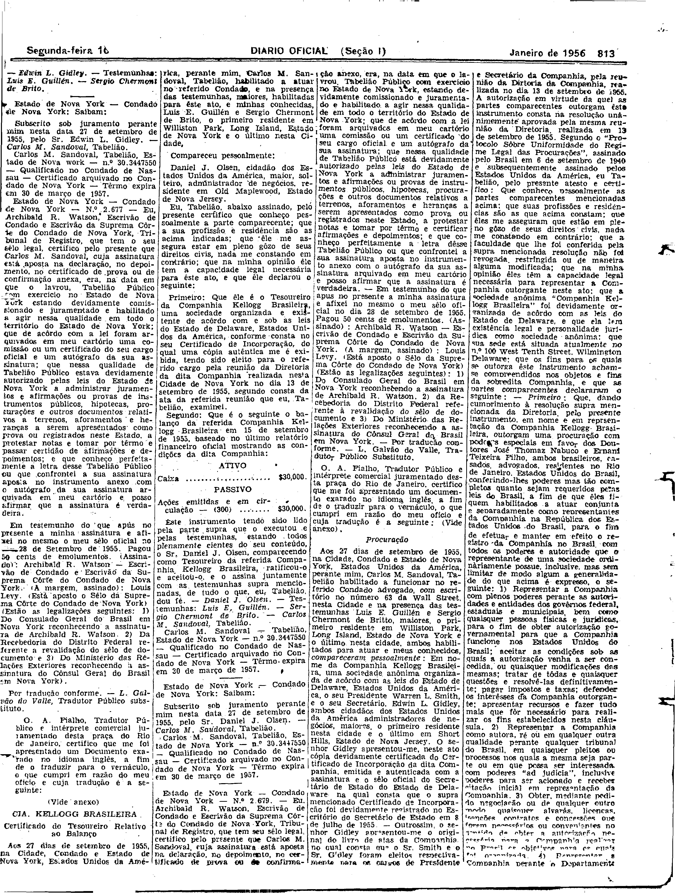
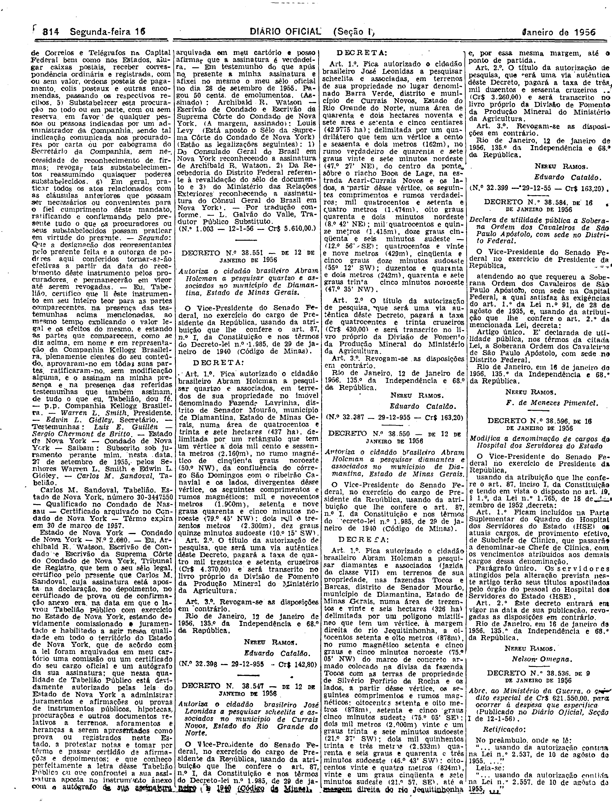

###DEC-038539-0-000-10-01-1956@@@

<strong>DECRETO Nº 38.539, DE 10 DE JANEIRO DE 1956.</strong>

<!-- fac-simile-oficial:inicio -->

## Fac-símile oficial do ato inteiro: cláusulas + Certificado de Incorporação, estatutos, atas e procuração traduzidos

Esta norma é reproduzida apenas em imagem. As páginas inteiras do _Diário Oficial da União_ (Seção I) de 16 de janeiro de 1956 trazem o decreto e o instrumento que o acompanha: PDF `DO_1_19560116_013.PDF`, p.1 do PDF (impressa 809, inferida: capa sem folio visível), p.2 do PDF (impressa 810), p.3 do PDF (impressa 811), p.4 do PDF (impressa 812), p.5 do PDF (impressa 813), p.6 do PDF (impressa 814).

O texto do Senado que antes constava aqui foi retirado para manter uma só versão do ato: não foi colacionado palavra a palavra com o impresso.

**Limites lidos nas imagens:** p.809 (PDF 1): decreto col.3 base–col.4 (NEREU RAMOS / Nelson Omegna); «Cláusulas que acompanham o Decreto n.º 38.539» col.4 base (I–III). p.810 (PDF 2): metade inferior; col.1 IV–VI e «Rio de Janeiro, 10 de janeiro de 1956. Nelson Omegna»; depois tradução O. A. Fialho do Certificado de Incorporação (cols.1–4). p.811–813 (PDF 3–5): estatutos, lista de acionistas, atas, balanço e procuração. p.814 (PDF 6): col.1 conclui a procuração; col.2 topo termina em «Por tradução conforme. — L. Galvão do Valle … (N.º 1.003 — 12-1-56 — Cr$ 5.610,00.)», antes do Decreto 38.551.

**Assinatura(s):** Nelson Omegna (cláusulas); O. A. Fialho e L. Galvão do Valle, tradutores

As imagens são as páginas inteiras, extraídas do PDF com `pdfimages -png` (imagem JBIG2 embutida, uma por página, sem reduzir), sem recorte, sem redesenho e sem transcrição. Cada página traz também outros atos do mesmo dia; a peça está apenas no trecho indicado. O texto do ato só existe na imagem. Não há OCR validado.

Fonte: Imprensa Nacional, Biblioteca Machado de Assis, `DO_1_19560116_013.PDF` (SHA-256 `8b100b04b7608ec8c08051ae0d3ee69d34c6ab8f5646171d908cc12ddf306e7d`). SHA-256 das imagens, na ordem: `b6578592802d2505c7733fd5dcee2f26ed96b558118911cb82cf44fa602581a5`, `225368248f191127c0b55f6dd9b49a2b7a24ff4633ee11a724b4ee8c52b5736c`, `47aab9eac1982cb5491e410d635d726dd64e29ca6916c1150c20080143333c05`, `0716b823a8710b089c5d649d1579f8c11e0c0d8f4647f1627b2b785ec3a6dc0d`, `90b953e69adf3a0f0b88e03f6229cdeb00af2599d8aa2ff8e9fc55d93ea83f61`, `e1db907ba704d1a4745b22fcfe8420df73d45d75a3260ca89ac7e92f2eac1032`.

[PDF da edição oficial](https://biblioteca.in.gov.br/documents/271518/581375/DO_1_19560116_013.PDF/ae0f6d71-77d9-33eb-ed5f-9488352721fa?t=1574964966670&download=true).

<!-- fac-simile-oficial:fim -->
