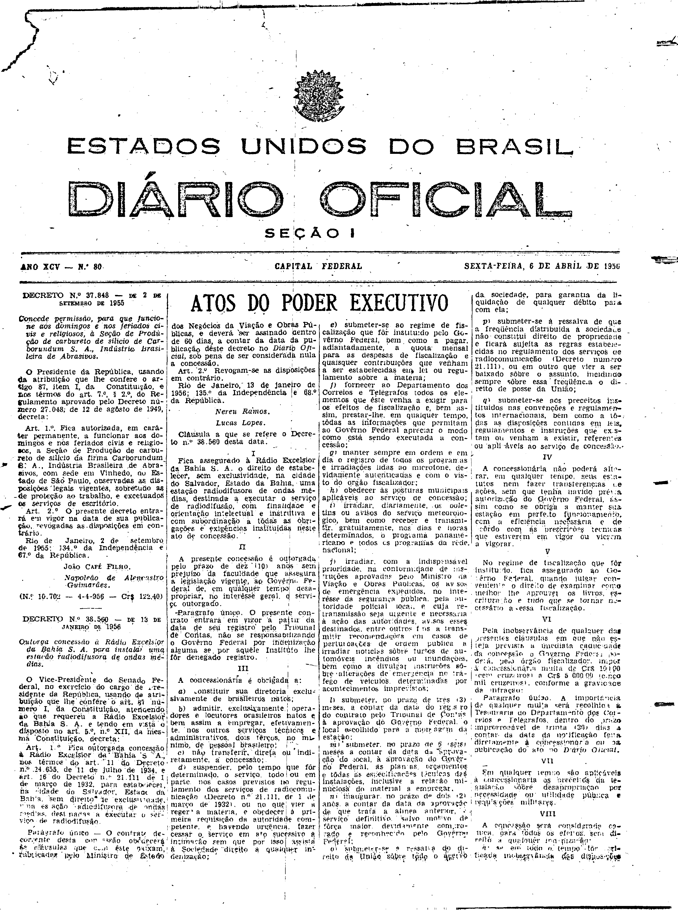
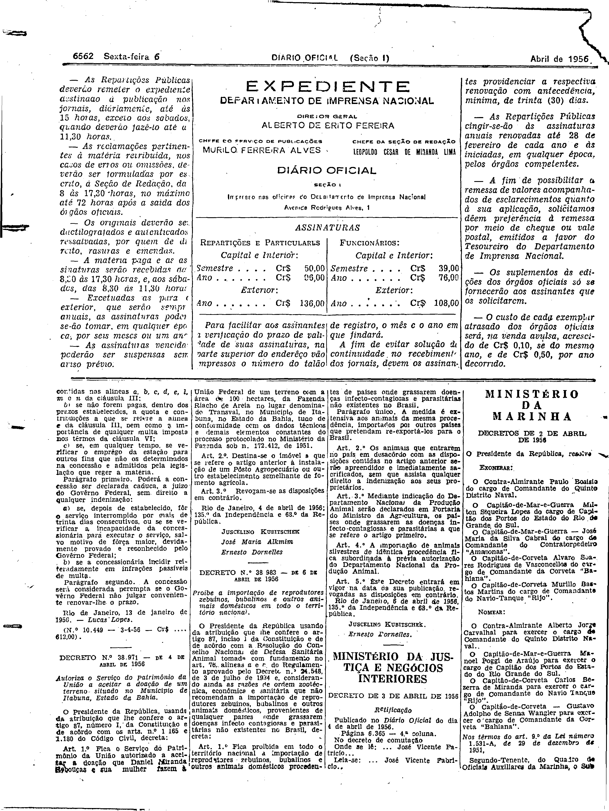

###DEC-038560-0-000-13-01-1956@@@

<strong>DECRETO Nº 38.560, DE 13 DE JANEIRO DE 1956.</strong>

<em><strong>Outorga concessão à Rádio Excelsior da Bahia S.A. para instalar uma estação radiodifusão de ondas médias.</strong></em>

<strong>O VICE-PRESIDENTE DO SENADO FEDERAL</strong>, no exercício do cargo de PRESIDENTE DA REPÚBLICA, usando da atribuição que lhe confere o art. 87, número I, da Constituição, atendendo ao que requereu a Rádio Excelsior da Bahia S.A. e tendo em vista o disposto no art. 5º, nº XII, da mesma Constituição,

<strong>DECRETA:</strong>

<strong>Art</strong>. 1º Fica outorgada concessão à Rádio Excelsior da Bahia S.A. nos têrmos do art. 11 do Decreto nº 24.655, de 11 de julho de 1934, e art. 16 do Decreto nº 21.111 de 1 de março de 1932, para estabelecer, na cidade do Salvador, Estado da Bahia, sem direito de exclusividade, uma estação radiodifusora de ondas médias, destinadas a executar o serviço de radiodifusão.

Parágrafo único. O contrato decorrente desta concessão obedecerá às cláusulas que com êste baixam, rubricadas pelo Ministério de Estado dos Negócios da Viação e Obras Públicas, e deverá ser assinado dentro de 60 dias, a contar da data de publicação dêste decreto no <em>Diário Oficial</em>, sob pena de ser considerada nula a concessão.

<strong>Art</strong>. 2º Revogam-se as disposições em contrário.

Rio de Janeiro, 13 de janeiro de 1956; 135º da Independência e 68º da República.

<strong>NEREU RAMOS</strong>

Lucas Lopes

<!-- fac-simile-oficial:inicio -->

## Fac-símile oficial: cláusulas

O texto acima não inclui as cláusulas a que se refere este decreto. A publicação oficial do anexo está em imagem, nas páginas do _Diário Oficial da União_ (Seção I) de 6 de abril de 1956: página 1 do PDF (capa do caderno) (a partir de «Cláusula a que se refere o Decreto n.º 38.560 desta data»); página 2 do PDF (até «N.º 10.449 — 3-4-56 — Cr$ …612,00»).

As imagens são as páginas inteiras, tal como digitalizadas pela Imprensa Nacional, sem recorte, sem redesenho e sem transcrição. Cada página traz também outros atos do mesmo dia; a peça deste decreto está apenas no trecho indicado, e o texto do anexo só existe na imagem. Não há OCR validado.

Fonte: Imprensa Nacional, Biblioteca Machado de Assis, arquivo `DO_1_19560406_080.PDF` (SHA-256 `a90540d5e35bac63fea65781e88d8c3ea864293bc5ba75f7c8def8079d050d83`), páginas 1, 2 do PDF. SHA-256 das imagens, na ordem: `cd99691158466b226e7fc198b86f9a5c1a2e38331404d77ff85368b167b2595e`, `35d1aedd5a90c97af3408a7e0d3a465fdb09f6dbc5aeadaec72595154401dc75`.

<!-- fac-simile-oficial:fim -->
