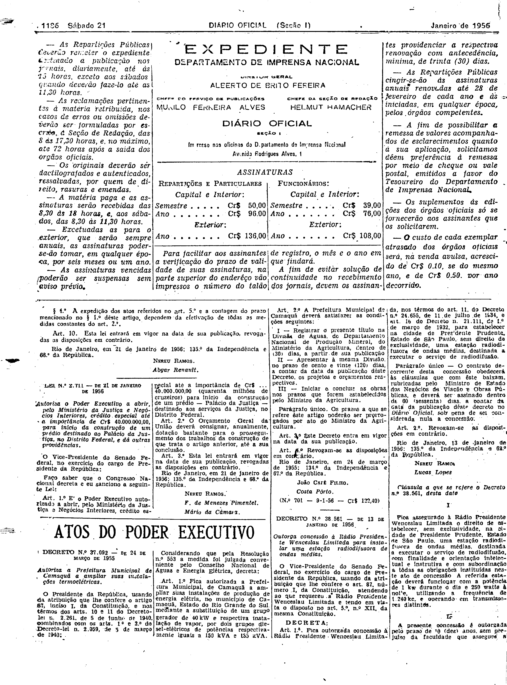
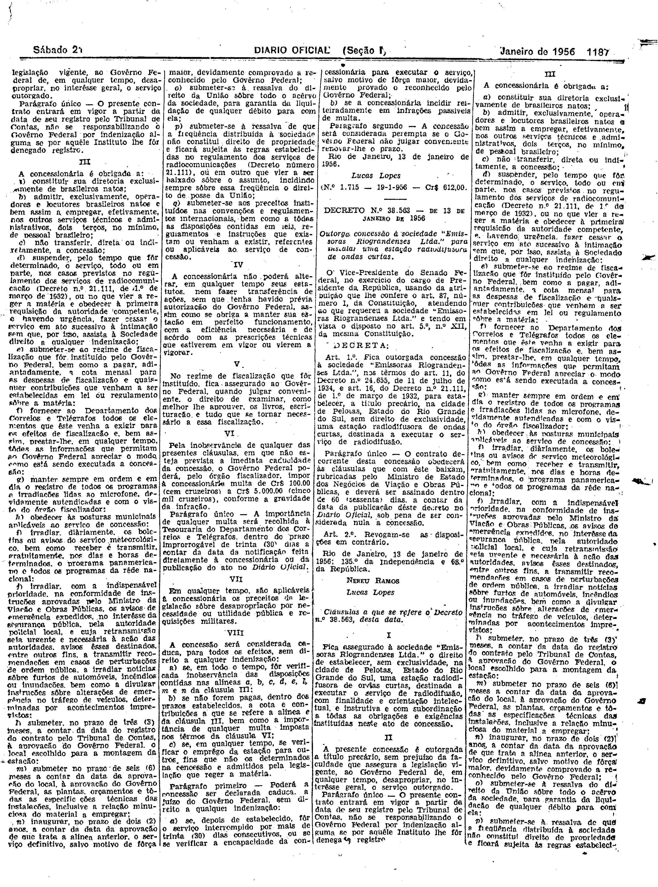

###DEC-038561-0-000-13-01-1956@@@

<strong>DECRETO Nº 38.561, DE 13 DE JANEIRO DE 1956.</strong>

<em><strong>Outorga concessão à Rádio Presidente Wenceslau Limitada para instalar uma estação radiodifusora de ondas médias.</strong></em>

<strong>O VICE-PRESIDENTE DO SENADO FEDERAL</strong>, no exercício do cargo de PRESIDENTE DA REPÚBLICA, usando da atribuição que lhe confere o artigo 87, nº I, da Constituição, atendendo ao que requereu a Rádio Presidente Wenceslau Limitada e tendo em vista o disposto no artigo 5º, nº XII, da mesma Constituição,

<strong>DECRETA:</strong>

<strong>Art</strong>. 1º Fica outorgada concessão à Rádio Presidente Wenceslau Limitada nos têrmos do art. 11, do Decreto nº 24.655, de 11 de julho de 1934, e art. 16, do Decreto nº 21.111, de 1º de março de 1932 para estabelecer na cidade de Presidente Prudente, Estado de São Paulo, sem direito de exclusividade, uma estação radiodifusora de ondas médias, destinada a executar o serviço de radiodifusão.

Parágrafo único. O contrato decorrente desta concessão obedecerá às cláusulas que com êste baixam, rubricadas pelo Ministro de Estado dos Negócios da Viação e Obras Públicas, e deverá ser assinado dentro de 60 (sessenta) dias, a contar da data da publicação dêste decreto no Diário Oficial, sob pena de ser considerada nula a concessão.

<strong>Art</strong>. 2º Revogam-se as disposições em contrário.

Rio de Janeiro, 13 de janeiro de 1956; 135º da Independência e 68º da República.

<strong>NEREU RAMOS</strong>

Lucas Lopes

<!-- fac-simile-oficial:inicio -->

## Fac-símile oficial: cláusulas

O texto acima não inclui as cláusulas a que se refere este decreto. A publicação oficial do anexo está em imagem, nas páginas do _Diário Oficial da União_ (Seção I) de 21 de janeiro de 1956: p. 1186 (a partir de «Cláusula a que se refere o Decreto n.º 38.561, desta data»); p. 1187 (até «N.º 1.715 — 19-1-956 — Cr$ 612,00»).

As imagens são as páginas inteiras, tal como digitalizadas pela Imprensa Nacional, sem recorte, sem redesenho e sem transcrição. Cada página traz também outros atos do mesmo dia; a peça deste decreto está apenas nas colunas indicadas, e o texto do anexo só existe na imagem. Não há OCR validado.

Fonte: Imprensa Nacional, Biblioteca Machado de Assis, arquivo `DO_1_19560121_018.PDF` (SHA-256 `36b27f4d8439990e0e2d8e49f8a3a509d09b04c3d8931c9846051b462971203b`), páginas 2, 3 do PDF. SHA-256 das imagens, na ordem: `f47cf50ac4c67de3628acfc1c0836b091598b8649925c94585b1ddfdd3fcd6ac`, `68a0530c8138fffffdcdb014507e9baa00647fae7bde1ad40f7f4c5f17c5f141`.

<!-- fac-simile-oficial:fim -->
