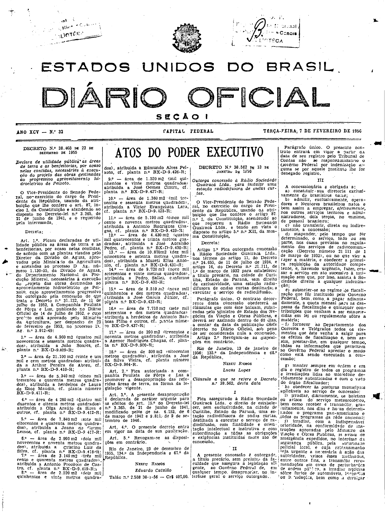

###DEC-038562-0-000-13-01-1956@@@

<strong>DECRETO Nº 38.562, DE 13 DE JANEIRO DE 1956.</strong>

<em><strong>Outorga concessão à Rádio Sociedade Guairacá Ltda. para instalar uma estação radiodifusora de ondas curtas.</strong></em>

<strong>O VICE-PRESIDENTE DO SENADO FEDERAL</strong>, no exercício do cargo de PRESIDENTE DA REPÚBLICA, usando da atribuição que lhe confere o artigo 87, nº I, da Constituição, atendendo ao que requereu a Rádio Sociedade Guairacá Ltda. e tendo em vista o disposto no artigo 5º nº XII, da mesma Constituição,

<strong>DECRETA:</strong>

<strong>Art</strong>. 1º Fica outorgada concessão à Rádio Sociedade Guairacá Ltda. nos têrmos do artigo 11, do Decreto nº 24.655, de 11 de julho de 1934, e artigo 16, do Decreto nº 21.111, de 1º de março de 1932 para estabelecer a título precário, na cidade de Curitiba, Estado do Paraná, sem direito de exclusividade, uma estação radiodifusora de ondas curtas destinada a executar o serviço de radiodifusão.

Parágrafo único. O contrato decorrente desta concessão obedecerá às cláusulas que com êste baixam, rubricadas pelo Ministro de Estado dos Negócios da Viação e Obras Públicas, e deverá ser assinado dentro de 60 dias, a contar da data da publicação dêste decreto no Diário Oficial, sob pena de ser considerada nula a concessão.

<strong>Art</strong>. 2º Revogam-se as disposições em contrário.

Rio de Janeiro, 13 de janeiro de 1956; 135º da Independência e 68º da República.

<strong>NEREU RAMOS</strong>

Lucas Lopes

<!-- fac-simile-oficial:inicio -->

## Fac-símile oficial: cláusulas

O texto acima não inclui as cláusulas a que se refere este decreto. A publicação oficial do anexo está em imagem, nas páginas do _Diário Oficial da União_ (Seção I) de 7 de fevereiro de 1956: capa (1ª página do caderno, sem numeração impressa; página 1 do PDF) (a partir de «Cláusula a que se refere o Decreto n.º 38.562, desta data»); página 2 do PDF (numeração impressa ilegível na imagem) (até «Talão n.º 2.150, Cr$ 612,00 25-1-56»).

As imagens são as páginas inteiras, tal como digitalizadas pela Imprensa Nacional, sem recorte, sem redesenho e sem transcrição. Cada página traz também outros atos do mesmo dia; a peça deste decreto está apenas nas colunas indicadas, e o texto do anexo só existe na imagem. Não há OCR validado.

Fonte: Imprensa Nacional, Biblioteca Machado de Assis, arquivo `DO_1_19560207_032.PDF` (SHA-256 `bc431d40dc43802c0d55110dab859a612efad32bb8f5a5d2c275a9292a200fd6`), páginas 1, 2 do PDF. SHA-256 das imagens, na ordem: `679c0531d1cf4c1cad320e578d3d7d5786d4a3595df5230bd063f63f3d3dab36`, `56e15c5be35f2ff7e64117f50086fe95daed68dded53ce0f624c160ac6db0712`.

<!-- fac-simile-oficial:fim -->
