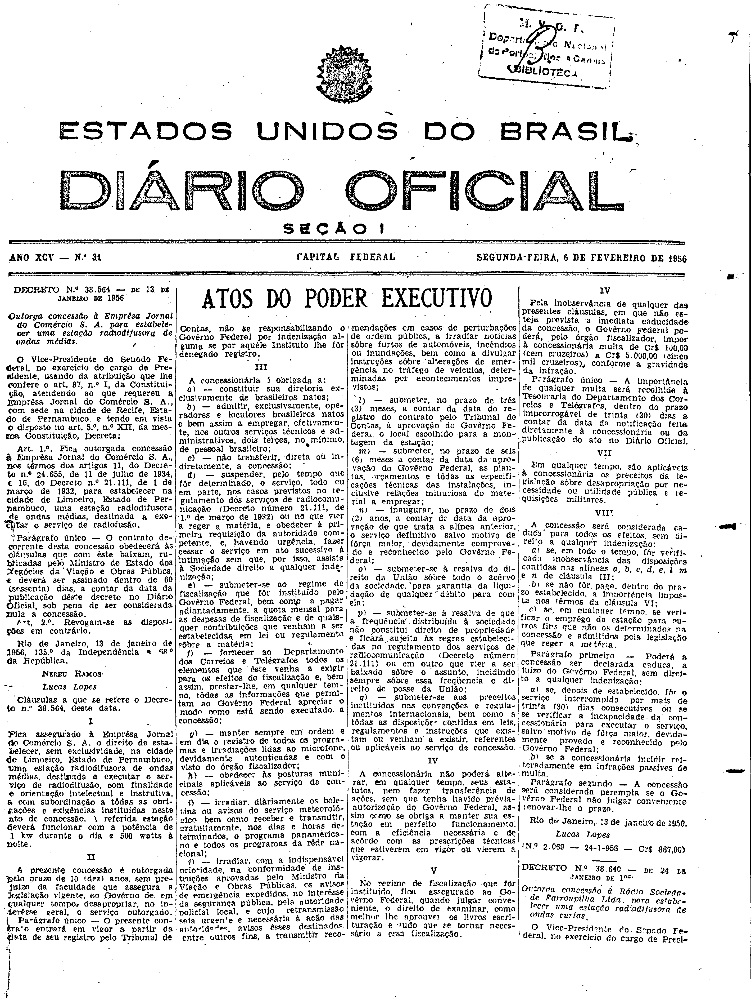

###DEC-038564-0-000-13-01-1956@@@

<strong>DECRETO Nº 38.564, DE 13 DE JANEIRO DE 1956.</strong>

<em><strong>Outorga concessão à Emprêsa Jornal do Comércio S.A. para estabelecer uma estação radiodifusora de ondas médias.</strong></em>

<strong>O VICE-PRESIDENTE DO SENADO FEDERAL</strong>, no exercício do cargo de PRESIDENTE DA REPÚBLICA, usando da atribuição que lhe confere o art. 87, nº I, da Constituição, atendendo ao que requereu a Emprêsa Jornal do Comércio S.A., com sede na cidade de Recife, Estado de Pernambuco e tendo em vista o disposto no art. 5º nº XII, da mesma Constituição,

<strong>DECRETA:</strong>

<strong>Art</strong>. 1º Fica outorgada concessão à Emprêsa Jornal do Comércio S.A., nos têrmos dos artigos 11, do Decreto nº 24.655, de 11 de julho de 1934, e 16 do Decreto nº 21.111, de 1 de março de 1932, para estabelecer na cidade de Limoeiro, Estado de Pernambuco, uma estação radiodifusora de ondas médias, destinada a executar o serviço de radiodifusão.

Parágrafo único - O contrato decorrente desta concessão obedecerá às cláusulas que com êste baixam, rubricadas pelo Ministro de Estado dos Negócios da Viação e Obras Públicas, e deverá ser assinado dentro de 60 (sessenta) dias, a contar da data da publicação dêste decreto no <em>Diário Oficial</em>, sob pena de ser considerada nula a concessão.

<strong>Art</strong>. 2º Revogam-se as disposições em contrário.

Rio de Janeiro, 13 de janeiro de 1956; 135º da Independência e 68º da República.

<strong>NEREU RAMOS</strong>

Lucas Lopes

<!-- fac-simile-oficial:inicio -->

## Fac-símile oficial: cláusulas

O texto acima não inclui as cláusulas a que se refere este decreto. A publicação oficial do anexo está em imagem, nas páginas do _Diário Oficial da União_ (Seção I) de 6 de fevereiro de 1956: página 1 do PDF (capa do caderno) (a partir de «Cláusulas a que se refere o Decreto n.º 38.564, desta data», até «N.º 2.069 — 24-1-956 — Cr$ 867,00»).

As imagens são as páginas inteiras, tal como digitalizadas pela Imprensa Nacional, sem recorte, sem redesenho e sem transcrição. Cada página traz também outros atos do mesmo dia; a peça deste decreto está apenas no trecho indicado, e o texto do anexo só existe na imagem. Não há OCR validado.

Fonte: Imprensa Nacional, Biblioteca Machado de Assis, arquivo `DO_1_19560206_031.PDF` (SHA-256 `c709a7d307c0cc6541f1a4c49c8f953c86a383d64dfeb37ba19200f975166a63`), páginas 1 do PDF. SHA-256 das imagens, na ordem: `5c643c70586516c71714fe96e182c6611429589ed6159af3d980cb163db0d7e5`.

<!-- fac-simile-oficial:fim -->
