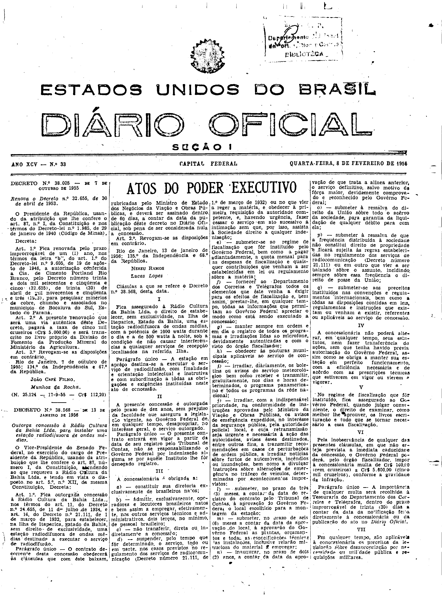
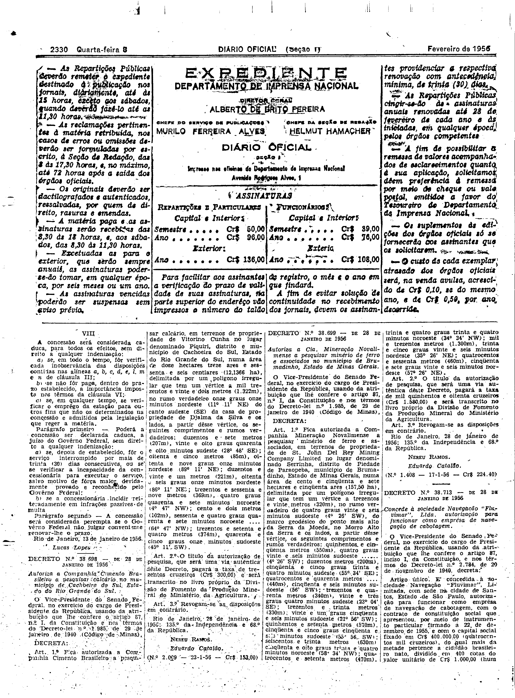

###DEC-038568-0-000-13-01-1956@@@

<strong>DECRETO Nº 38.568, DE 13 DE JANEIRO DE 1956.</strong>

<em><strong>Outorga concessão à Rádio Cultura da Bahia Ltda. para instalar uma estação radiodifusora de ondas médias.</strong></em>

<strong>O VICE-PRESIDENTE DO SENADO FEDERAL</strong>, no exercício do cargo de PRESIDENTE da REPÚBLICA, usando da atribuição que lhe confere o art. 87, número I, da Constituição, atendendo ao que requereu a Rádio Cultura da Bahia Ltda, e tendo em vista o disposto no art. 5º, nº XII, da mesma Constituição.

<strong>DECRETA:</strong>

<strong>Art</strong>. 1º Fica outorgada concessão à Rádio Cultura da Bahia Ltda., nos têrmos do art. 11, do Decreto nº 24.655, de 11 de julho de 1934, e art. 16 do Decreto nº 21.111, de 1 de março de 1932, para estabelecer na Ilha de Itaparica, Estado da Bahia, sem direito de exclusividade, uma estação radiodifusora de ondas médias destinadas a executar o serviço de radiodifusão.

Parágrafo único - O contrato decorrente desta concessão obedecerá às cláusulas que com êste baixam, rubricadas pelo Ministro de Estado dos Negócios da Viação e Obras Públicas, e deverá ser assinado dentro de 60 dias, a contar da data da publicação dêste decreto no <em>Diário Oficial</em>, sob pena de ser considerada nula a concessão.

<strong>Art</strong>. 2º Revogam-se as disposições em contrário.

Rio de Janeiro, 13 de janeiro de 1956; 135º da Independência e 68 da República.

<strong>NEREU RAMOS</strong>

Lucas Lopes

<!-- fac-simile-oficial:inicio -->

## Fac-símile oficial: cláusulas

O texto acima não inclui as cláusulas a que se refere este decreto. A publicação oficial do anexo está em imagem, nas páginas do _Diário Oficial da União_ (Seção I) de 8 de fevereiro de 1956: capa (1ª página do caderno, sem numeração impressa; página 1 do PDF) (a partir de «Cláusulas a que se refere o Decreto n.º 38.568, desta data», na metade direita da página); p. 2330 (até «Rio de Janeiro, 13 de janeiro de 1956. Lucas Lopes», no fim da cláusula VIII e do parágrafo segundo).

As imagens são as páginas inteiras, tal como digitalizadas pela Imprensa Nacional, sem recorte, sem redesenho e sem transcrição. Cada página traz também outros atos do mesmo dia; a peça deste decreto está apenas nas colunas indicadas, e o texto do anexo só existe na imagem. Não há OCR validado.

Fonte: Imprensa Nacional, Biblioteca Machado de Assis, arquivo `DO_1_19560208_033.PDF` (SHA-256 `511d6aa880d85adfae0f956e89b6904a0588a0e83a537169eae8ca332de27f83`), páginas 1, 2 do PDF. SHA-256 das imagens, na ordem: `4a771988e4f49b1b4fc3da3bdc103ef3fc6d6bd82a67c253d6dd8a52688e8cbf`, `8ceb1446749bb82c47d0fd0444447d09d14d172820e4904d93d6d16d9c91b647`.

<!-- fac-simile-oficial:fim -->
