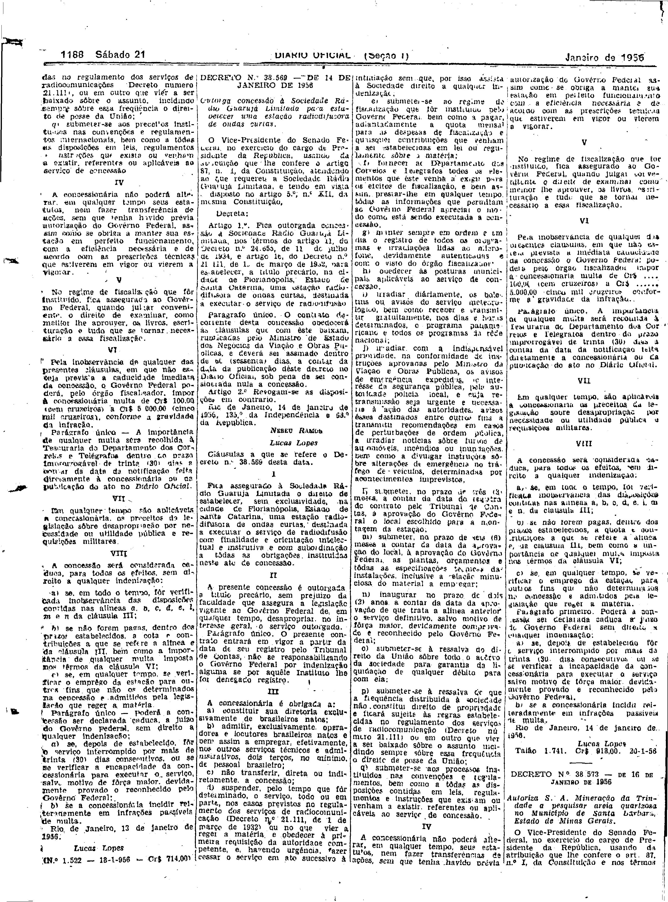

###DEC-038569-0-000-14-01-1956@@@

<strong>DECRETO Nº 38.569, DE 14 DE JANEIRO DE 1956.</strong>

<em><strong>Outorga concessão à Sociedade Rádio Guarujá Limitada para estabelecer uma estação radiodifusora de ondas curtas.</strong></em>

<strong>O VICE-PRESIDENTE DO SENADO FEDERAL</strong>, no exercício do cargo de PRESIDENTE DA REPÚBLICA, usando da atribuição que lhe confere o artigo 87, nº I, da Constituição, atendendo ao que requereu a Sociedade Rádio Guarujá Limitada, e tendo em vista o disposto no artigo 5º, nº XII, da mesma Constituição,

<strong>DECRETA:</strong>

<strong>Art</strong>. 1º Fica outorgadas concessão à Sociedade Rádio Guarujá Limitada, nos têrmos do artigo 11 do Decreto nº 24.655, de 11 de julho de 1934, e artigo 16, do Decreto nº 21.111, de 1 de março de 1932, para estabelecer a título precário, na cidade de Florianópolis, Estado de Santa Catarina, uma estação radiodifusora de ondas curtas, destinada a executar o serviço de radiodifusão.

Parágrafo único. O contrato decorrente desta concessão obedecerá às cláusulas que com êste baixam, rubricadas pelo Ministro de Estado dos Negócios da Viação e Obras Públicas, e deverá ser assinado dentro de 60 (sessenta) dias a contar da data da publicação dêste decreto no <em>Diário</em> <em>Oficial</em>, sob pena de ser considerada nula a concessão.

<strong>Art</strong>. 2º Revogam-se as disposições em contrário.

Rio de Janeiro, 14 de janeiro de 1956; 135º da Independência e 68º da República.

<strong>NEREU RAMOS</strong>

Lucas Lopes

<!-- fac-simile-oficial:inicio -->

## Fac-símile oficial: clausulas

A peça vinculada ao Decreto nº 38.569 é reproduzida nas imagens abaixo, a partir da publicação oficial da Imprensa Nacional. A reprodução é em fac-símile, sem transcrição por OCR nem reconstrução do conteúdo.

As imagens mostram páginas inteiras do Diário Oficial da União e podem conter outras matérias. Essas matérias vizinhas não são atribuídas a este decreto. A peça é identificada pelo seu título e pela referência ao ato nas páginas indicadas.

SHA-256 desta imagem: `9bbd1e646b186300b4440a491e49c1e154749c87aae761cdc31faa1c6f47d83e`.

Fontes oficiais da publicação:

- [DO_1_19560121_018.PDF](https://biblioteca.in.gov.br/documents/271518/581375/DO_1_19560121_018.PDF/2ae1dbd5-373c-2a07-07af-aed9b9579588?t=1574964990250&download=true) — SHA-256 do PDF: `36b27f4d8439990e0e2d8e49f8a3a509d09b04c3d8931c9846051b462971203b`.

<!-- fac-simile-oficial:fim -->
