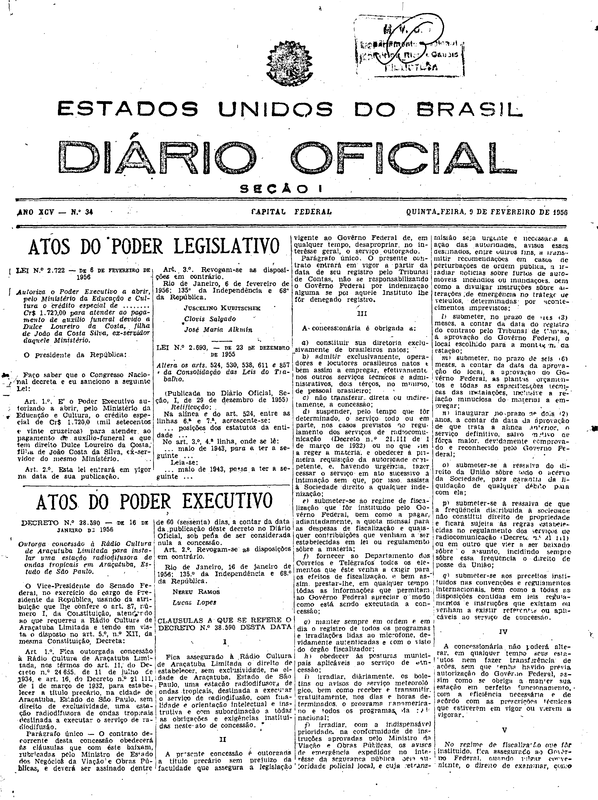
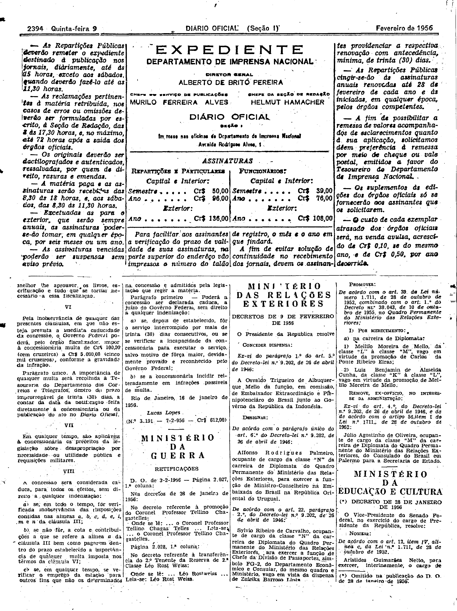

###DEC-038590-0-000-16-01-1956@@@

<strong>DECRETO Nº 38.590, DE 16 DE JANEIRO DE 1956.</strong>

<em><strong>Outorga concessão à Rádio Cultura de Araçutuba Limitada para instalar uma estação radiodifusora de ondas tropicais em Araçatuba, Estado de São Paulo.</strong></em>

<strong>O VICE-PRESIDENTE DO SENADO FEDERAL</strong>, no exercício do cargo de PRESIDENTE DA REPÚBLICA, usando da atribuição que lhe confere o art. 87, número I, da Constituição, atendendo ao que requereu a Rádio Cultura de Araçatuba Limitada e tendo em vista o disposto no art. 5º, nº XII, da mesma Constituição,

<strong>DECRETA:</strong>

<strong>Art</strong>. 1º Fica outorgada concessão à Rádio Cultura de Araçatuba Limitada, nos têrmos do art. 11, do Decreto nº 24.655, de 11 de julho de 1934, e art. 16, do Decreto nº 21.111, de 1 de março de 1932, para estabelecer a título precário, na cidade de Araçatuba, Estado de São Paulo, sem direito de exclusividade, uma estação radiodifusora de ondas tropicais destinada a executar o serviço de radiodifusão.

Parágrafo único. O contrato decorrente desta concessão obedecerá às cláusulas que com êste baixam, rubricadas pelo Ministro de Estado dos Negócios da Viação e Obras Públicas, e deverá ser assinado dentre 60 (sessenta) dias, a contar da data da publicação dêste decreto no <em>Diário</em> <em>Oficial</em>, sob pena de ser considerada nula a concessão.

<strong>Art</strong>. 2º Revogam-se as disposições em contrário.

Rio de Janeiro, 16 de janeiro de 1956; 135º da Independência e 68º da República.

<strong>NEREU RAMOS</strong>

Lucas Lopes

<!-- fac-simile-oficial:inicio -->

## Fac-símile oficial: cláusulas

O texto acima não inclui as cláusulas a que se refere este decreto. A publicação oficial do anexo está em imagem, nas páginas do _Diário Oficial da União_ (Seção I) de 9 de fevereiro de 1956: página 1 do PDF (capa do caderno) (a partir de «CLÁUSULAS A QUE SE REFERE O DECRETO N.º 38.590 DESTA DATA»); página 2 do PDF (até «N.º 3.191 — 7-2-956 — Cr$ 612,00»).

As imagens são as páginas inteiras, tal como digitalizadas pela Imprensa Nacional, sem recorte, sem redesenho e sem transcrição. Cada página traz também outros atos do mesmo dia; a peça deste decreto está apenas no trecho indicado, e o texto do anexo só existe na imagem. Não há OCR validado.

Fonte: Imprensa Nacional, Biblioteca Machado de Assis, arquivo `DO_1_19560209_034.PDF` (SHA-256 `00b248d204925c42d2f05969bd6bc02811d5d655d325e72d04c0d9448a00f329`), páginas 1, 2 do PDF. SHA-256 das imagens, na ordem: `6d7ec23eda132f98d402e1ac029bc477f1aae0f2f19d6d573d523668426a26d2`, `36440f1c0e3c4b5d7b7f2f2fb397caab3e963de838efb1e10923f52e5e21e707`.

<!-- fac-simile-oficial:fim -->
