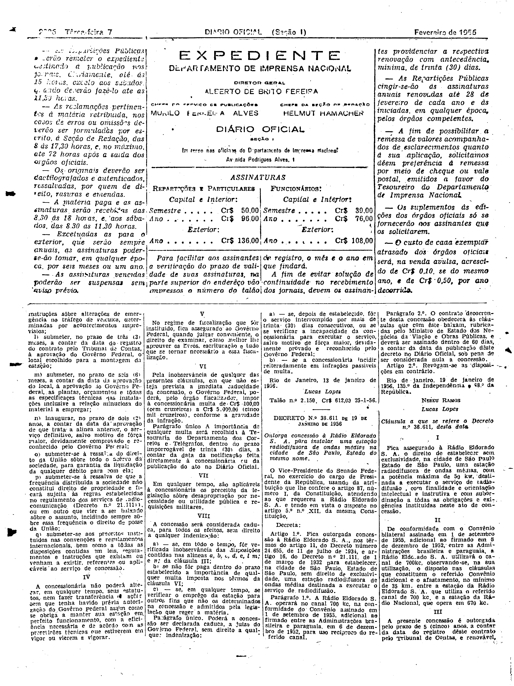
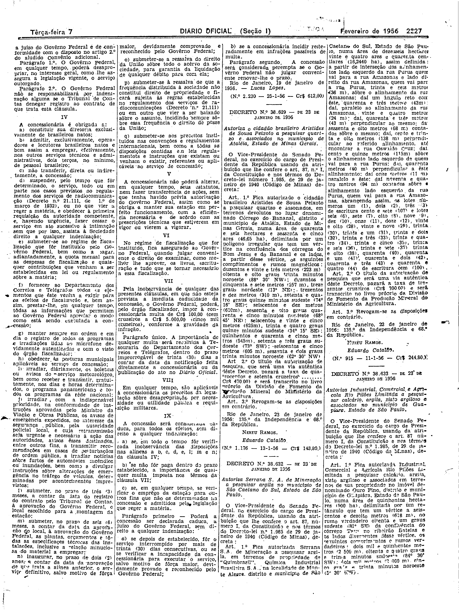

###DEC-038611-0-000-19-01-1956@@@

<strong>DECRETO Nº 38.611, DE 10 DE JANEIRO DE 1956</strong>

<em><strong>Outorga concessão à Rádio Eldorado S. A. para instalar uma estação radiodifusora de ondas médias na cidade de São Paulo, Estado do mesmo nome.</strong></em>

<strong>O VICE-PRESIDENTE DO SENADO FEDERAL</strong>, no exercício do cargo de PRESIDENTE DA REPÚBLICA, usando da atribuição que lhe confere o artigo 87, número I, da Constituição, atendendo no que requereu a Rádio Eldorado S. A. e tendo em vista no disposto artigo 5º nº XII, da mesma Constituição,

<strong>DECRETA:</strong>

<strong>Art</strong>. 1º Fica outorgada concessão a Rádio Eldorado S. A., nos têrmos do artigo 11, do Decreto número 24.655, de 11 de junho de 1934, e artigo 16, do Decreto n.º 21.111, de 1 de março de 1932 para estabelecer, na cidade de São Paulo, Estado de São Paulo, sem direito de exclusividade, uma estação radidifusora de ondas média destinada a executar o serviço de radiodifusão.

§ 1º A Rádio Eldorado S. A. operará no canal 700 kc, na conformidade do Convênio assinado em 1 de setembro de 1955, adicional ao firmado entre as Administrações brasileira e paraguaia, em 6 de dezembro de 1952, para uso recíproco do referido canal.

§ 2º O contrato decorrente desta concessão obedecerá às cláusulas que com êste baixam, rubricadas pelo Ministério de Estado de Negócios da Viação e Obras Públicas, e deverá ser assinado dentro de 60 dias, a contar da data da publicação dêste decreto no <em>Diário Oficial</em>, sob pena de ser considerada nula a concessão.

<strong>Art</strong>. 2º revogam-se todas as disposições em contrário.

Rio de janeiro, 19 de janeiro de 1956, 135º da Independência e 68º da República.

<strong>NEREU RAMOS</strong>

Lucas Lopes

<!-- fac-simile-oficial:inicio -->

## Fac-símile oficial: cláusulas

O texto acima não inclui as cláusulas a que se refere este decreto. A publicação oficial do anexo está em imagem, nas páginas do _Diário Oficial da União_ (Seção I) de 7 de fevereiro de 1956: página 2 do PDF (numeração impressa ilegível na imagem) (a partir de «Cláusula a que se refere o Decreto n.º 38.611, desta data»); p. 2227 (até «N.º 2.230 — 25-1-56 — Cr$ 612,00»).

As imagens são as páginas inteiras, tal como digitalizadas pela Imprensa Nacional, sem recorte, sem redesenho e sem transcrição. Cada página traz também outros atos do mesmo dia; a peça deste decreto está apenas nas colunas indicadas, e o texto do anexo só existe na imagem. Não há OCR validado.

Fonte: Imprensa Nacional, Biblioteca Machado de Assis, arquivo `DO_1_19560207_032.PDF` (SHA-256 `bc431d40dc43802c0d55110dab859a612efad32bb8f5a5d2c275a9292a200fd6`), páginas 2, 3 do PDF. SHA-256 das imagens, na ordem: `56e15c5be35f2ff7e64117f50086fe95daed68dded53ce0f624c160ac6db0712`, `c705e5a082d814b9f8129f676d4b16b42e047b93781ee66b2f66ff3bef4a870b`.

<!-- fac-simile-oficial:fim -->
