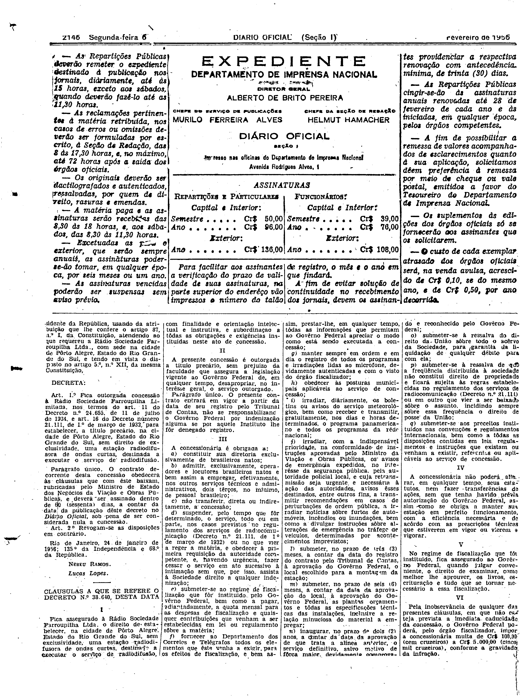
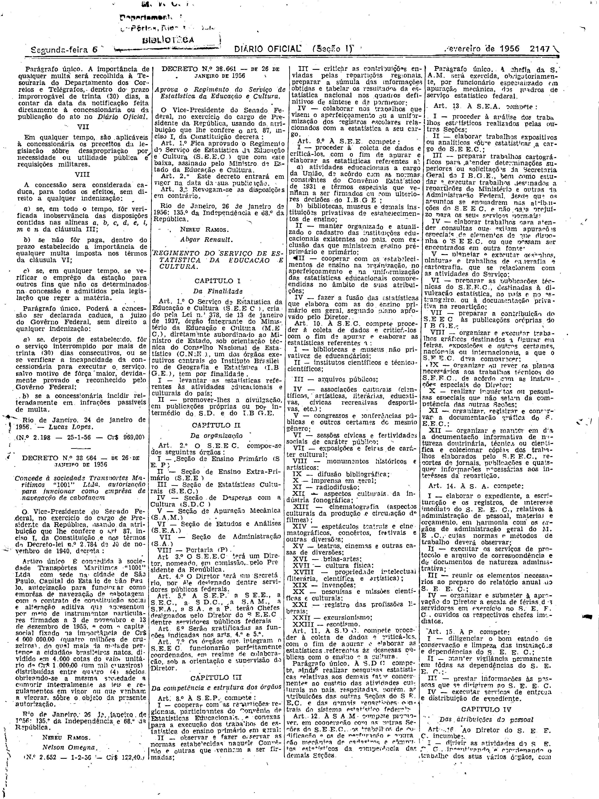

###DEC-038640-0-000-24-01-1956@@@

<strong>DECRETO Nº 38.640, DE 24 DE JANEIRO DE 1956.</strong>

<em><strong>Outorga concessão à Rádio Sociedade Farroupilha Ltda. para estabelecer uma estação radiodifusora de ondas curtas.</strong></em>

<strong>O VICE-PRESIDENTE DO SENADO FEDERAL</strong>, no exercício do cargo de PRESIDENTE DA REPÚBLICA, usando da atribuição que lhe confere o artigo 87, nº I, da Constituição, atendendo ao que requereu a Rádio Sociedade Farroupilha Ltda, com sede na cidade de Pôrto Alegre, Estado do Rio Grande do Sul, e tendo em vista o disposto no artigo 5º, nº XII, da mesma Constituição,

<strong>DECRETA:</strong>

<strong>Art</strong>. 1º Fica outorgada concessão à Rádio Sociedade Farroupilha Limitada, nos têrmos do artigo 11 do Decreto nº 24.655, de 11 de julho de 1934, e artigo 16 do Decreto número 21.111, de 1º de março de 1932, para estabelecer, a título precário na cidade de Pôrto Alegre, Estado do Rio Grande do Sul, sem direito de exclusividade, uma estação radiodifusora de ondas curtas, destinada a executar o serviço de radiodifusão.

Parágrafo Único. O contrato decorrente desta concessão obedecerá às cláusulas que com êste baixam, rubricadas pelo Ministro de Estado dos Negócios da Viação e Obras públicas, e deverá ser assinado dentro de 60 (sessenta) dias, a contar da data da publicação dêste decreto no <em>Diário Oficial</em>, sob pena de ser considerada nula a concessão.

<strong>Art</strong>. 2º Revogam-se as disposições em contrário.

Rio de Janeiro, 24 janeiro de 1956; 135º da Independência e 68º da República.

<strong>NEREU RAMOS</strong>

Lucas Lopes

<!-- fac-simile-oficial:inicio -->

## Fac-símile oficial: cláusulas

O texto acima não inclui as cláusulas a que se refere este decreto. A publicação oficial do anexo está em imagem, nas páginas do _Diário Oficial da União_ (Seção I) de 6 de fevereiro de 1956: p. 2146 (a partir de «CLÁUSULAS A QUE SE REFERE O DECRETO N.º 38.640, DESTA DATA»); p. 2147 (até «N.º 2.198 — 25-1-56 — Cr$ 969,00»).

As imagens são as páginas inteiras, tal como digitalizadas pela Imprensa Nacional, sem recorte, sem redesenho e sem transcrição. Cada página traz também outros atos do mesmo dia; a peça deste decreto está apenas nas colunas indicadas, e o texto do anexo só existe na imagem. Não há OCR validado.

Fonte: Imprensa Nacional, Biblioteca Machado de Assis, arquivo `DO_1_19560206_031.PDF` (SHA-256 `c709a7d307c0cc6541f1a4c49c8f953c86a383d64dfeb37ba19200f975166a63`), páginas 2, 3 do PDF. SHA-256 das imagens, na ordem: `cc712d48869da7c32a5206252af9b87feafca66dd8002ad47ff20f0c9f2cb59a`, `ac996a1dc3ebe45e6b5077479efc7193f47a9331920a3b407471ef33431062ab`.

<!-- fac-simile-oficial:fim -->
