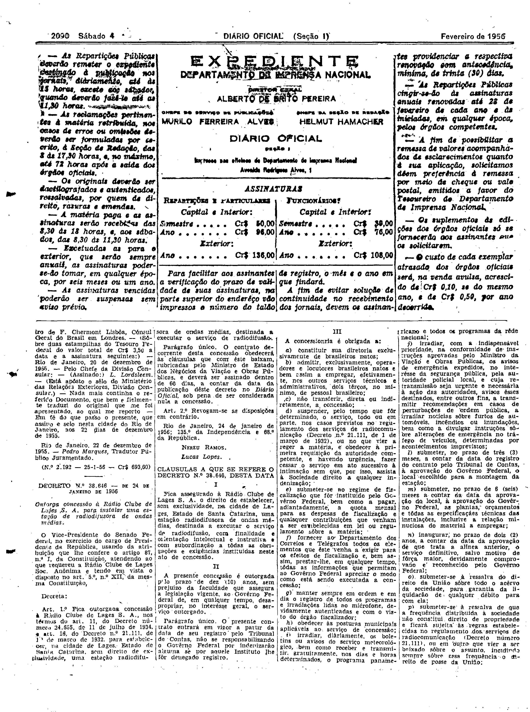
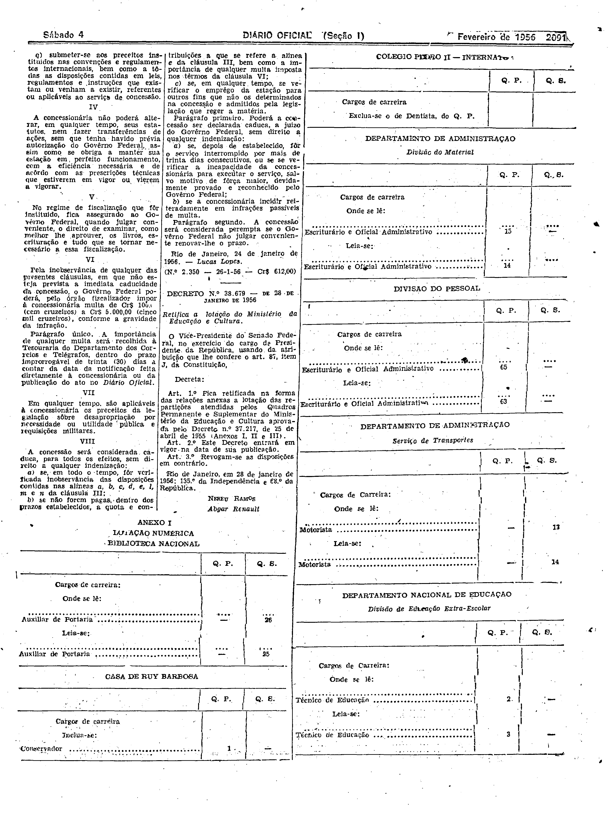

###DEC-038646-0-000-24-01-1956@@@

<strong>DECRETO Nº 38.646, DE 24 DE JANEIRO DE 1956.</strong>

<em><strong>Outorga concessão à Rádio Clube de Lajes S. A. para instalar uma estação de radiodifusora de ondas médias.</strong></em>

<strong>O VICE-PRESIDENTE DO SENADO FEDERAL</strong>, no exercício do cargo de PRESIDENTE DA REPÚBLICA, usando da atribuição que lhe confere o artigo 87, nº I, da Constituição, atendendo ao que requereu a Rádio Clube de Lages Soc. Anônima e tendo em vista o disposto no art. 5º, nº XII, da mesma Constituição,

<strong>DECRETA:</strong>

<strong>Art</strong>. 1º Fica outorgada concessão à Rádio Clube de Lages S. A., nos têrmos do art. 11, do Decreto número 24.655, de 11 de julho de 1934, e art. 16 do Decreto nº 21.111, de 1º de março de 1932, para estabelecer, na cidade Lages, Estado de Santa Catarina, sem direito de exclusividade, uma estação radiodifusora de ondas médias, destinada a executar o serviço de radiodifusão.

Parágrafo único. O contrato decorrente desta concessão obedecerá as cláusulas que com êste baixam, rubricadas pelo Ministro de Estado dos Negócios da Viação e Obras Públicas, e deverá ser assinado dentro de 60 dias, a contar da data de publicação dêste decreto no <em>Diário</em> <em>Oficial</em> sob pena de ser considerada nula a concessão.

<strong>Art</strong>. 2º Revogam-se as disposições em contrário.

Rio de Janeiro, 24 de janeiro de 1956; 135º da Independência e 68º da República.

<strong>NEREU RAMOS</strong>

Lucas Lopes

<!-- fac-simile-oficial:inicio -->

## Fac-símile oficial: cláusulas

O texto acima não inclui as cláusulas a que se refere este decreto. A publicação oficial do anexo está em imagem, nas páginas do _Diário Oficial da União_ (Seção I) de 4 de fevereiro de 1956: página 2 do PDF (a partir de «CLÁUSULAS A QUE SE REFERE O DECRETO N.º 38.646, DESTA DATA»); página 3 do PDF (até «N.º 2.350 — 26-1-56 — Cr$ 612,00»).

As imagens são as páginas inteiras, tal como digitalizadas pela Imprensa Nacional, sem recorte, sem redesenho e sem transcrição. Cada página traz também outros atos do mesmo dia; a peça deste decreto está apenas no trecho indicado, e o texto do anexo só existe na imagem. Não há OCR validado.

Fonte: Imprensa Nacional, Biblioteca Machado de Assis, arquivo `DO_1_19560204_030.PDF` (SHA-256 `8e1892bca01082877c3d5081a9dbbd05433456d99da705c26d36d1904cacd419`), páginas 2, 3 do PDF. SHA-256 das imagens, na ordem: `bb6f21832dc3b1008c3d382b931a2571c7ba8e3e93a4dca77f8ec90e57a88733`, `5f22baefa35e76f614f5ff63342af195665097c1698739eb892c510a50b8fb94`.

<!-- fac-simile-oficial:fim -->
