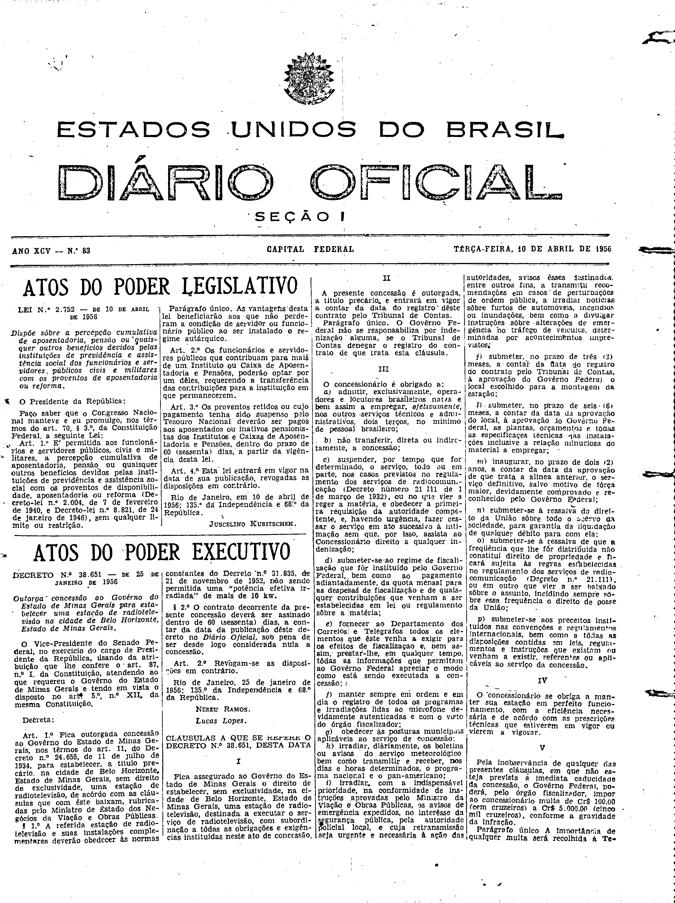
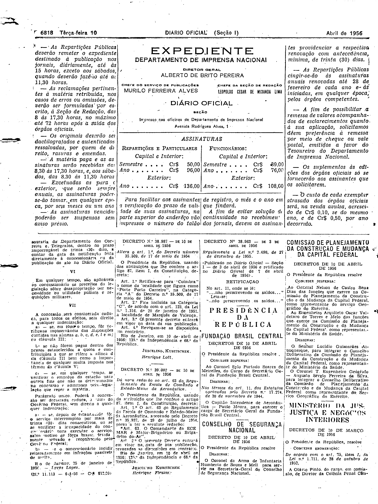

###DEC-038651-0-000-25-01-1956@@@

<strong>DECRETO Nº 38.651, DE 25 DE JANEIRO DE 1956.</strong>

<em><strong>Outorga concessão ao Govêrno do Estado de Minas Gerais para estabelecer uma estação de radiotelevisão na cidade de Belo Horizonte, Estado de Minas Gerais.</strong></em>

<strong>O VICE-PRESIDENTE DO SENADO FEDERAL</strong>, no exercício do cargo de PRESIDENTE DA REPÚBLICA, usando da atribuição que lhe confere o art. 87, nº I, da Constituição, atendendo ao que requereu o Govêrno do Estado de Minas Gerais e tendo em vista o disposto no art. 5º, nº XII, da mesma Constituição,

<strong>DECRETA:</strong>

<strong>Art</strong>. 1º Fica outorgada concessão ao Govêrno do Estado de Minas Gerais, nos têrmos do art. 11, do Decreto nº 24.655, de 11 de julho de 1934, para estabelecer, a título precário, na cidade de Belo Horizonte, Estado de Minas Gerais, sem direito de exclusividade, uma estação de radiotelevisão, de acôrdo com as cláusulas que com êste baixam, rubricadas pelo Ministro de Estado dos Negócios da Viação e Obras Públicas.

§ 1º A referida estação de radiotelevisão e suas instalações complementares deverão obedecer às normas constantes do Decreto nº 31.835, de 21 de novembro de 1952, não sendo permitida uma “potência efetiva irradiada” de mais de 10 kw.

§ 2º O contrato decorrente da presente concessão deverá ser assinado dentro de 60 (sessenta) dias, a contar da data da publicação dêste decreto no <em>Diário</em> <em>Oficial</em>, sob pena de ser desde logo considerada nula a concessão.

<strong>Art</strong>. 2º Revogam-se as disposições em contrário.

Rio de Janeiro, 25 de janeiro de 1956; 135º da Independência e 68º da República.

<strong>NEREU RAMOS</strong>

Lucas Lopes

<!-- fac-simile-oficial:inicio -->

## Fac-símile oficial: cláusulas

O texto acima não inclui as cláusulas a que se refere este decreto. A publicação oficial do anexo está em imagem, nas páginas do _Diário Oficial da União_ (Seção I) de 10 de abril de 1956: página 1 do PDF (capa do caderno) (a partir de «CLÁUSULAS A QUE SE REFERE O DECRETO N.º 38.651, DESTA DATA»); página 2 do PDF (até «N.º 11.113 — 6-4-56 — Cr$ 612,00»).

As imagens são as páginas inteiras, tal como digitalizadas pela Imprensa Nacional, sem recorte, sem redesenho e sem transcrição. Cada página traz também outros atos do mesmo dia; a peça deste decreto está apenas no trecho indicado, e o texto do anexo só existe na imagem. Não há OCR validado.

Fonte: Imprensa Nacional, Biblioteca Machado de Assis, arquivo `DO_1_19560410_083.PDF` (SHA-256 `dc7ba21970578229382575d6f213c40056e48356c372372a5bcddd2faf14bd7d`), páginas 1, 2 do PDF. SHA-256 das imagens, na ordem: `24bfd04806ab2b82fa13caa10ed9e58f17ba071fd110c32bd65c3e43b705c4d3`, `5f65fb187575f6b69bb9685b056b365ffe895755e0e3cb2f807234ba73d9071c`.

<!-- fac-simile-oficial:fim -->
