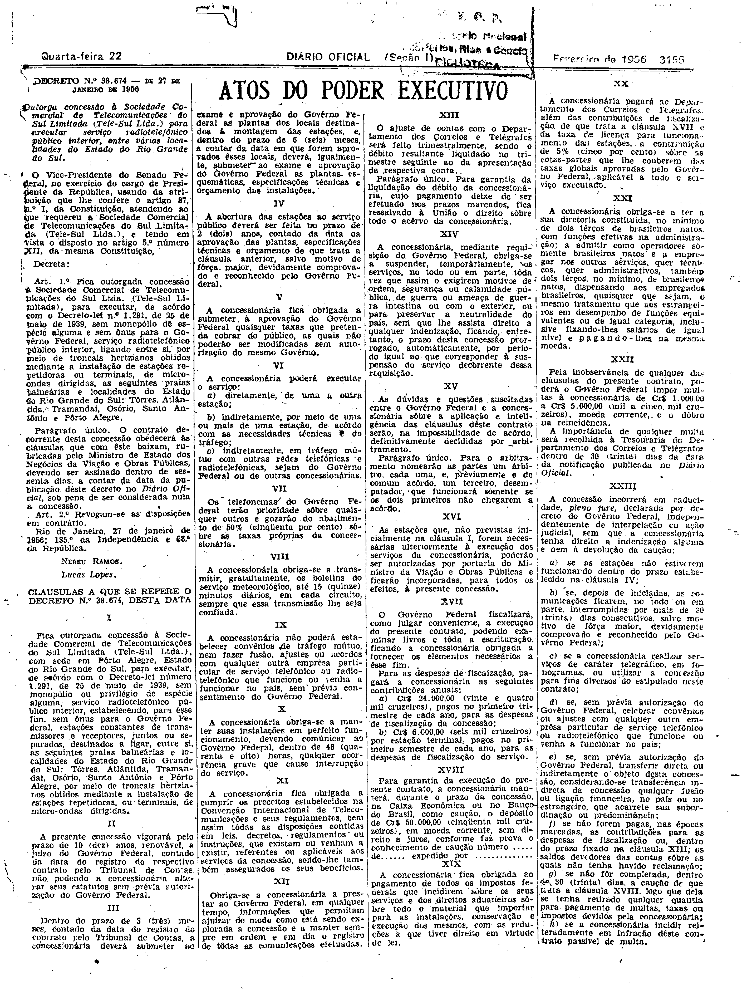
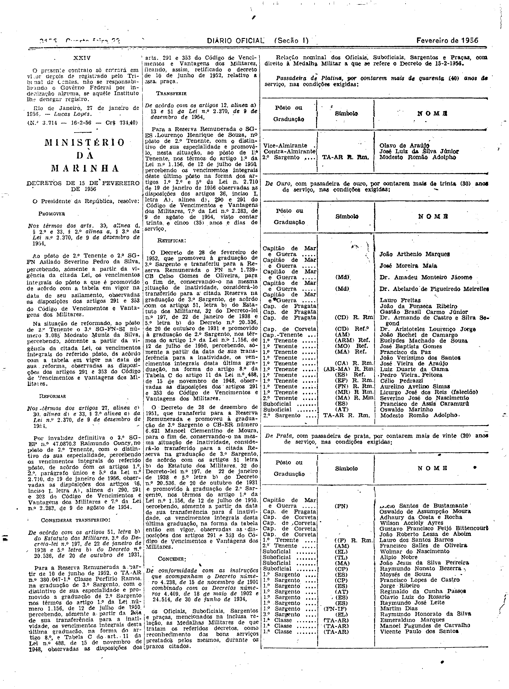

###DEC-038674-0-000-27-01-1956@@@

<strong>DECRETO Nº 38.674, DE 27 DE JANEIRO DE 1956.</strong>

<em><strong>Outorga concessão a Sociedade Comercial de Telecomunicações do Sul Limitada (Tele-Sul Ltda) para executar serviços radiotelefônico público interior, entre várias localidades do Estado do Rio Grande do Sul.</strong></em>

<strong>O VICE-PRESIDENTE DO SENADO FEDERAL</strong>, no exercício do cargo de PRESIDENTE da REPÚBLICA, usando da atribuição que lhe confere o art. 87, nº I, da Constituição atendendo ao que requereu a Sociedade Comercial de Telecomunicações do Sul Limitada (Tele-Sul Ltda) e tendo em vista o disposto no artigo 5º número XII, da mesma Constituição,

<strong>DECRETA:</strong>

<strong>Art</strong>. 1º Fica outorgada concessão à Sociedade Comercial de Telecomunicações do Sul Ltda. (Tele-Sul Limitada), para executar, de acôrdo com o Decreto-lei nº 1.291, de 25 de maio de 1939, sem monopólio de espécie alguma e sem ônus para o Govêrno Federal, serviço radiotelefônico público interior, ligando entre si, por meio de troncais hertzianos obtidos mediante a instalação de estações repetidoras ou terminais, de micro-ondas dirigidas, as seguintes praias balnearias e localidades do Estado do Rio Grande do Sul: Torres, Atlântida, Tramandaí, Osório, Santo Antônio e Porto Alegre.

Parágrafo único - O contrato decorrente desta concessão obedecerá às cláusulas que com êste baixam, rubricadas pelo Ministro do Estado dos Negócios da Viação e Obras Públicas, devendo ser assinado dentro de sessenta dias, a contar da data da publicação dêste decreto no <em>Diário Oficial</em> da União, sob pena se ser considerada nula a concessão.

<strong>Art</strong>. 2<strong>º</strong> Revogam-se as disposições em contrário.

Rio de Janeiro, 27 de janeiro de 1956; 135º da Independência e 68º da República.

<strong>JUCELINO KUBTSCHEK</strong>

Mário Meneghetti

<!-- fac-simile-oficial:inicio -->

## Fac-símile oficial: cláusulas

O texto acima não inclui as cláusulas a que se refere este decreto. A publicação oficial do anexo está em imagem, nas páginas do _Diário Oficial da União_ (Seção I) de 22 de fevereiro de 1956: página 3 do PDF (a partir de «CLÁUSULAS A QUE SE REFERE O DECRETO N.º 38.674, DESTA DATA»); página 4 do PDF (até «N.º 3.714 — 16-2-56 — Cr$ 734,40»).

As imagens são as páginas inteiras, tal como digitalizadas pela Imprensa Nacional, sem recorte, sem redesenho e sem transcrição. Cada página traz também outros atos do mesmo dia; a peça deste decreto está apenas no trecho indicado, e o texto do anexo só existe na imagem. Não há OCR validado.

Fonte: Imprensa Nacional, Biblioteca Machado de Assis, arquivo `DO_1_19560222_044.PDF` (SHA-256 `5341e7da1493bdf8100a79f66c182370bb05f1afcc504e3cce9d3ad70866f0b6`), páginas 3, 4 do PDF. SHA-256 das imagens, na ordem: `f8b533585ee84f47810c010a46a24f50a7a2477a155017558582de9805991d22`, `33f7358ad8895b8a1a0f63ff9dc53ca43f3335a5aa1e0b0dc5cdb626191993d3`.

<!-- fac-simile-oficial:fim -->
