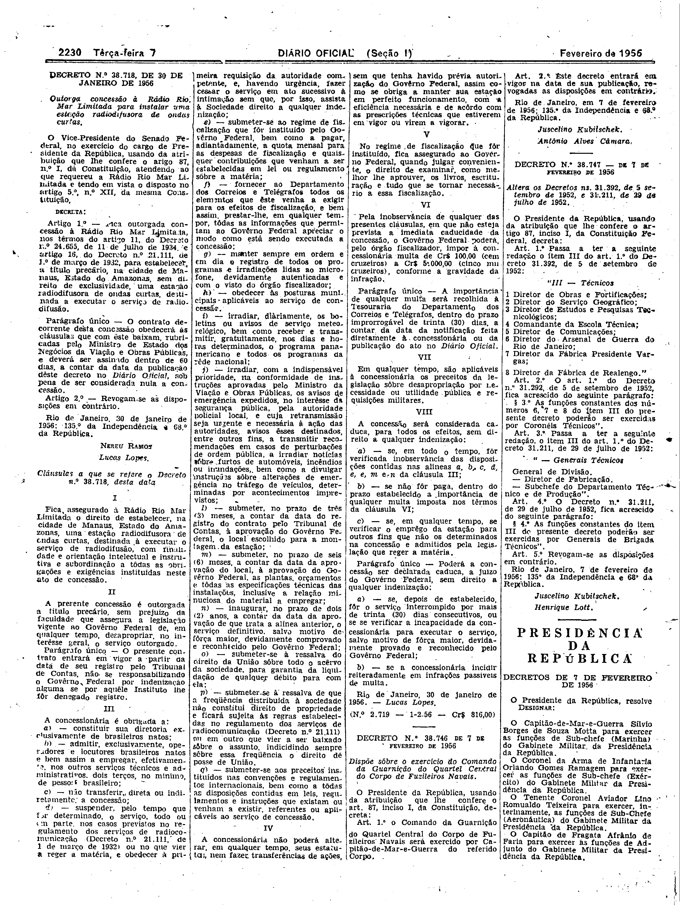

###DEC-038718-0-000-30-01-1956@@@

<strong>DECRETO Nº 38.718, DE 30 DE JANEIRO DE 1956.</strong>

<em><strong>Outorga concessão à Rádio Rio, Mar Limitada para instalar uma estação radiodifusora de ondas curtas.</strong></em>

<strong>O VICE-PRESIDENTE DO SENADO FEDERAL</strong>, no exercicio do cargo de PRESIDENTE da REPÚBLICA, usando da atribuição que lhe confere o artigo 87, nº l, da Constituição, atendendo ao que requereu a Rádio Rio Mar Limitada e tendo em vista o disposto o artigo 5º, nº XII, da mesma constituição,

<strong>DECRETA:</strong>

<strong>Art</strong>. 1º - Fica outorga concessão à Rádio Rio Mar Limitada, nos têrmos do artigo 11 Decreto nº 24.655, de 11 de julho de 1934, e artigo 16, do Decreto nº 21.111, de 1ºde março de 1932, para estabelecer, a título precário, na cidade de Manaus, Estado do Amazonas, sem direito de exclusividade, uma estação radiodifusora de ondas curtas, destinada a executar o serviço de radiodifusão.

Parágrafo único - O contrato decorrente desta concessão obedecerá às cláusulas que com êste baixam, rubricadas pelo Ministro de Estado dos Negócios da Viação e obras Públicas, e deverá ser assinado dentro de 60 dias a contar da data da publicação dêste decreto no <em>Diário</em> <em>Oficial</em>, sob pena de ser considerada nula a concessão.

<strong>Art</strong>. 2º - Revogam-se as disposições em contrário.

Rio de Janeiro, 30 de janeiro de 1956; 135º da Independência e 68º da República.

<strong>NEREU RAMOS</strong>

Lucas Lopes

<!-- fac-simile-oficial:inicio -->

## Fac-símile oficial: cláusulas

O texto acima não inclui as cláusulas a que se refere este decreto. A publicação oficial do anexo está em imagem, nas páginas do _Diário Oficial da União_ (Seção I) de 7 de fevereiro de 1956: página 6 do PDF (a partir de «Cláusulas a que se refere o Decreto n.º 38.718, desta data», até «N.º 2.719 — 1-2-56 — Cr$ 816,00»).

As imagens são as páginas inteiras, tal como digitalizadas pela Imprensa Nacional, sem recorte, sem redesenho e sem transcrição. Cada página traz também outros atos do mesmo dia; a peça deste decreto está apenas no trecho indicado, e o texto do anexo só existe na imagem. Não há OCR validado.

Fonte: Imprensa Nacional, Biblioteca Machado de Assis, arquivo `DO_1_19560207_032.PDF` (SHA-256 `bc431d40dc43802c0d55110dab859a612efad32bb8f5a5d2c275a9292a200fd6`), páginas 6 do PDF. SHA-256 das imagens, na ordem: `8b4c622a0810a8583df4624952258fc48659fa52fb2e7335171014bdd85c611b`.

<!-- fac-simile-oficial:fim -->
