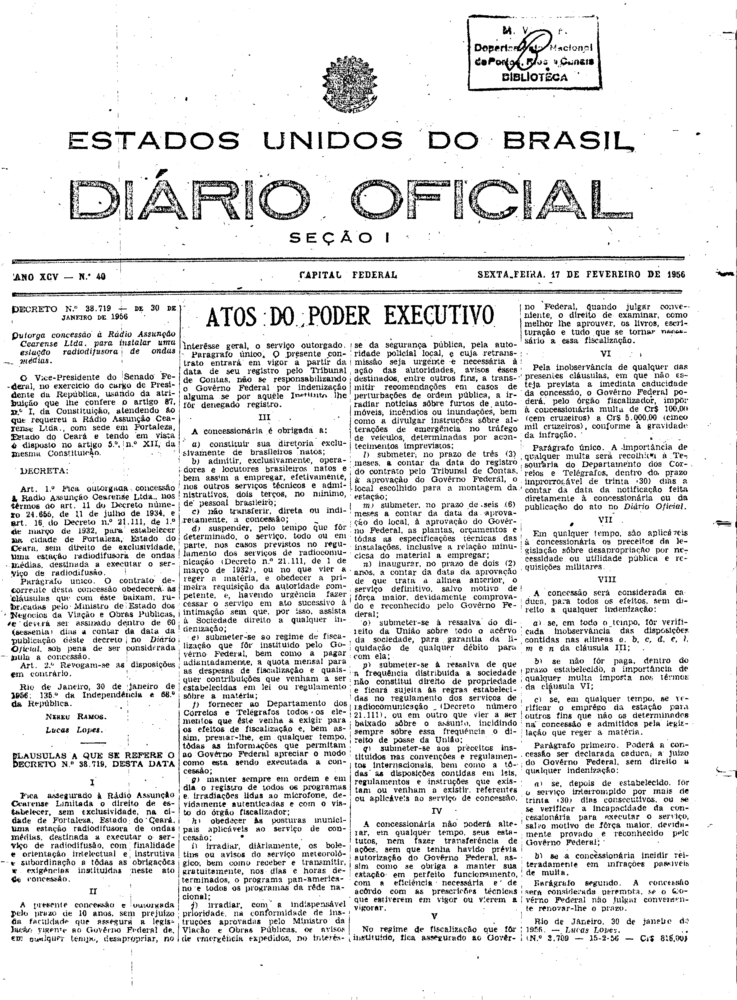

###DEC-038719-0-000-30-01-1956@@@

<strong>DECRETO Nº 38.719, DE 30 DE JANEIRO DE 1956.</strong>

<em><strong>Outorga concessão à Rádio Assunção Cearense Ltda. para instalar uma estação de radiodifusora de ondas médias.</strong></em>

<strong>O VICE-PRESIDENTE DO SENADO FEDERAL</strong>, no exercício do cargo de PRESIDENTE DA REPÚBLICA, usando da atribuição que lhe confere o artigo 87, nº l da Constituição, atendendo ao que requereu a Rádio Assunção Cearense Ltda., com sede em Fortaleza, Estado do Ceará e tendo em vista o disposto no artigo 5º, nº Xll, da mesma constituição.

<strong>DECRETA:</strong>

<strong>Art</strong>. 1º Fica outorgada concessão a Rádio Assunção Cearense Ltda., nos têrmos do art. 11 do Decreto número 24.655, de 11 de julho de 1934, e art. 16 do Decreto nº 21.111, de 1º de março de 1932, para estabelecer na cidade de Fortaleza, Estado do Ceará, sem direto de exclusividade, uma estação radiodifusora de ondas médias, destinadas a executar o serviço de radiodifusão.

Parágrafo único. O contrato de corrente desta concessão obedecerá às cláusulas que com êste baixam, rubricadas pelo Ministro de Estado dos Negócios da Viação e Obras Públicas, e deverá ser assinados dentro de 60 (sessenta) dias a contar da data da publicação dêste decreto no <em>Diário Oficial</em> sob pena de ser considerada nula a concessão.

<strong>Art</strong>. 2º Revogam-se as disposições em contrário.

Rio de Janeiro, 30 de janeiro de 1956;135ºda Independência e 68ºda República.

<strong>NEREU RAMOS</strong>

Lucas Lopes

<!-- fac-simile-oficial:inicio -->

## Fac-símile oficial: cláusulas

O texto acima não inclui as cláusulas a que se refere este decreto. A publicação oficial do anexo está em imagem, nas páginas do _Diário Oficial da União_ (Seção I) de 17 de fevereiro de 1956: página 1 do PDF (capa do caderno) (a partir de «CLÁUSULAS A QUE SE REFERE O DECRETO N.º 38.719, DESTA DATA», até «N.º 3.709 — 15-2-56 — Cr$ 816,00»).

As imagens são as páginas inteiras, tal como digitalizadas pela Imprensa Nacional, sem recorte, sem redesenho e sem transcrição. Cada página traz também outros atos do mesmo dia; a peça deste decreto está apenas no trecho indicado, e o texto do anexo só existe na imagem. Não há OCR validado.

Fonte: Imprensa Nacional, Biblioteca Machado de Assis, arquivo `DO_1_19560217_040.PDF` (SHA-256 `d57394b4a05f5b8c62595048d9f43b3bacf29c8a795bcccb7fd32b9c1248ba19`), páginas 1 do PDF. SHA-256 das imagens, na ordem: `01f3a41abdfc728a3e6ec504f171e210ada417bd9077905774972cc4278cb3de`.

<!-- fac-simile-oficial:fim -->
