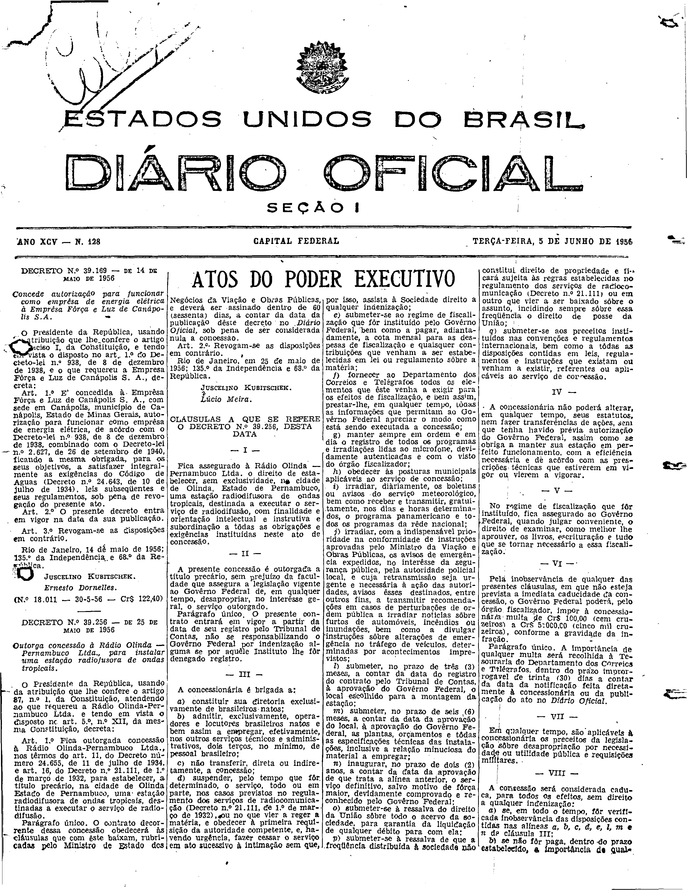
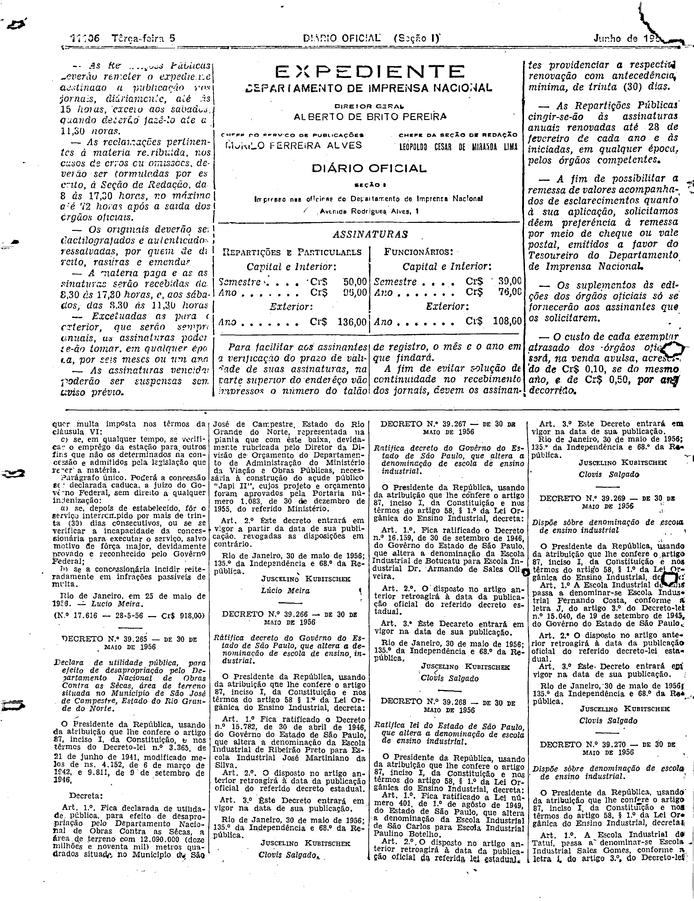

###DEC-039256-0-000-25-05-1956@@@

<strong>DECRETO Nº 39.256, DE 25 DE MAIO DE 1956.</strong>

<em><strong>Outorga concessão à Rádio Olinda - Pernambuco Ltda., para instalar uma estação radiodifusora de ondas tropicais.</strong></em>

<strong>O PRESIDENTE DA REPÚBLICA</strong>, usando da atribuição que lhe confere o artigo 87, n° I, da constituição, atendendo do que requereu a Rádio Olinda-Pernambuco Ltda. e tendo em vista o disposto no art. 5, n° XII, da mesma Constituição,

<strong>DECRETA:</strong>

<strong>Art</strong>. 1º Fica outorgada a concessão à Rádio Olinda-Pernambuco Ltda. nos têrmos do art. 11, do Decreto número 24.655, de 11 de julho de 1934, e art. 16, do Decreto n.° 21.111, de 1º de março de 1932, para estabelecer, a título precário, na cidade de Olinda estado de Pernambuco, uma estação radiodifusora de ondas tropicais, destinadas a executar o serviço de radiodifusão.

Parágrafo Único. O contrato decorrente dessa concessão obedecerá às cláusulas que com êste baixam, rubricadas pelo Ministro de Estado do Negócios da Viação e Obras Públicas, e deverá ser assinado dentro de 60 (sessenta) dias, a contar da data da publicação dêste Decreto no <em>Diário Oficial</em>, sob a pena de ser considerada nula a concessão.

<strong>Art</strong>. 2º Revogam-se as disposições em contrário.

Rio de Janeiro, em 25 de maio de 1956; 135º da Independência e 68º da República.

<strong>JUSCELINO KUBITSCHEK</strong>

Lúcio Meira

<!-- fac-simile-oficial:inicio -->

## Fac-símile oficial: cláusulas

O texto acima não inclui as cláusulas a que se refere este decreto. A publicação oficial do anexo está em imagem, nas páginas do _Diário Oficial da União_ (Seção I) de 5 de junho de 1956: página 49 do PDF (capa do caderno) (a partir de «CLÁUSULAS A QUE SE REFERE O DECRETO N.º 39.256, DESTA DATA»); página 50 do PDF (até «N.º 17.616 — 28-5-56 — Cr$ 918,00»).

As imagens são as páginas inteiras, tal como digitalizadas pela Imprensa Nacional, sem recorte, sem redesenho e sem transcrição. Cada página traz também outros atos do mesmo dia; a peça deste decreto está apenas no trecho indicado, e o texto do anexo só existe na imagem. Não há OCR validado.

Fonte: Imprensa Nacional, Biblioteca Machado de Assis, arquivo `DO_1_19560605_128.PDF` (SHA-256 `5c7feb03af4650d4b101fe4138660913faf7c5f6995ec85cc6536ab6c24f1e5d`), páginas 49, 50 do PDF. SHA-256 das imagens, na ordem: `2a67edb4b449e3010f1eab8ce02b62e74ff3e72f03ce4a7193e8e5239baefe3d`, `222dbdf42acc5d2918857922f710f034dbca325d1808a330aa0059490e6cce89`.

<!-- fac-simile-oficial:fim -->
