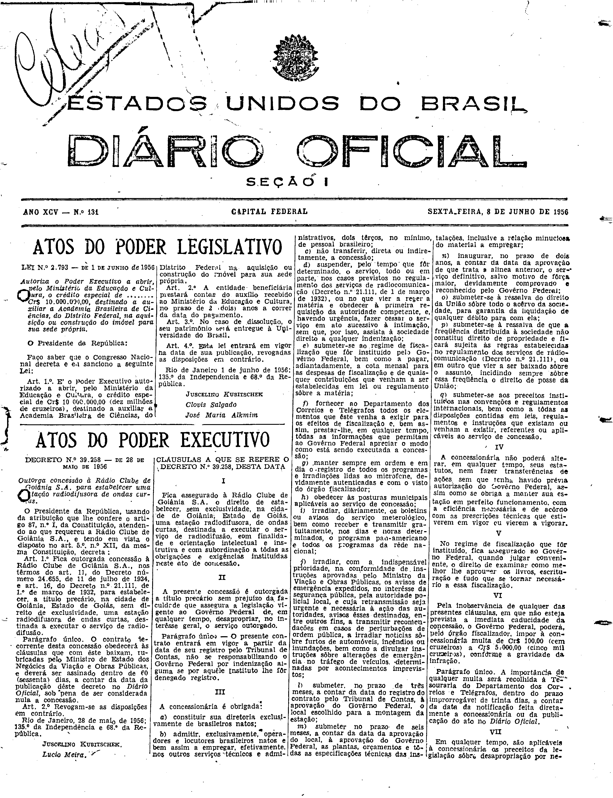
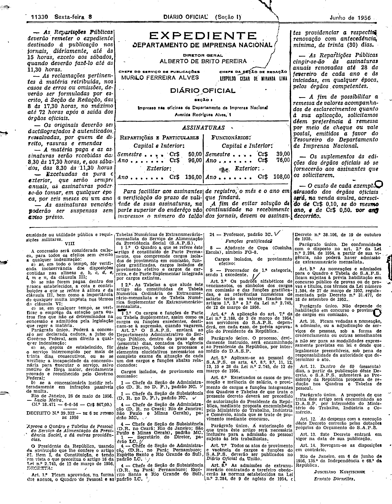

###DEC-039258-0-000-28-05-1956@@@

<strong>DECRETO Nº 39.258, DE 28 DE MAIO DE 1956.</strong>

<em><strong>Outorga concessão à Radio Clube de Goiânia S.A. para estabelecer uma estação radiodifusora de ondas curtas.</strong></em>

<strong>O PRESIDENTE DA REPÚBLICA</strong>, usando da atribuição que lhe confere o artigo 87, nº I, da Constituição atendendo ao que requereu à Radio Clube de Goiânia S.A., e tendo em vista o disposto no art. 5º nº XII, da mesma Constituição,

<strong>DECRETA:</strong>

<strong>Art</strong>. 1º Fica outorga concessão à Radio Clube de Goiânia S.A. nos têrmos do art. 11 do Decreto número 24.655, de 11 de julho de 1934, e art. 16, do Decreto nº 21.111, de 1º de março de 1932, para estabelecer, título precário, na cidade de Goiânia, Estado de Goiás, sem direito de exclusividade, uma estação radiodifusora de ondas curtas, destinada a executar o serviço de radiodifusão.

Parágrafo único. O contrato decorrente desta concessão obedecerá as cláusulas que com êste baixam rubricadas pelo Ministro do Estado dos Negócios da Aviação e Obras Públicas, e deverá ser assinado dentro de 60 (sessenta  dias a contar da data da publicação dêste Decreto no <em>Diário Oficial</em>, sob pena de ser considerada nula a concessão.

<strong>Art</strong>. 2º Revogam-se as disposições em contrário.

Rio de Janeiro, 28 de maio de 1956; 135º da Independência e 68º da República.

<strong>JUSCELINO KUBITSCHEK</strong>

Lúcio Meira

<!-- fac-simile-oficial:inicio -->

## Fac-símile oficial: cláusulas

O texto acima não inclui as cláusulas a que se refere este decreto. A publicação oficial do anexo está em imagem, nas páginas do _Diário Oficial da União_ (Seção I) de 8 de junho de 1956: página 1 do PDF (capa do caderno) (a partir de «CLÁUSULAS A QUE SE REFERE O DECRETO N.º 39.258, DESTA DATA»); página 2 do PDF (até «N.º 18.471 — 6-6-56 — Cr$ 867,00»).

As imagens são as páginas inteiras, tal como digitalizadas pela Imprensa Nacional, sem recorte, sem redesenho e sem transcrição. Cada página traz também outros atos do mesmo dia; a peça deste decreto está apenas no trecho indicado, e o texto do anexo só existe na imagem. Não há OCR validado.

Fonte: Imprensa Nacional, Biblioteca Machado de Assis, arquivo `DO_1_19560608_131.PDF` (SHA-256 `d32d7350933bdafb1052074b3171a2d4fab836c97944619b8714aea35c2b4a33`), páginas 1, 2 do PDF. SHA-256 das imagens, na ordem: `f35a5197cad84ccf5342d502f48ff7da00d415f0a961f82fb74231e4da744145`, `574843acf0c149be17cf01bdb83699df40da9e239a1059b7b40ebc430fe6a2c7`.

<!-- fac-simile-oficial:fim -->
