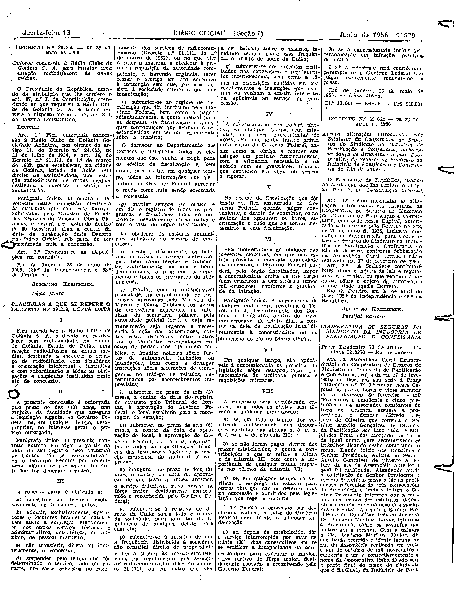

###DEC-039259-0-000-28-05-1956@@@

<strong>DECRETO N° 39.259, DE 28 DE MAIO DE 1956.</strong>

<em><strong>Outorga concessão à Rádio Clube de Goiânia S.A. para instalar uma estação radiofusora de ondas médias.</strong></em>

<strong>O PRESIDENTE DA REPÚBLICA</strong>, usando da atribuição que lhe confere o art. 87, n° I, da Constituição, atendendo ao que requereu a Rádio Clube de Goiânia S.A., e tendo em vista o disposto no art. 5º, n° XII, da mesma constituição,

<strong>DECRETA:</strong>

<strong>Art</strong>. 1º Fica outorgada a concessão à Rádio Clube de Goiânia Sociedade Anônima, nos têrmos do art. 11, do Decreto n° 24.655, de 11 de julho de 1934, e art. 16, do Decreto-lei n° 21.111, de 1º de março de 1932, para estabelecer, na cidade de Goiânia, Estado de Goiás, sem direito de exclusividade, uma estação radiofusora de ondas médias, destinada a executar o serviço de radiofusão.

Parágrafo único. O contrato decorrente desta concessão obedecerá às cláusulas que com êste baixam, rubricadas pelo Ministro de Estado dos Negócios da Viação e Obras Públicas, e deverá ser assinado dentro de 60 (sessenta) dias, a contar da data da publicação dêste Decreto no <em>Diário Oficial</em>, sob pena de ser considerada nula a concessão.

<strong>Art</strong>. 2º Revogam-se as disposições em contrário.

Rio de Janeiro, 28 de maio de 1956; 135º da Independência e 68º da República.

<strong>JUSCELINO KUBITSCHEK</strong>

Lúcio Meira

<!-- fac-simile-oficial:inicio -->

## Fac-símile oficial: cláusulas

O texto acima não inclui as cláusulas a que se refere este decreto. A publicação oficial do anexo está em imagem, nas páginas do _Diário Oficial da União_ (Seção I) de 13 de junho de 1956: página 5 do PDF (a partir de «CLÁUSULAS A QUE SE REFERE O DECRETO N.º 39.259, DESTA DATA», até «N.º 18.647 — 6-6-56 — Cr$ 918,00»).

As imagens são as páginas inteiras, tal como digitalizadas pela Imprensa Nacional, sem recorte, sem redesenho e sem transcrição. Cada página traz também outros atos do mesmo dia; a peça deste decreto está apenas no trecho indicado, e o texto do anexo só existe na imagem. Não há OCR validado.

Fonte: Imprensa Nacional, Biblioteca Machado de Assis, arquivo `DO_1_19560613_135.PDF` (SHA-256 `a4667f21cfa887b787034eddf23ae3a8ab737b8a8bd27801b941c327542a53aa`), páginas 5 do PDF. SHA-256 das imagens, na ordem: `e86f7cb5cc5be4a010231839771a110bf00f6fe295bd1d4de0ca2cff9c40d5da`.

<!-- fac-simile-oficial:fim -->
