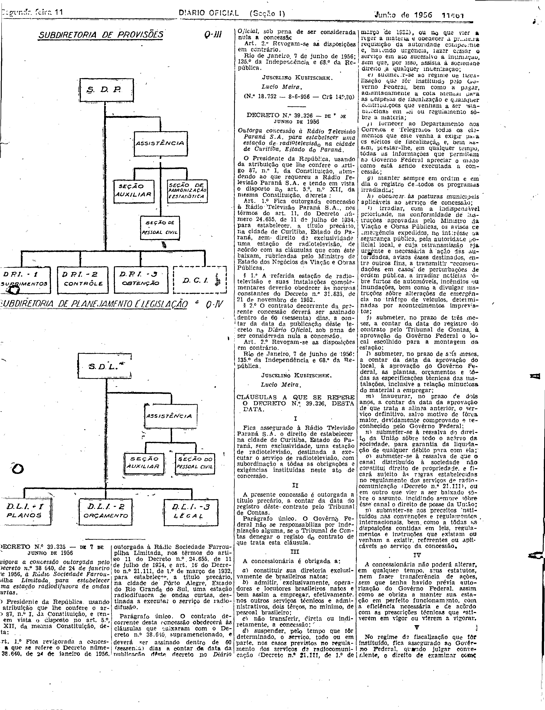
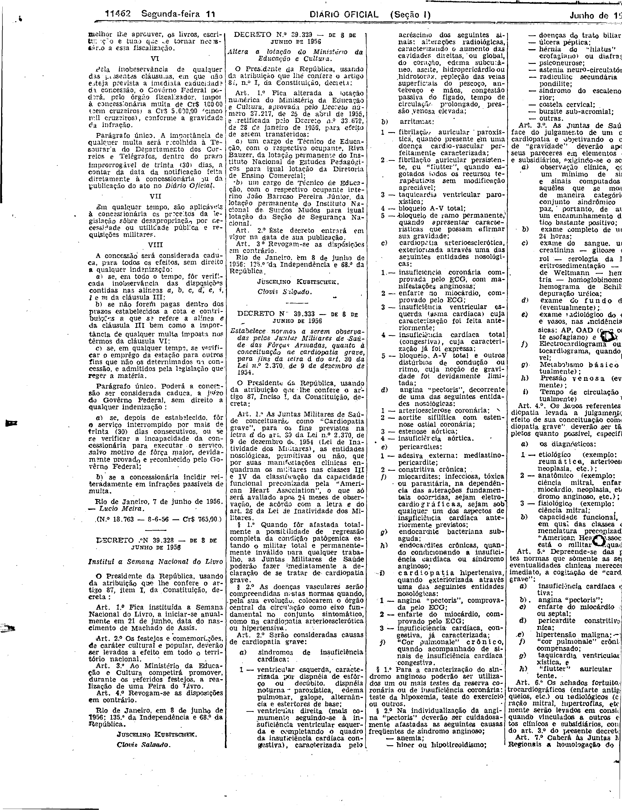

###DEC-039326-0-000-07-06-1956@@@

<strong>DECRETO Nº 39.326, DE 7 DE JUNHO DE 1956.</strong>

<em><strong>Outorga concessão à Rádio Televisão Paraná S.A. para estabelecer uma estação de radiotelevisão na cidade de Curitiba, Estado do Paraná.</strong></em>

<strong>O PRESIDENTE DA REPÚBLICA</strong>, usando da atribuição que lhe confere o artigo 87, nº I, da Constituição, atendendo ao que requereu à Rádio Televisão Paraná S.A. e tendo em vista o disposto no art. 5º, nº XII, da mesma Constituição,

<strong>DECRETA:</strong>

<strong>Art</strong>. 1º Fica outorgada concessão à Rádio Televisão Paraná S.A., nos têrmos do art. 11, Decreto número 24.655, de 11 de julho de 1934, para estabelecer, a título precário, na cidade de Curitiba, Estado do Paraná, sem direito de exclusividade, uma estação de radiotelevisão, de acôrdo com as cláusulas que com êste baixam, rubricadas pelo Ministro de Estado dos Negócios da Viação e Obras Públicas.

§ 1º A referida estação de radiotelevisão e suas instalações complementares deverão obedecer as normas constantes do Decreto nº 31.835, de 21 de novembro de 1952.

§ 2º O contrato decorrente da presente concessão deverá ser assinado dentro de 60 (sessenta) dias, a contar da data da publicação dêste decreto no <em>Diário Oficial,</em> sob pena de ser considerada nula a concessão.

<strong>Art</strong>. 2º Revogam - se as disposições em contrário.

Rio de Janeiro, 7 de junho de 1956; 135º da Independência e 68º da República.

<strong>JUSCELINO KUBITSCHEK</strong>

Lúcio Meira

<!-- fac-simile-oficial:inicio -->

## Fac-símile oficial: cláusulas

O texto acima não inclui as cláusulas a que se refere este decreto. A publicação oficial do anexo está em imagem, nas páginas do _Diário Oficial da União_ (Seção I) de 11 de junho de 1956: página 5 do PDF (a partir de «CLÁUSULAS A QUE SE REFERE O DECRETO N.º 39.326, DESTA DATA»); página 6 do PDF (até «N.º 18.763 — 8-6-56 — Cr$ 765,00», com a margem direita da página, cortada na própria digitalização, fora das colunas desta peça).

As imagens são as páginas inteiras, tal como digitalizadas pela Imprensa Nacional, sem recorte, sem redesenho e sem transcrição. Cada página traz também outros atos do mesmo dia; a peça deste decreto está apenas no trecho indicado, e o texto do anexo só existe na imagem. Não há OCR validado.

Fonte: Imprensa Nacional, Biblioteca Machado de Assis, arquivo `DO_1_19560611_133.PDF` (SHA-256 `1d6f3798a609b261c5c7df2a58be8a2158c6c0f2f4caaf675aea6a11875716d9`), páginas 5, 6 do PDF. SHA-256 das imagens, na ordem: `0cbfe492d076640b8939d6ad64786f3c78db9867038bf9367de20d583812029e`, `74d94cbdd6d18d90b556164756711c58d765e6ae8080e17c21ca9898a0026d98`.

<!-- fac-simile-oficial:fim -->
