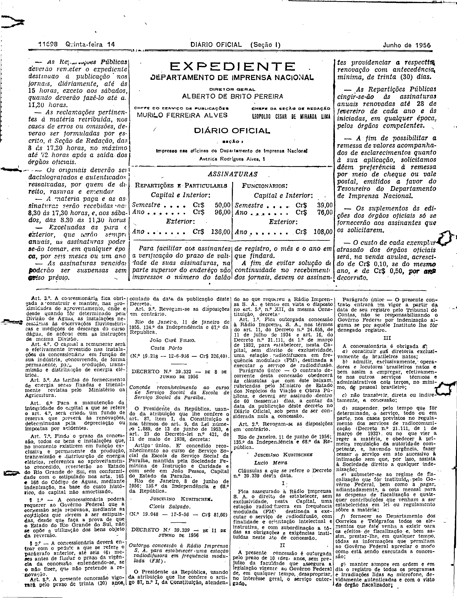
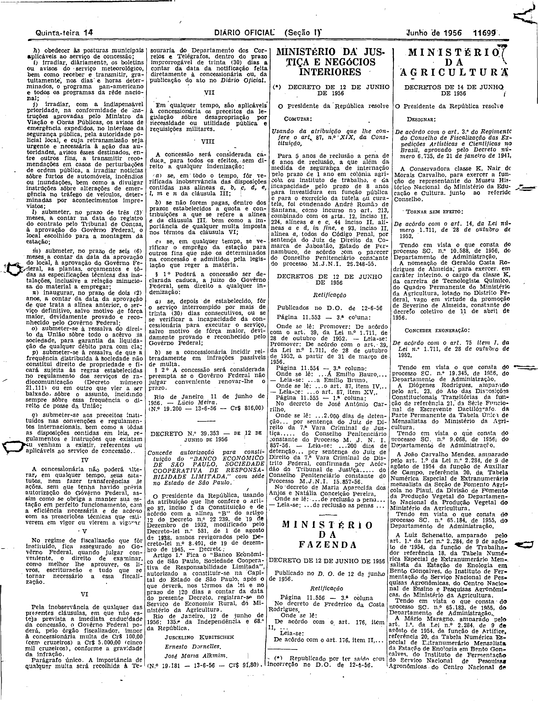

###DEC-039339-0-000-11-06-1956@@@

<strong>DECRETO Nº 39.339, DE 11 DE JUNHO DE 1956.</strong>

<em><strong>Outorga concessão à Rádio Imprensa S.A. para estabelecer uma estação radiodifusora em frequência modulada (FM).</strong></em>

<strong>O PRESIDENTE DA REPÚBLICA</strong>, usando da atribuição que lhe confere o artigo 87, nº I, da Constituição, atendendo ao que requereu a Rádio Imprensa S.A. e tendo em vista o disposto no artigo nº 5º XII, da mesma Constituição,

<strong>DECRETA:</strong>

<strong>Art</strong>. 1º Fica outorgada concessão à Rádio Imprensa S.A. nos têrmos do artigo 11, do Decreto nº 24.655, de 11 de julho de 1934 e artigo 16, do Decreto nº 21.111, de 1º de março de 1932, para estabelecer, nesta Capital, sem direito de exclusividade, uma estação Radiodifusora em frequência modulada (FM), destinada a executar o serviço de radiodifusão.

Parágrafo único. O contrato decorrente desta concessão obedecerá às cláusulas que com êste baixam, rubricadas pelo Ministro de Estado dos Negócios da Viação e Obras Públicas, e deverá ser assinado dentro de 60 (sessenta) dias, a contar da data da publicação dêste decreto no <em>Diário Oficial</em>, sob pena de ser considerada nula a concessão.

<strong>Art</strong>. 2º Revogam-se as disposições em contrário.

Rio de Janeiro, 11 de junho de 1956; 135º da Independência e 68º da República.

<strong>JUSCELINO KUBITSCHEK</strong>

Lúcio Meira

<!-- fac-simile-oficial:inicio -->

## Fac-símile oficial: cláusulas

O texto acima não inclui as cláusulas a que se refere este decreto. A publicação oficial do anexo está em imagem, nas páginas do _Diário Oficial da União_ (Seção I) de 14 de junho de 1956: página 34 do PDF (a partir de «Cláusulas a que se refere o Decreto n.º 39.339 desta data»); página 35 do PDF (até «N.º 19.200 — 13-6-56 — Cr$ 816,00»).

As imagens são as páginas inteiras, tal como digitalizadas pela Imprensa Nacional, sem recorte, sem redesenho e sem transcrição. Cada página traz também outros atos do mesmo dia; a peça deste decreto está apenas no trecho indicado, e o texto do anexo só existe na imagem. Não há OCR validado.

Fonte: Imprensa Nacional, Biblioteca Machado de Assis, arquivo `DO_1_19560614_136.PDF` (SHA-256 `047a93422de39def6f5ce93967dc59f5a1400785372840d5d620a0a489d22a65`), páginas 34, 35 do PDF. SHA-256 das imagens, na ordem: `361c1635b0a680074d2414c829aa4154b1d87a34d5bfac7853115355666e82d8`, `40dd576c4af52e579db3df980e06528dee1030bed27d1dc9bf699068586d9de3`.

<!-- fac-simile-oficial:fim -->
