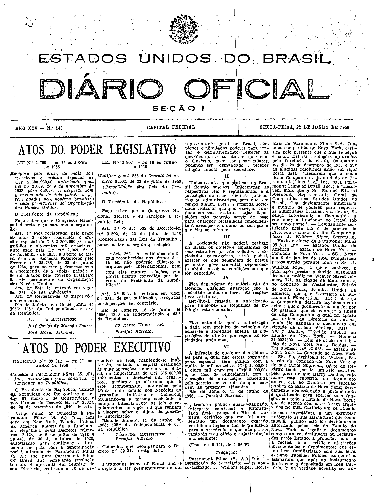

###DEC-039342-0-000-11-06-1956@@@

<strong>DECRETO Nº 39.342, DE 11 DE JUNHO DE 1956.</strong>

<em><strong>Concede à Paramount Films (S. A.), Inc., autorização para continuar a funcionar na República.</strong></em>

<strong>O PRESIDENTE DA REPÚBLICA</strong>, usando da atribuição que lhe confere o artigo 87, inciso I, da Constituição, e nos têrmos do Decreto-lei nº 2.627, de 26 de setembro de 1940,

<strong>DECRETA:</strong>

Artigo único. É concedida à Paramount Films (S. A.), Inc., com sede em New York, Estados Unidos da América, autorizada a funcionar na República pelos Decretos números 12.124 de 5 de julho de 1916 e 18.448, de 30 de outubro de 1928,autoriação para continuar a funcionar no país com a denominação social alterada de Paramount Films (S. A.) Inc., para <em>Paramount Films Of Brazil</em>, Inc., constante resolução tomada e aprovada em reunião de sua Diretoria, realizada a 28 de dezembro de 1956, mantendo-se inalterado, contudo o capital destinado às suas operações comerciais no Brasil, na importância de Cr$ 816.000,00 (oitocentos e dezesseis mil cruzeiros), mediante as cláusulas que a êste acompanham, assinadas pelo Ministro de Estado dos Negócios do Trabalho, Indústria e Comércio, obrigando-se a mesma sociedade a cumprir integralmente as leis e regulamentos em vigor ou que venham a vigorar sôbre o objeto da presente autorização.

Rio de Janeiro, 11 de junho de 1956; 135º da Independência e 68º da República.

<strong>JUSCELINO KUBITSCHEK</strong>

Parsifal Barroso

<!-- fac-simile-oficial:inicio -->

## Fac-símile oficial: clausulas

A peça vinculada ao Decreto nº 39.342 é reproduzida nas imagens abaixo, a partir da publicação oficial da Imprensa Nacional. A reprodução é em fac-símile, sem transcrição por OCR nem reconstrução do conteúdo.

As imagens mostram páginas inteiras do Diário Oficial da União e podem conter outras matérias. Essas matérias vizinhas não são atribuídas a este decreto. A peça é identificada pelo seu título e pela referência ao ato nas páginas indicadas.

SHA-256 desta imagem: `3a140edc25abafcdbaa10fe4c87c034727c9a566e3a634d6c3f0f8c0e44d83c4`.

Fontes oficiais da publicação:

- [DO_1_19560622_143.PDF](https://biblioteca.in.gov.br/documents/271518/581375/DO_1_19560622_143.PDF/eacd038c-7327-2b0a-95b2-455af56248fa?t=1574963511220&download=true) — SHA-256 do PDF: `f7c9ffb47c7bca9b00f263a6a17c42898868e163162d95e36052f8512b247098`.

<!-- fac-simile-oficial:fim -->
