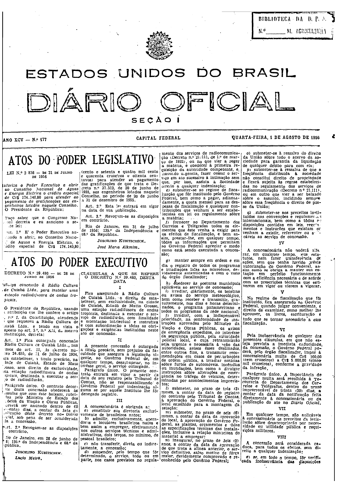
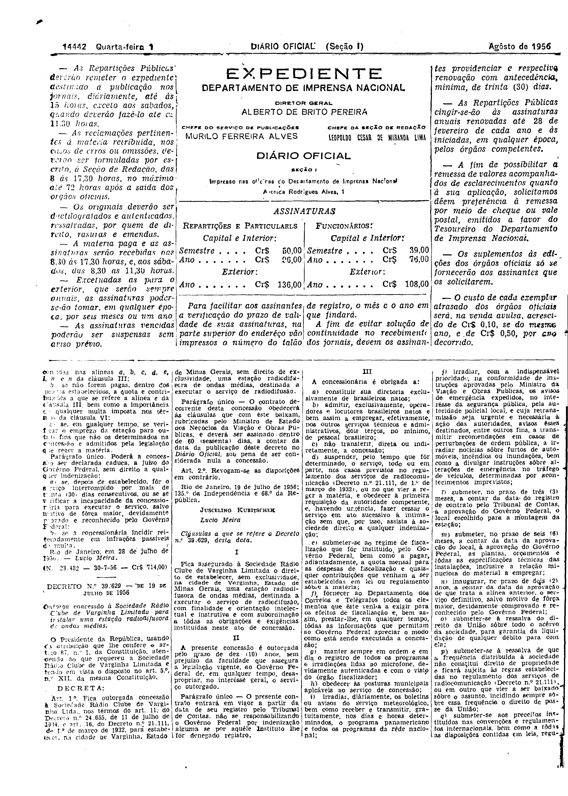

###Dec-039480-0-000-28-06-1956@@@

<strong>DECRETO Nº 39.480, DE 28 DE JUNHO DE 1956.</strong>

<em><strong>Outorgada concessão à Rádio Cultura de Cuiabá Ltda. para instalar uma estação radiofusora de ondas tropicais.</strong></em>

<strong>O PRESIDENTE DA REPÚBLICA</strong>, usando da atribuição que lhe confere o artigo 87, nº I, da Constituição, atendendo ao que se refere a Rádio Cultura de Cuiabá Ltda, e tendo em vista o disposto no art. 5º, nº XII da mesma Constituição,

<strong>DECRETA:</strong>

<strong>Art</strong>. 1º Fica outorgada concessão à Rádio Cultura de Cuiabá Ltda., nos têrmos do art. 11, do Decreto número 24.655, de 11 de julho de 1934, para estabelecer, a título precário, na cidade de Cuiabá, Estado de Mato Grosso, sem direito da exclusividade, uma estação radiofusora de ondas tropicais, destinada a executar o serviço de radiodifusão.

Parágrafo único. O contrato decorrente desta concessão obedecerá às cláusas que com êste baixam, rubricadas pelo Ministro de Estado dos Negócios da Viação e Obras Públicas, e deverá ser assinado dentro de 60 (sessenta) dias, a contar da data da publicação dêste decreto no <em>Diário Oficial</em>, sob pena de considerada nula a concessão.

<strong>Art</strong>. 2º Revogam-se as disposições em contrário.

Rio de Janeiro, em 28 de junho de 1956; 135º de Independência e 68º da República.

<strong>JUSCELINO KUBITSCHEK</strong>

Lucio Meira

<!-- fac-simile-oficial:inicio -->

## Fac-símile oficial: cláusulas

O texto acima não inclui as cláusulas a que se refere este decreto. A publicação oficial do anexo está em imagem, nas páginas do _Diário Oficial da União_ (Seção I) de 1 de agosto de 1956: página 1 do PDF (capa do caderno) (a partir de «CLÁUSULAS A QUE SE REFERE O DECRETO N.º 39.480, DESTA DATA»); página 2 do PDF (até «N. 23.482 — 30-7-56 — Cr$ 714,00»).

As imagens são as páginas inteiras, tal como digitalizadas pela Imprensa Nacional, sem recorte, sem redesenho e sem transcrição. Cada página traz também outros atos do mesmo dia; a peça deste decreto está apenas no trecho indicado, e o texto do anexo só existe na imagem. Não há OCR validado.

Fonte: Imprensa Nacional, Biblioteca Machado de Assis, arquivo `DO_1_19560801_177.PDF` (SHA-256 `e41eec593e47f06af65d1710184972881e886d8bb1e6290396c0a9529e6ef526`), páginas 1, 2 do PDF. SHA-256 das imagens, na ordem: `005e9c0560ddc4c9010f1ffdbeaf268fbbb03516a58a9bd5bb4296db0e5da29f`, `5492a365b3be6024e6e582b70ce046a49a748643a6e11042747b0b1d8d658adc`.

<!-- fac-simile-oficial:fim -->
