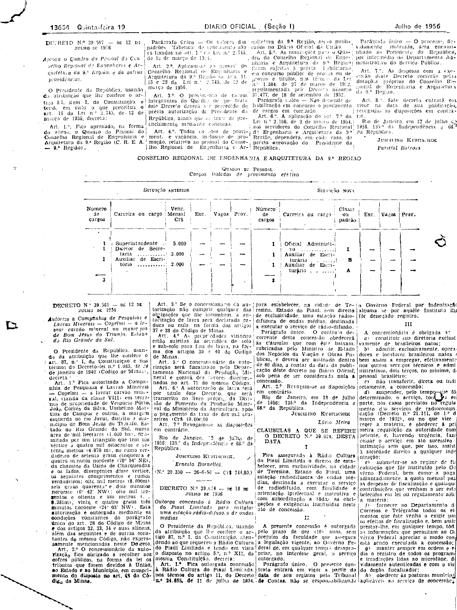
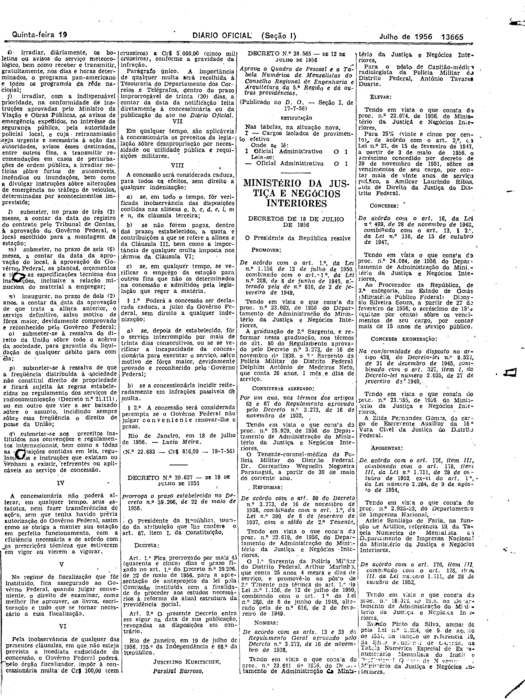

###DEC-039624-0-000-18-07-1956@@@

<strong>DECRETO Nº 39.624, DE 18 DE JULHO DE 1956.</strong>

<em><strong>Outorga concessão à Rádio Cultura do Piauí Limitada para instalar uma estação radiodifusora de ondas médias.</strong></em>

<strong>O PRESIDENTE DA REPÚBLICA</strong>, usando da atribuição que lhe confere o artigo 87, nº I, da Constituição, atendendo o que requereu a Rádio Cultura do Piauí Limitada e tendo em vista o disposto no artigo 5º, nº XII, da mesma Constituição,

<strong>DECRETA:</strong>

<strong>Art</strong>. 1º Fica outorgada concessão à Rádio Cultura do Piauí Limitada, nos têrmos do artigo 11, do Decreto nº 24.655, de 11 de julho de 1934, para estabelecer, na cidade de Teresina, Estado do Piauí, sem direito de exclusividade, uma estação radiodifusora de ondas médias, destinada a executar o serviço de radiodifusão.

Parágrafo único. O contrato decorrente desta concessão obedecerá às cláusulas que com êste baixam, rubricadas pelo Ministro de Estado dos Negócios da Viação e Obras Públicas, e deverá ser assinado dentro de 60 dias, a contar da data da publicação dêste decreto no <em>Diário</em> <em>Oficial</em>, sob pena de ser considerada nula a concessão.

<strong>Art</strong>. 2º Revogam-se as disposições em contrário.

Rio de Janeiro, em 18 de julho de 1956; 135º da Independência e 68º da República.

<strong>JUSCELINO KUBITSCHEK</strong>

Lúcio Meira

<!-- fac-simile-oficial:inicio -->

## Fac-símile oficial: cláusulas

O texto acima não inclui as cláusulas a que se refere este decreto. A publicação oficial do anexo está em imagem, nas páginas do _Diário Oficial da União_ (Seção I) de 19 de julho de 1956: página 8 do PDF (a partir de «CLÁUSULAS A QUE SE REFERE O DECRETO N.º 39.624, DESTA DATA»); página 9 do PDF (até «N.º 22.683 — Cr$ 816,00 — 19-7-56»).

As imagens são as páginas inteiras, tal como digitalizadas pela Imprensa Nacional, sem recorte, sem redesenho e sem transcrição. Cada página traz também outros atos do mesmo dia; a peça deste decreto está apenas no trecho indicado, e o texto do anexo só existe na imagem. Não há OCR validado.

Fonte: Imprensa Nacional, Biblioteca Machado de Assis, arquivo `DO_1_19560719_166.PDF` (SHA-256 `f802220b7ae45edb9d463e2cd38981bcffb0fd524628f9ce9cf9b70c5c437932`), páginas 8, 9 do PDF. SHA-256 das imagens, na ordem: `0131f650f0838b808472e253ccb526d53dd50bb315b6b4ac32223910a22abf4b`, `1ccbed008845d33ea806e4c8f79ad5ef6da2e7d1c08dc6dd96254095af12829e`.

<!-- fac-simile-oficial:fim -->
