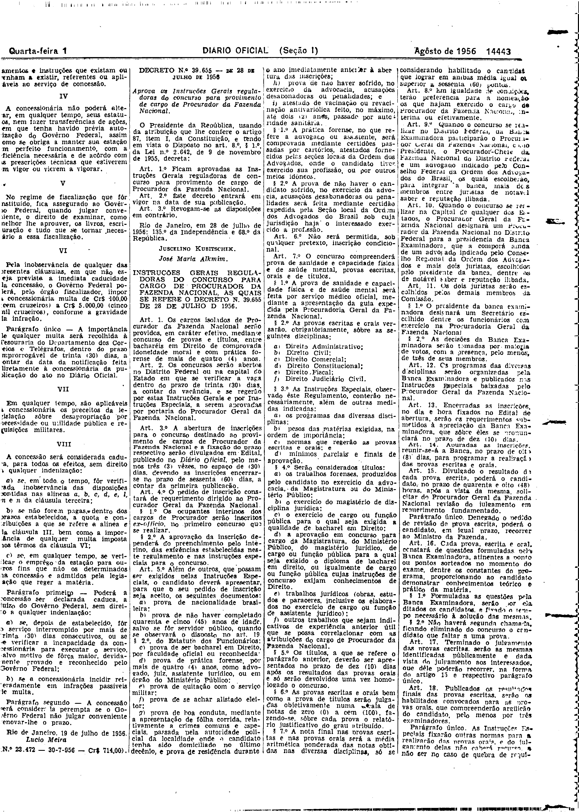

###DEC-039629-0-000-19-07-1956@@@

<strong>DECRETO Nº 39.629, DE 19 DE JULHO DE 1956.</strong>

<em><strong>Outorga concessão à Sociedade Rádio Clube de Varginha Limitada para instalar uma estação radiodifusora de ondas médias.</strong></em>

<strong>O PRESIDENTE DA REPÚBLICA</strong>, usando da atribuição que lhe confere o artigo 87, nº I, da Constituição, atendendo ao que requereu a Sociedade Rádio Clube de Varginha Limitada e tendo em vista o disposto no art. 5º, nº XII, da mesma Constituição,

<strong>DECRETA:</strong>

<strong>Art</strong>. 1º Fica outorgada concessão à Sociedade Rádio Clube de Varginha Ltda, nos têrmos do art. 11, do Decreto nº 24.655, de 11 de julho de 1934, e art. 16, do Decreto nº 21.111, de 1.º de março de 1932, para estabelecer, na cidade de Varginha, Estado de Minas Gerais, sem direito de exclusividade, uma estação radiodifusora de ondas médias, destinada a executar o serviço de radiodifusão.

Parágrafo único - O contrato decorrente desta concessão obedecerá às cláusulas que com êste baixam, rubricadas pelo Ministro de Estado dos Negócios da Viação e Obras Públicas, e deverá ser assinado dentro de 60 (sessenta) dias, a contar de data da publicação dêste decreto no <em>Diário Oficial</em>, sob pena de ser considerada nula a concessão.

<strong>Art</strong>. 2º Revogam-se as disposições em contrário.

Rio de Janeiro, 19 de julho de 1956; 135.º da Independência e 68.º da República.

<strong>JUSCELINO KUBITSCHEK</strong>

Lucio Meira

<!-- fac-simile-oficial:inicio -->

## Fac-símile oficial: cláusulas

O texto acima não inclui as cláusulas a que se refere este decreto. A publicação oficial do anexo está em imagem, nas páginas do _Diário Oficial da União_ (Seção I) de 1 de agosto de 1956: página 2 do PDF (a partir de «Cláusulas a que se refere o Decreto n.º 39.629, desta data»); página 3 do PDF (até «N.º 23.472 — 30-7-956 — Cr$ 714,00»).

As imagens são as páginas inteiras, tal como digitalizadas pela Imprensa Nacional, sem recorte, sem redesenho e sem transcrição. Cada página traz também outros atos do mesmo dia; a peça deste decreto está apenas no trecho indicado, e o texto do anexo só existe na imagem. Não há OCR validado.

Fonte: Imprensa Nacional, Biblioteca Machado de Assis, arquivo `DO_1_19560801_177.PDF` (SHA-256 `e41eec593e47f06af65d1710184972881e886d8bb1e6290396c0a9529e6ef526`), páginas 2, 3 do PDF. SHA-256 das imagens, na ordem: `5492a365b3be6024e6e582b70ce046a49a748643a6e11042747b0b1d8d658adc`, `1ab6ce0a4885b70617e692c5a23eb727949f10d2a283cffe01e22f076db82abc`.

<!-- fac-simile-oficial:fim -->
