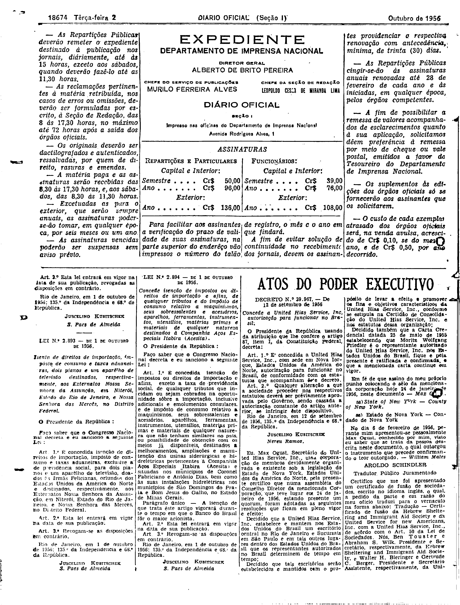
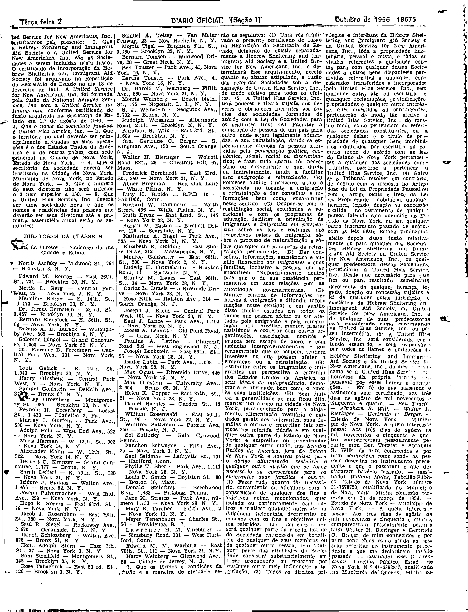
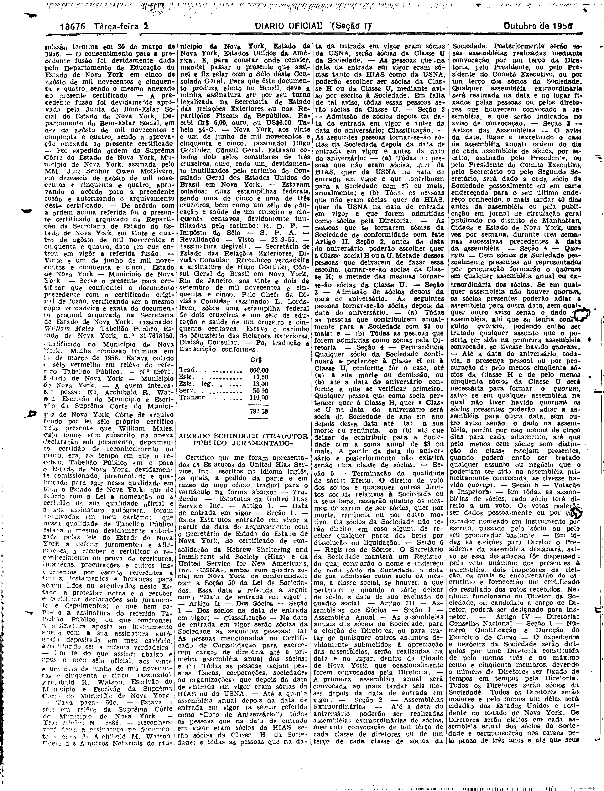
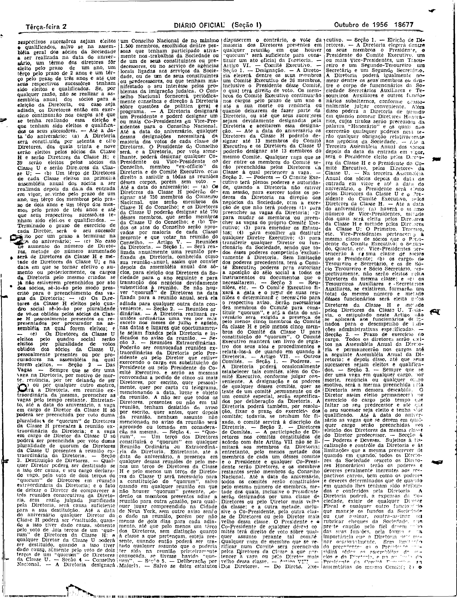
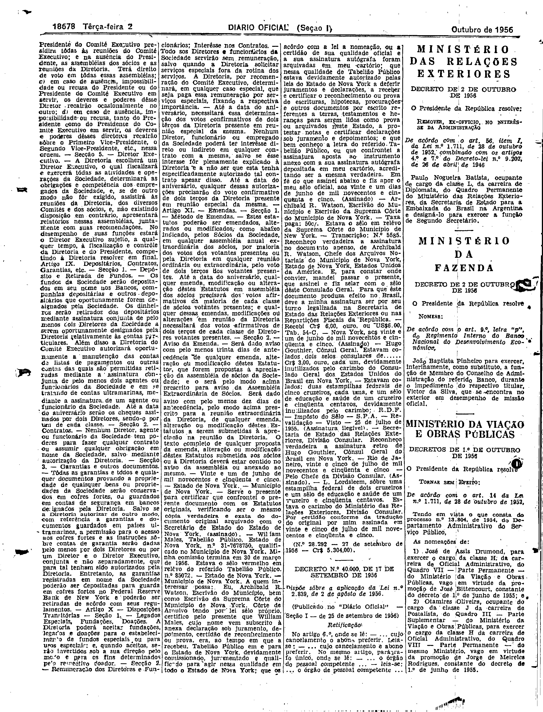

###DEC-039967-0-000-12-09-1956@@@

<strong>DECRETO Nº 39.967, DE 12 DE SETEMBRO DE 1956.</strong>

<em><strong>Concede a united Hias Service, Inc. autorização para funcionar no Brasil.</strong></em>

<strong>O PRESIDENTE DA REPÚBLICA</strong>, usando da atribuição que lhe confere o artigo 87, item I, da Constituição Federal,

<strong>DECRETA:</strong>

<strong>Art</strong>. 1º É concedida a <em>United Hias Servic, Inc</em>., com sede em Nova Iorque, autorização para funcionar no Brasil, de conformidade com os estatutos que acompanham êste decreto.

<strong>Art</strong>. 2º Qualquer alteração a que a sociedade proceder nos respectivos estatutos deverá ser prèviamente aprovada pelo Govêrno, sendo cassada a autorização constante do artigo anterior, se infringir êste dispositivo.

Rio de Janeiro, em 12 de setembro de 1956; 135º da Independência e 68º da República.

<strong>JUSCELINO KUBITSCHEK</strong>

Nereu Ramos

<!-- fac-simile-oficial:inicio -->

## Fac-símile oficial: estatuto

A peça vinculada ao Decreto nº 39.967 é reproduzida nas imagens abaixo, a partir da publicação oficial da Imprensa Nacional. A reprodução é em fac-símile, sem transcrição por OCR nem reconstrução do conteúdo.

As imagens mostram páginas inteiras do Diário Oficial da União e podem conter outras matérias. Essas matérias vizinhas não são atribuídas a este decreto. A peça é identificada pelo seu título e pela referência ao ato nas páginas indicadas.

SHA-256 desta imagem: `03e536de19d3b4b6673df6069654a2c3087bc3f2972f7506e7f8406720986226`.

SHA-256 desta imagem: `e4cfb80f3a5ef3b7fa97826d85114baf12fa95b3da33974f2bceb5692a4a7ace`.

SHA-256 desta imagem: `edc2bc1f172e077e4fc5be58ef03fa68c36907f362a8059b5db8d388b9d196aa`.

SHA-256 desta imagem: `937594e6971afc5ed1b418883f54f9965b3ffb5af065185314be708c6d8cba89`.

SHA-256 desta imagem: `876f40cc60edf559a89b23474896223a79a8ec238ca910ebf8fb6a9a98cdebf6`.

Fontes oficiais da publicação:

- [DO_1_19561002_227.PDF](https://biblioteca.in.gov.br/documents/271518/581375/DO_1_19561002_227.PDF/857eace5-763d-ba1b-3b33-6731b356c5dc?t=1574964353540&download=true) — SHA-256 do PDF: `79af9efd1439d6ad6f7a512a3489ee01c8b5c3ef02d29f40ddba24b3c4df466f`.

<!-- fac-simile-oficial:fim -->
