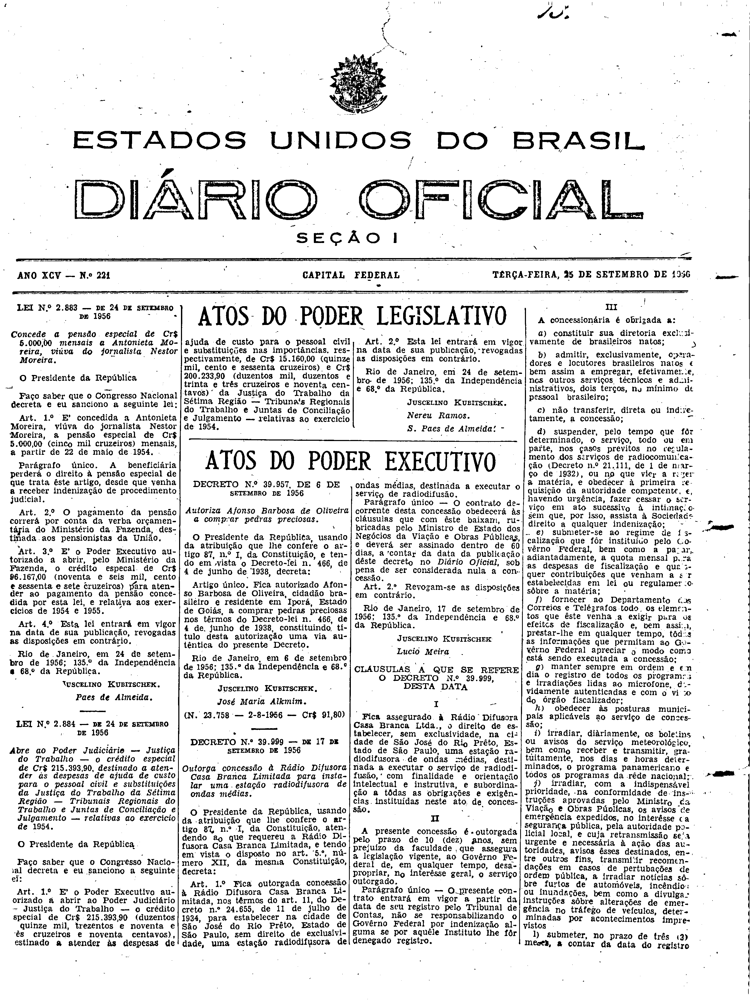
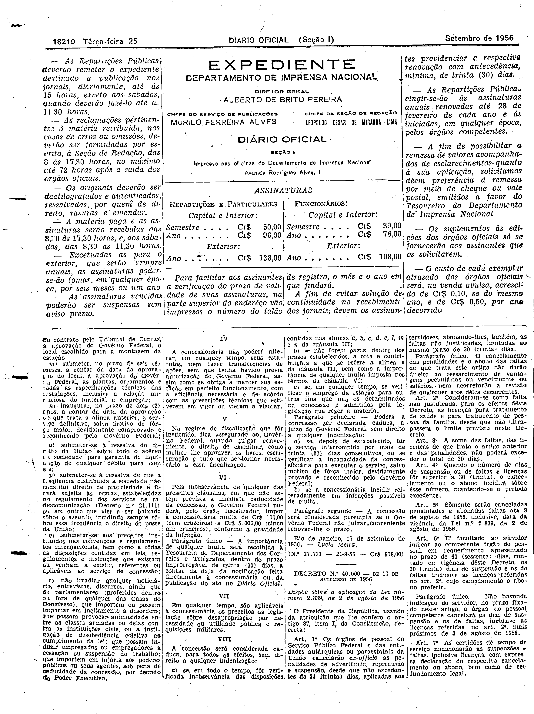

###DEC-039999-0-000-17-09-1956@@@

<strong>DECRETO Nº 39.999, DE 17 DE SETEMBRO DE 1956.</strong>

<em><strong>Outorga concessão à Rádio Difusora Casa Branca Limitada para instalar uma estação radiodifusora de ondas médias.</strong></em>

<strong>O PRESIDENTE DA REPÚBLICA</strong>, usando da atribuição que lhe confere o artigo 87, nº I, da Constituição, atendendo ao que requereu a Rádio Difusora Casa Branca Limitada, e tendo em vista o disposto no art.5º, número XII, da mesma Constituição,

<strong>DECRETA:</strong>

<strong>Art</strong>. 1º Fica outorgada concessão à Rádio Difusora Casa Branca Limitada, nos têrmos do art. 11, do Decreto nº 24.655, de 11 de julho de 1934, para estabelecer na cidade de São José do Rio Prêto, Estado de São Paulo, sem direito de exclusividade, uma estação radiodifusora de ondas médias, destinada a executar o serviço de radiodifusão.

Parágrafo único - O contrato decorrente desta concessão obedecerá às cláusulas que com êste baixam, rubricadas pelo Ministro de Estado dos Negócios da Viação e Obras Públicas, e deverá ser assinado dentro de 60 dias, a contar da data da publicação dêste decreto no Diário Oficial, sob pena de ser considerada nula a concessão.

<strong>Art</strong>. 2º Revogam-se as disposições em contrário.

Rio de Janeiro, 17 de setembro de 1956; 135º da Independência e 68º da República.

<strong>JUSCELINO KUBISTSCHEK.</strong>

Lúcio Meira

###DEC-039999-0-000-17-09-1956@@@RET01+++

<strong>DECRETO Nº 39.999, DE 17 DE SETEMBRO DE 1956.</strong>

<em><strong>Outorga concessão à Rádio Difusora Casa Branca Limitada para instalar uma estação radiodifusora de ondas médias.</strong></em>

(Publicado no <em>Diário Oficial</em> de 25 de setembro de 1956 - Seção I).

<strong>RETIFICAÇÃO</strong>

Na cláusula terceira, letra <em>j</em>

<u><strong>ONDE SE LÊ:</strong></u>

...outros fins transmitir...

<u><strong>LEIA-SE:</strong></u>

...outros fins, a transmitir...

Na cláusula oitava, letra <em>b</em>

<u><strong>ONDE SE LÊ:</strong></u>

b) não forem pagas,...

<u><strong>LEIA-SE:</strong></u>

b) se não forem pagas,...

<!-- fac-simile-oficial:inicio -->

## Fac-símile oficial: cláusulas

O texto acima não inclui as cláusulas a que se refere este decreto. A publicação oficial do anexo está em imagem, nas páginas do _Diário Oficial da União_ (Seção I) de 25 de setembro de 1956: página 1 do PDF (capa do caderno) (a partir de «CLÁUSULAS A QUE SE REFERE O DECRETO N.º 39.999, DESTA DATA»); página 2 do PDF (até «N.º 27.731 — 21-9-56 — Cr$ 918,00»).

As imagens são as páginas inteiras, tal como digitalizadas pela Imprensa Nacional, sem recorte, sem redesenho e sem transcrição. Cada página traz também outros atos do mesmo dia; a peça deste decreto está apenas no trecho indicado, e o texto do anexo só existe na imagem. Não há OCR validado.

Fonte: Imprensa Nacional, Biblioteca Machado de Assis, arquivo `DO_1_19560925_221.PDF` (SHA-256 `b6b5d9486a673ab9ae75c003cc6dd180b7f892dd44773f86cba0e23e463d68f8`), páginas 1, 2 do PDF. SHA-256 das imagens, na ordem: `7141c0c9499b1f2e7ca64660c3f826e0cf09ccd4faa111be0777315fe2a361a4`, `7d5c11625db5dea2b4d6510b3093357d23cdda07791a07b3a2254ea416cc0b93`.

<!-- fac-simile-oficial:fim -->
