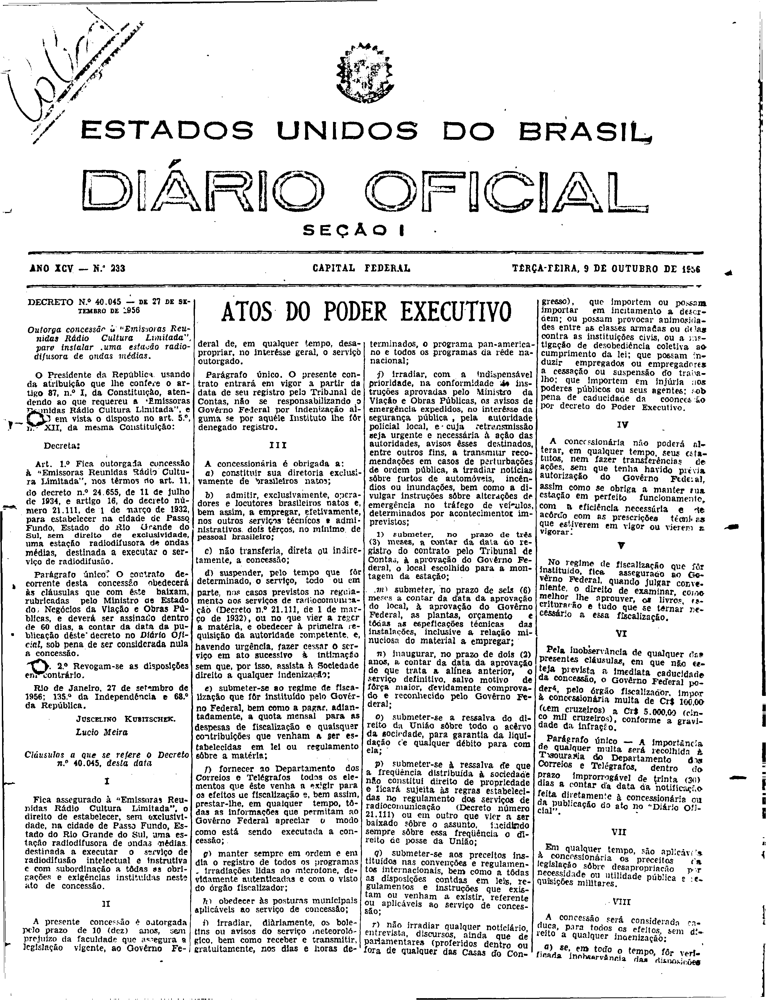
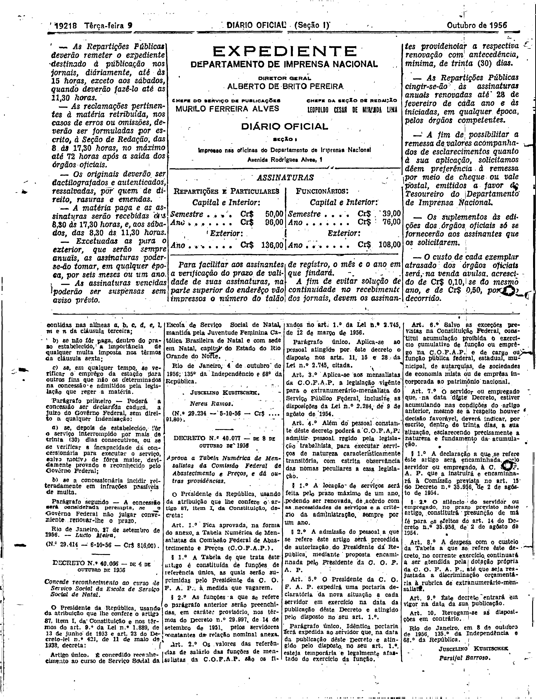

###DEC-040045-0-000-27-09-1956@@@

<strong>DECRETO Nº 40.045, DE 27 DE SETEMBRO DE 1956.</strong>

<em><strong>Outorga concessão à “Emissoras Reunidas Rádio Cultura Limitada”, para instalar uma estação radiodifusora de ondas médias.</strong></em>

<strong>O PRESIDENTE DA REPÚBLICA</strong>, usando da atribuição que lhe confere o art. 87, nº I, da Constituição, atendendo ao que requereu a “Emissoras Reunidas Rádio Cultura Limitada”, e tendo em vista o disposto no art. 5º nº XII, da mesma Constituição,

<strong>DECRETA:</strong>

<strong>Art</strong>. 1º Fica outorgada concessão à “Emissoras Reunidas Rádio Cultura Limitada”, nos têrmos ao art. 11, do decreto nº 24.655, de 11 de julho de 1934, e artigo 16 do decreto número 21.111, de 1 de março de 1932, para estabelecer na cidade de Passo Fundo, Estado do Rio de Grande do Sul, sem direito de exclusividade, uma estação radiodifusora de ondas médias, destinada a executar o serviço de radiodifusão.

Parágrafo único. O contrato de corrente desta concessão obedecerá às cláusulas que com êste baixam rubricadas pelo Ministro de Estado, Negócios da Viação e Obras Públicas, e deverá ser assinado dentro de 60 dias, a contar da data da publicação dêste Decreto no <em>Diário Oficial</em>, sob pena de ser considerada nula a concessão.

<strong>Art</strong>. 2º Revogam-se as disposições em contrário.

Rio de Janeiro, 27 de setembro de 1956; 135º da Independência e 68º da República.

<strong>JUSCELINO KUBITSCHEK</strong>

Lúcio Meira

<!-- fac-simile-oficial:inicio -->

## Fac-símile oficial: cláusulas

O texto acima não inclui as cláusulas a que se refere este decreto. A publicação oficial do anexo está em imagem, nas páginas do _Diário Oficial da União_ (Seção I) de 9 de outubro de 1956: página 1 do PDF (capa do caderno) (a partir de «Cláusulas a que se refere o Decreto n.º 40.045, desta data»); página 2 do PDF (até «N.º 29.414 — 6-10-56 — Cr$ 816,00»).

As imagens são as páginas inteiras, tal como digitalizadas pela Imprensa Nacional, sem recorte, sem redesenho e sem transcrição. Cada página traz também outros atos do mesmo dia; a peça deste decreto está apenas no trecho indicado, e o texto do anexo só existe na imagem. Não há OCR validado.

Fonte: Imprensa Nacional, Biblioteca Machado de Assis, arquivo `DO_1_19561009_233.PDF` (SHA-256 `e2438e75ce9ea4b8dbc06295d6f98d0c41c017ec842919141dedb491c9be339c`), páginas 1, 2 do PDF. SHA-256 das imagens, na ordem: `2063796616a2b328a38605cebf68000900219be654e5a44c606d6cdca167233e`, `9f1efe788359abd594f8186159c4cb8da7471adb82f0fd7cea0d52bb9ebf8fd2`.

<!-- fac-simile-oficial:fim -->
