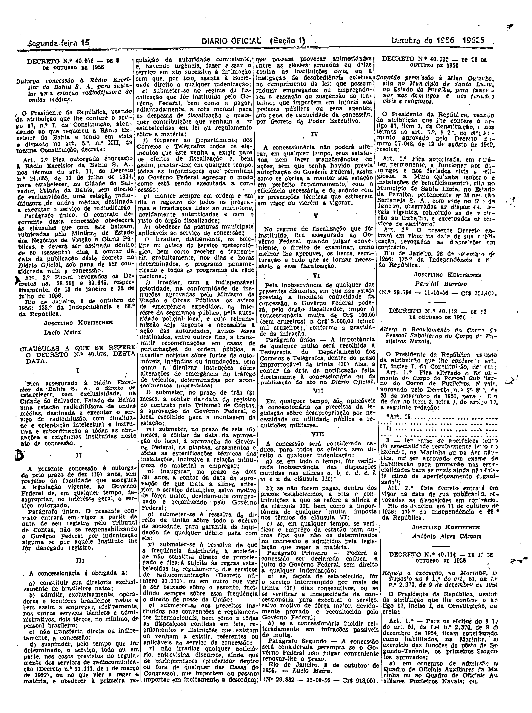

###DEC-040076-0-000-08-10-1956@@@

<strong>DECRETO Nº 40.076, DE 8 DE OUTUBRO DE 1956.</strong>

<em><strong>Outorgada concessão à Rádio Excelsior da Bahia S.A. para instalar uma estação radiodifusora de ondas médias.</strong></em>

<strong>O PRESIDENTE DA REPÚBLICA</strong>, usando da atribuição que lhe confere o artigo 87, nº l, da Constituição atendendo ao que requereu a Rádio Excelsior da Bahia e tendo em vista mesma Constituição,

<strong>DECRETA:</strong>

<strong>Art</strong>. 1º Fica outorgada concessão à Rádio <em>Excelsior</em> da Bahia S.A. nos têrmos do art. 11, do Decreto nº 24.655, de 11 de julho de 1934, para estabelecer, na cidade do Salvador, Estado da Bahia, sem direito de exclusividade, uma estação radiodifusora de ondas médias, destinadas a executar o serviço de radiodifusão.

Parágrafo único. O contrato decorrente desta concessão obedecerá às cláusulas que com êste baixam, rubricadas pelo Ministro de Estado dos Negócios da Viação e Obras Públicas, e deverá ser assinado dentro de 60 (sessenta) dias, a contar da data da publicação dêste decreto no <em>Diário Oficial</em>, sob pena de ser considerada nula a concessão.

<strong>Art</strong>. 2º Ficam revogados os Decretos ns. 38.560 e 30.645, respectivamente, de 13 de janeiro e 25 de julho de 1956.

Rio de Janeiro, 8 de outubro de 1956; 135º da Independência e 68º da República.

<strong>JUSCELINO KUBITSCHEK</strong>

Lúcio Meira

<!-- fac-simile-oficial:inicio -->

## Fac-símile oficial: cláusulas

O texto acima não inclui as cláusulas a que se refere este decreto. A publicação oficial do anexo está em imagem, nas páginas do _Diário Oficial da União_ (Seção I) de 15 de outubro de 1956: página 9 do PDF (a partir de «CLÁUSULAS A QUE SE REFERE O DECRETO N.º 40.076, DESTA DATA», até «N.º 29.882 — 11-10-56 — Cr$ 918,00»).

As imagens são as páginas inteiras, tal como digitalizadas pela Imprensa Nacional, sem recorte, sem redesenho e sem transcrição. Cada página traz também outros atos do mesmo dia; a peça deste decreto está apenas no trecho indicado, e o texto do anexo só existe na imagem. Não há OCR validado.

Fonte: Imprensa Nacional, Biblioteca Machado de Assis, arquivo `DO_1_19561015_238.PDF` (SHA-256 `c6607f1ea2e8173db32996c6cffb68a559b1eb51c3b0f3ee016ae094292295da`), páginas 9 do PDF. SHA-256 das imagens, na ordem: `47c8debc358d261a9f5ddb2f2d7f5f804f8336a41f68b8488ceccf8d67d0f52d`.

<!-- fac-simile-oficial:fim -->
