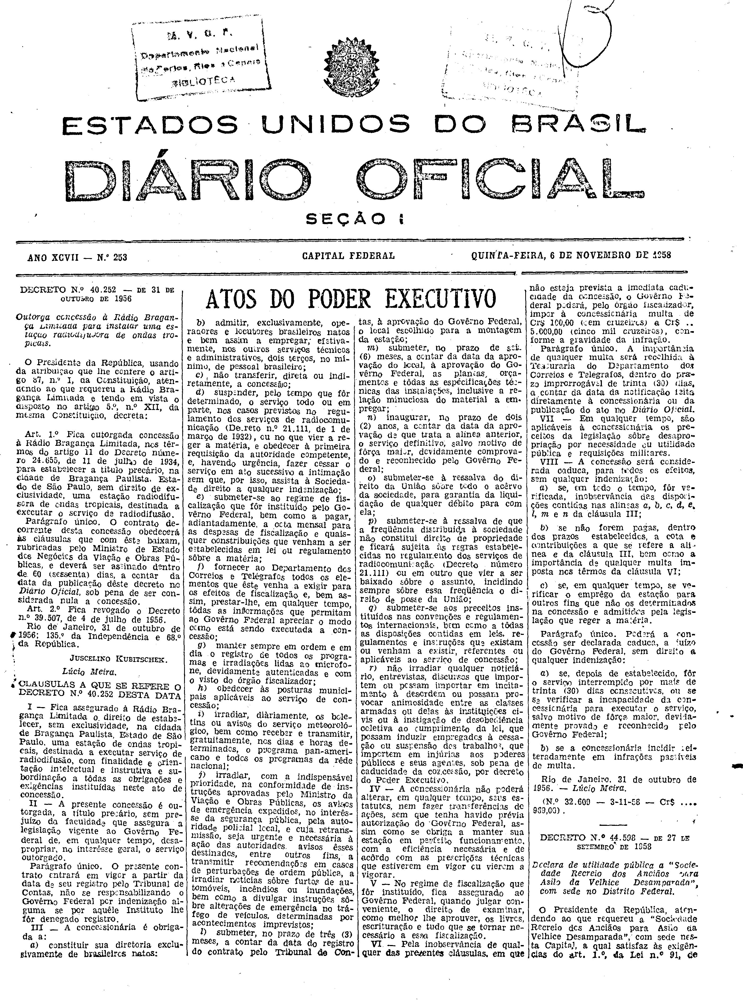

###DEC-040252-0-000-31-10-1956@@@

<strong>DECRETO Nº 40.252, DE 31 DE OUTUBRO DE 1956.</strong>

<!-- fac-simile-oficial:inicio -->

## Fac-símile oficial: decreto e cláusulas

O decreto e as cláusulas são reproduzidos integralmente nas páginas abaixo da edição indicada do Diário Oficial da União. A primeira publicação não foi verificada. As páginas inteiras também contêm matérias vizinhas, que não são atribuídas a este ato. Não há transcrição por OCR.

SHA-256 da imagem: `db6d3f9cd054be27cb0334ec16e84cc7454a5379e71ee6fd34b248e0f1f21d80`.

Fonte: [DO_1_19581106_253.PDF](https://biblioteca.in.gov.br/documents/271518/581421/DO_1_19581106_253.PDF/3e42128f-7d9c-4e83-3d79-123d174d6cca?t=1574964198857&download=true), edição 1958-11-06; SHA-256 do PDF: `08c316c21e0235f674f29ccb8bced28bc8e741633af83d038a9df8210640958c`.

<!-- fac-simile-oficial:fim -->
