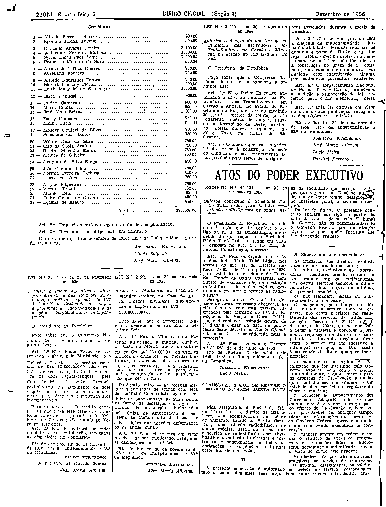
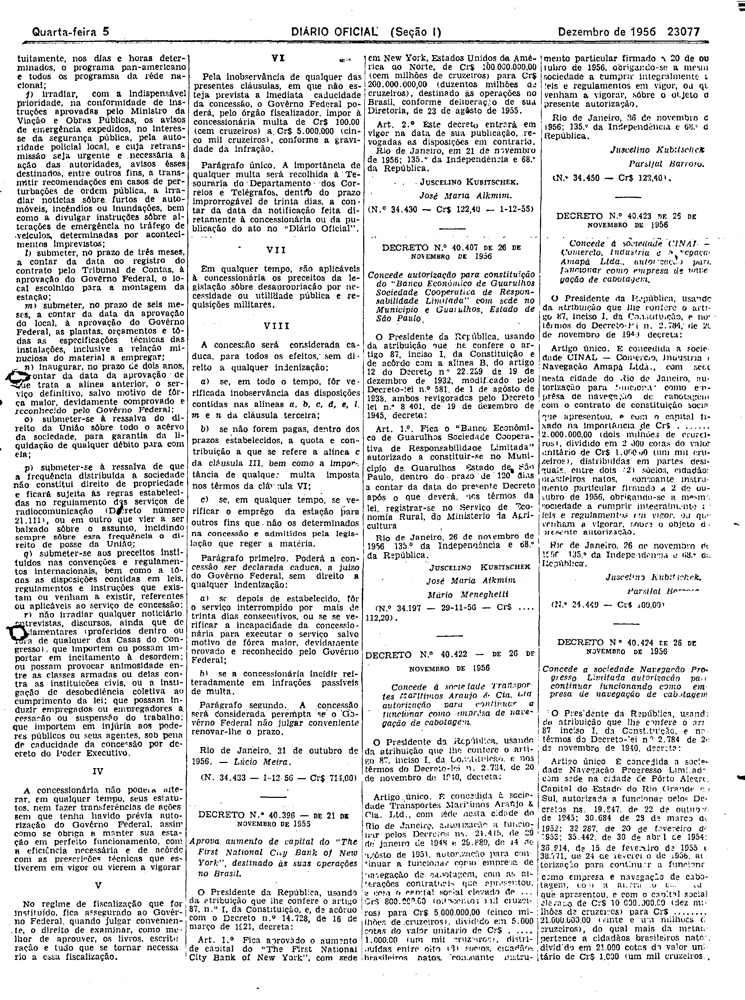

###DEC-040254-0-000-31-10-1956@@@

<strong>DECRETO Nº 40.254, DE 31 DE OUTUBRO DE 1956.</strong>

<em><strong>Outorga concessão à Sociedade Rádio Tubá Ltda., para instalar uma estação radiodifusora de ondas médias.</strong></em>

<strong>O PRESIDENTE DA REPÚBLICA</strong>, usando da atribuição que lhe confere o artigo 87, nº I, da Constituição, atendendo ao que requereu a Sociedade Rádio Tubá Ltda., e tendo em vista o disposto no art. 5º, nº XII, da mesma Constituição,

<strong>DECRETA:</strong>

<strong>Art</strong>. 1º Fica outorgada concessão à sociedade Rádio Tubá Ltda., nos têrmos do art. 11, do Decreto número 24.655, de 11 de julho de 1934, para estabelecer na cidade de Tubarão, Estado de Santa Catarina, sem direito de exclusividade, uma estação radiodifusora de ondas médias, destinada a executar o serviço de radiodifusão.

Parágrafo único. O contrato decorrente desta concessão obedecerá às cláusulas que com êste baixam, rubricadas pelo Ministro de Estado dos Negócios da Viação e Obras Públicas, e deverá ser assinado dentro de 60 dias, a contar da data da publicação dêste decreto no <em>Diário Oficial</em>, sob pena de ser considerada nula a concessão.

<strong>Art</strong>. 2º Fica revogado o Decreto nº 39.508, de 4 de julho de 1956.

Rio de Janeiro, de 31 de outubro de 1956; 135º da Independência e 68º da República.

<strong>JUSCELINO KUBITSCHEK</strong>

Lúcio Meira

<!-- fac-simile-oficial:inicio -->

## Fac-símile oficial: cláusulas

O texto acima não inclui as cláusulas a que se refere este decreto. A publicação oficial do anexo está em imagem, nas páginas do _Diário Oficial da União_ (Seção I) de 5 de dezembro de 1956: página 4 do PDF (a partir de «CLÁUSULAS A QUE SE REFERE O DECRETO N.º 40.254, DESTA DATA»); página 5 do PDF (até «N. 34.433 — 1-12-56 — Cr$ 714,00»).

As imagens são as páginas inteiras, tal como digitalizadas pela Imprensa Nacional, sem recorte, sem redesenho e sem transcrição. Cada página traz também outros atos do mesmo dia; a peça deste decreto está apenas no trecho indicado, e o texto do anexo só existe na imagem. Não há OCR validado.

Fonte: Imprensa Nacional, Biblioteca Machado de Assis, arquivo `DO_1_19561205_279.PDF` (SHA-256 `17c4f48a2022e2d5bd60f369b01f3c4bfd58b7c1275d1b2ed0da4f3d52b3728d`), páginas 4, 5 do PDF. SHA-256 das imagens, na ordem: `c0b8f9f74163ac3ab3787992ff4f6dd44fbbefbeb9ac1f2cacee8df5d6e8897a`, `7d1dd54ea87e64b283563455264ad4da30f2998b7f37a368eaeacb066ea727d5`.

<!-- fac-simile-oficial:fim -->
