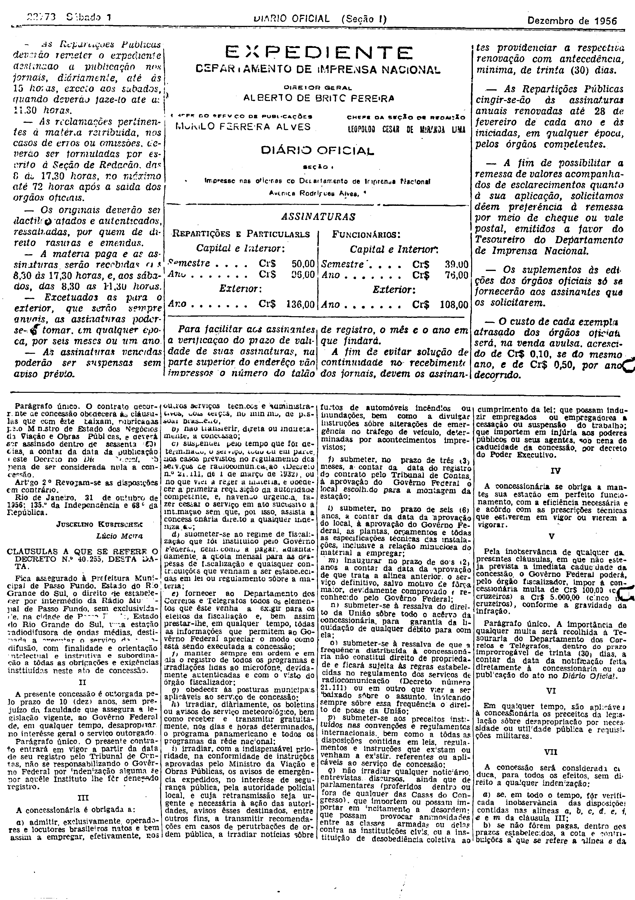

###DEC-040255-0-000-31-10-1956@@@

<strong>DECRETO Nº 40.255, DE 31 DE OUTUBRO DE 1956.</strong>

<em><strong>Outorga concessão à Prefeitura Municipal de Passo Fundo, para instalar uma estação radiodifusora de ondas médias.</strong></em>

<strong>O PRESIDENTE DA REPÚBLICA</strong>, usando da atribuição que lhe confere o artigo 87, nº I, da Constituição, atendendo ao que requereu a Prefeitura Municipal de Passo Fundo, e tendo em vista o disposto no artigo 5º nº XII, da mesma Constituição,

<strong>DECRETA:</strong>

<strong>Art</strong>. 1º Fica outorgada concessão à Prefeitura Municipal de Passo Fundo, nos têrmos do artigo 11, do Decreto número 24.655, de 11 de julho de 1934, para estabelecer, por intermédio da Rádio Municipal de Passo Fundo, na cidade de Passo Fundo, Estado do Rio Grande do Sul, sem direito de exclusividade, uma estação de radiodifusora de ondas médias, destinada a executar o serviço de radiodifusão.

Parágrafo único. O contrato decorrente de concessão obedecerá às cláusulas que com êste baixam, rubricadas pelo Ministro de Estado dos Negócios da Viação e Obras Públicas, e deverá ser assinado dentro de sessenta (60) dias, a contar da data da publicação dêste Decreto no <em>Diário</em> <em>Oficial</em>, sob pena de ser considerada nula a concessão.

<strong>Art</strong>. 2º Revogam-se as disposições em contrário.

Rio de Janeiro, 31 de outubro de 1956; 135º da Independência e 68º da República.

<strong>JUSCELINO KUBITSCHEK</strong>

Lúcio Meira

<!-- fac-simile-oficial:inicio -->

## Fac-símile oficial: cláusulas

O texto acima não inclui as cláusulas a que se refere este decreto. A publicação oficial do anexo está em imagem, nas páginas do _Diário Oficial da União_ (Seção I) de 1 de dezembro de 1956: página 2 do PDF (a partir de «CLÁUSULAS A QUE SE REFERE O DECRETO N.º 40.255, DESTA DATA»); página 3 do PDF (até «N. 34.190 — 28-11-56 — Cr$ 714,00»).

As imagens são as páginas inteiras, tal como digitalizadas pela Imprensa Nacional, sem recorte, sem redesenho e sem transcrição. Cada página traz também outros atos do mesmo dia; a peça deste decreto está apenas no trecho indicado, e o texto do anexo só existe na imagem. Não há OCR validado.

Fonte: Imprensa Nacional, Biblioteca Machado de Assis, arquivo `DO_1_19561201_276.PDF` (SHA-256 `e842f5bc06b1b4bce345a36889d3f347bcc692349f8820920b8ec746d41eac9b`), páginas 2, 3 do PDF. SHA-256 das imagens, na ordem: `3b51fb627f8a58b32aec99da376db903a074914f7f0f898c9efa9eb42cb2249a`, `98f4a7d4b80cf1dc9c915cb4a7ee6a1332096170d3e1c972874d8ff481bf4ca2`.

<!-- fac-simile-oficial:fim -->
