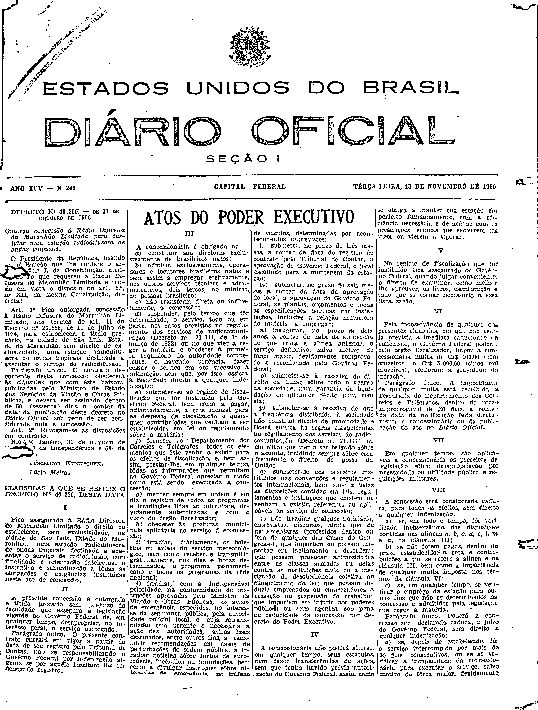
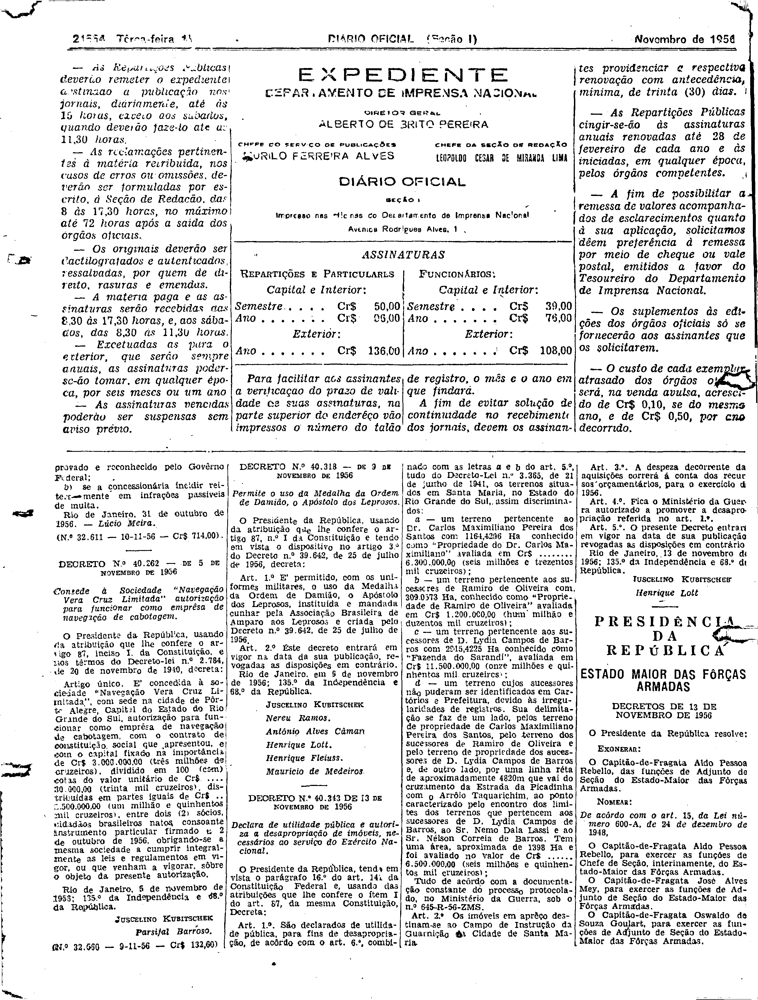

###DEC-040256-0-000-31-10-1956@@@

<strong>DECRETO Nº 40.256, DE 31 DE OUTUBRO DE 1956</strong>

<em><strong>Outorga concessão à Rádio Difusora do Maranhão Limitada para instalar uma estação radiodifusora de onda tropicais.</strong></em>

<strong>O PRESIDENTE DA REPÚBLICA</strong>, usando da atribuição que lhe confere o artigo 87, nº I, da Constituição, atendendo ao que requereu a Rádio Difusora do Maranhão Limitada e tendo em vista o disposto no art. 5.º n.º XII, da mesma Constituição,

<strong>DECRETA:</strong>

<strong>Art</strong>. 1.º Fica outorgada concessão à Rádio Difusora do Maranhão Limitada, nos têrmos do art.11 do Decreto nº 24.655, de 11 de julho de 1934, para estabelecer, a título precário, na cidade de São Luiz, Estado do Maranhão, sem direito de exclusividade, uma estação radiodifusora de ondas tropicais, destinada a  executar o serviço de radiodifusão.

Parágrafo único. O contrato decorrente desta concessão obedecerá às cláusulas que com êste baixam, rubricadas pelo Ministro de Estado dos Negócios da Viação e Obras Pública, e deverá ser assinado dentro de 60 (sessenta) dias, a contar da data da publicação dêste decreto no <em>Diário Oficial</em>, sob pena de ser considerada nula a concessão.

<strong>Art</strong>. 2º Revogam-se as disposições em contrário.

Rio de Janeiro, 31 de outubro de 1956; 135.º da Independência e 68.º da República.

<strong>JUCELINO KUBITSCHEK</strong>

Lúcio Meira

<!-- fac-simile-oficial:inicio -->

## Fac-símile oficial: cláusulas

O texto acima não inclui as cláusulas a que se refere este decreto. A publicação oficial do anexo está em imagem, nas páginas do _Diário Oficial da União_ (Seção I) de 13 de novembro de 1956: página 1 do PDF (capa do caderno) (a partir de «CLÁUSULAS A QUE SE REFERE O DECRETO N.º 40.256, DESTA DATA»); página 2 do PDF (até «N.º 32.611 — 10-11-56 — Cr$ 714,00»).

As imagens são as páginas inteiras, tal como digitalizadas pela Imprensa Nacional, sem recorte, sem redesenho e sem transcrição. Cada página traz também outros atos do mesmo dia; a peça deste decreto está apenas no trecho indicado, e o texto do anexo só existe na imagem. Não há OCR validado.

Fonte: Imprensa Nacional, Biblioteca Machado de Assis, arquivo `DO_1_19561113_261.PDF` (SHA-256 `7b0dbb911aa220da0ec57328a47405dbab4cfdd9697de674b70efeb15ecb10d4`), páginas 1, 2 do PDF. SHA-256 das imagens, na ordem: `880209fdf3e9def0009019b5b129044aa050169e4cefb890201ca894fd808d7c`, `0a540831dbe2c4cb8fe20e6d92feb135df6e2b6d35f415bcbe15d8b16c835406`.

<!-- fac-simile-oficial:fim -->
