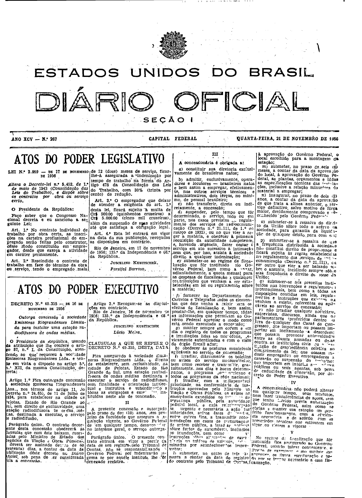
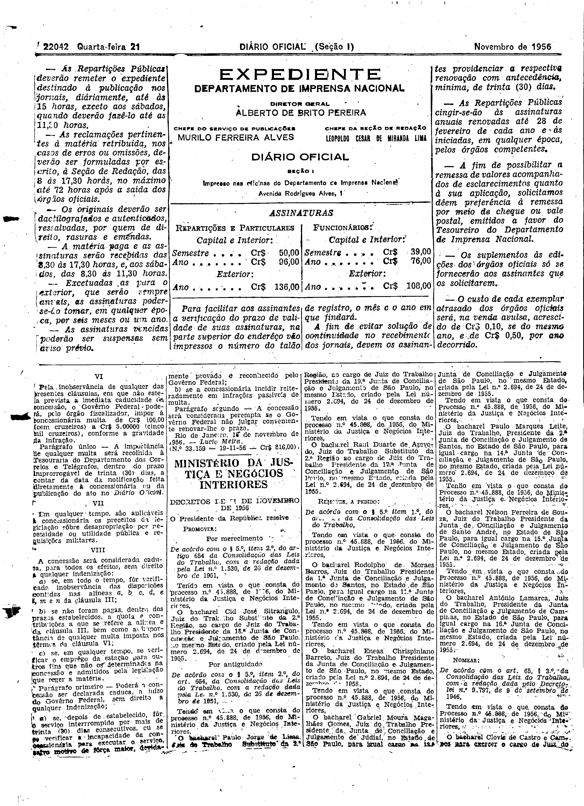

###DEC-040355-0-000-16-11-1956@@@

<strong>DECRETO Nº 40.355, DE 16 DE NOVEMBRO DE 1956.</strong>

<em><strong>Outorga concessão à sociedade Emissoras Riograndenses Limitada para instalar uma estação radiodifusora de ondas médias.</strong></em>

<strong>O PRESIDENTE DA REPÚBLICA</strong>, usando da atribuição que lhe confere o art. 87, nº I, da Constituição, atendendo ao que requereu à sociedade Emissoras Riograndenses Ltda. e tendo em vista o disposto no artigo 5º nº XII, da mesma Constituição,

<strong>DECRETA:</strong>

<strong>Art</strong>. 1º Fica outorgada concessão à sociedade Emissoras Riograndenses Ltda., nos têrmos do artigo 11, do Decreto nº 24.655, de 11 de julho de 1934, para estabelecer na cidade de Pelotas, Estado do Rio Grande do Sul, em direito de exclusividade, uma estação radiodifusora de ondas médias destinadas a executar o serviço de radiodifusão.

Parágrafo único. O contrato decorrente desta concessão obedecerá às clausulas que com êste baixam rubricadas pelo Ministro de Estado dos Negócios da Viação e Obras Públicas, e deverá ser assinado dentro de 60 (sessenta) dias, a contar da data da publicação dêste decreto no <em>Diário Oficial</em>, sob pena de ser considerada nula a concessão.

<strong>Art</strong>. 2º Revogam-se as disposições em contrário.

Rio de Janeiro, em 16 de novembro de 1956; 135º da Independência e 68º da República.

<strong>JUSCELINO KUBITSCHEK</strong>

Lúcio Meira

<!-- fac-simile-oficial:inicio -->

## Fac-símile oficial: cláusulas

O texto acima não inclui as cláusulas a que se refere este decreto. A publicação oficial do anexo está em imagem, nas páginas do _Diário Oficial da União_ (Seção I) de 21 de novembro de 1956: página 1 do PDF (capa do caderno) (a partir de «CLÁUSULAS A QUE SE REFERE O DECRETO N.º 40.355, DESTA DATA»); página 2 do PDF (até «N.º 33.159 — 19-11-56 — Cr$ 816,00»).

As imagens são as páginas inteiras, tal como digitalizadas pela Imprensa Nacional, sem recorte, sem redesenho e sem transcrição. Cada página traz também outros atos do mesmo dia; a peça deste decreto está apenas no trecho indicado, e o texto do anexo só existe na imagem. Não há OCR validado.

Fonte: Imprensa Nacional, Biblioteca Machado de Assis, arquivo `DO_1_19561121_267.PDF` (SHA-256 `759c3ee8be9c8fa23f6dce179eea4ee92af053b64af9a838b10d132dd24d28af`), páginas 1, 2 do PDF. SHA-256 das imagens, na ordem: `66f171f70925773e2c6131b8bbcf57f6c2930c7fae925fb86d4d2beb4a7056ba`, `a10ed580ce907bc8726322ee1637ace139bf07aecc2e7c2ba66501ffd67f3fb2`.

<!-- fac-simile-oficial:fim -->
