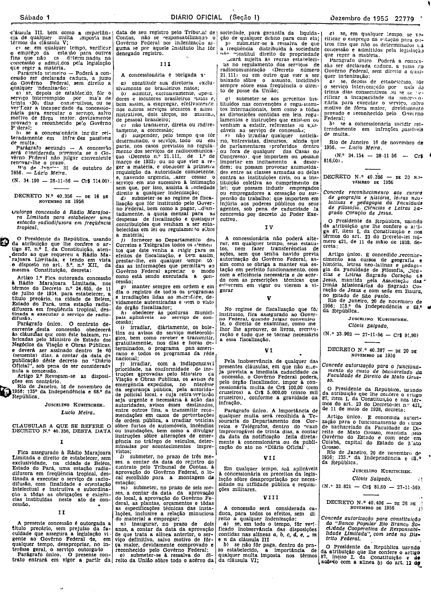

###DEC-040356-0-000-16-11-1956@@@

<strong>DECRETO Nº 40.356, DE 16 DE NOVEMBRO DE 1956.</strong>

<em><strong>Outorga concessão à Rádio Marajoara Limitada para estabelecer uma estação radiodifusora em freqüência tropical.</strong></em>

<strong>O PRESIDENTE DA REPÚBLICA</strong>, usando da atribuição que lhe confere o art. 87, item I, da Constituição, atendendo ao que requereu à Rádio Marajoara Limitada,. e tendo em vista o disposto no artigo 5º n.º XII, da mesma Constituição,

<strong>DECRETA:</strong>

<strong>Art</strong>. 1º Fica outorgada concessão à Rádio Marajoara Limitada, nos têrmos do art. 11, do Decreto 24.655, de 11 de julho de 1934, para estabelecer na cidade de Belém, Estado do Pará, uma estação radiodifusora em freqüência tropical, destinada a executar o serviço de radiodifusão.

Parágrafo único. O contrato decorrente desta concessão obedecerá às clausulas que com êste baixam rubricadas pelo Ministro de Estado dos Negócios da Viação e Obras Públicas, e deverá ser assinado dentro de 60 (sessenta) dias, a contar da data da publicação dêste decreto no <em>“Diário Oficial</em>”, sob pena de ser considerada nula a concessão.

<strong>Art</strong>. 2º Revogam-se as disposições em contrário.

Rio de Janeiro, em 16 de novembro de 1956; 135º da Independência e 68º da República.

<strong>JUSCELINO KUBITSCHEK</strong>

Lúcio Meira

<!-- fac-simile-oficial:inicio -->

## Fac-símile oficial: cláusulas

O texto acima não inclui as cláusulas a que se refere este decreto. A publicação oficial do anexo está em imagem, nas páginas do _Diário Oficial da União_ (Seção I) de 1 de dezembro de 1956: página 3 do PDF (a partir de «CLÁUSULAS A QUE SE REFERE O DECRETO N.º 40.356, DESTA DATA», até «N. 34.154 — 28-11-56 — Cr$ 816,00»).

As imagens são as páginas inteiras, tal como digitalizadas pela Imprensa Nacional, sem recorte, sem redesenho e sem transcrição. Cada página traz também outros atos do mesmo dia; a peça deste decreto está apenas no trecho indicado, e o texto do anexo só existe na imagem. Não há OCR validado.

Fonte: Imprensa Nacional, Biblioteca Machado de Assis, arquivo `DO_1_19561201_276.PDF` (SHA-256 `e842f5bc06b1b4bce345a36889d3f347bcc692349f8820920b8ec746d41eac9b`), páginas 3 do PDF. SHA-256 das imagens, na ordem: `98f4a7d4b80cf1dc9c915cb4a7ee6a1332096170d3e1c972874d8ff481bf4ca2`.

<!-- fac-simile-oficial:fim -->
