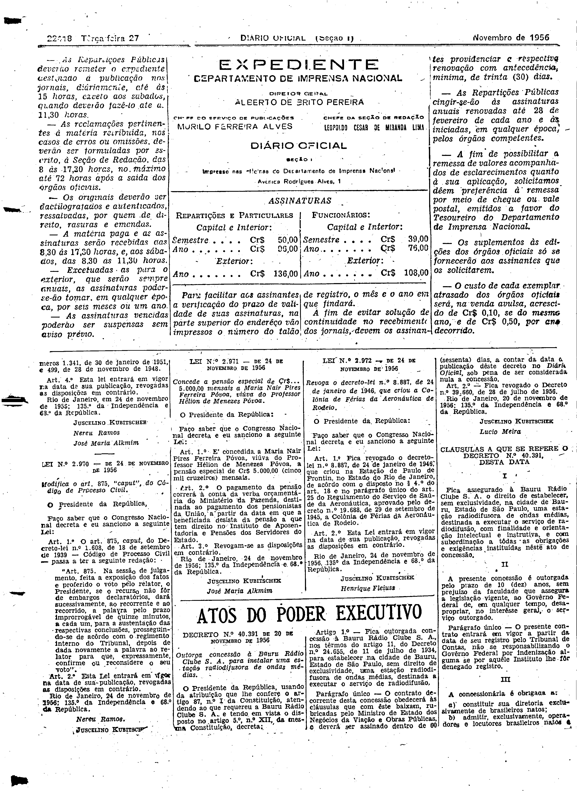
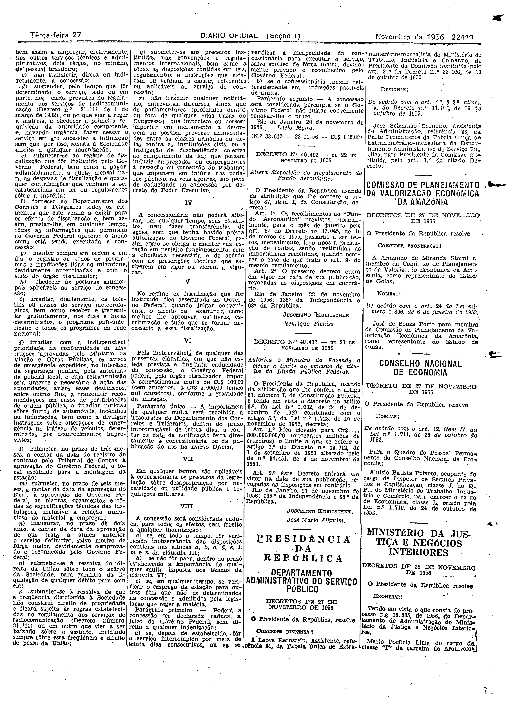

###DEC-040391-0-000-20-11-1956@@@

<strong>DECRETO Nº 40.391, DE 20 DE NOVEMBRO DE 1956.</strong>

<em><strong>Outorga concessão à Bauru Rádio Clube S. A. para instalar uma estação radiodifusora de ondas médias.</strong></em>

<strong>O PRESIDENTE DA REPÚBLICA</strong>, usando da atribuição que lhe confere o artigo 87, nº l da Constituição, atendendo ao que requereu a Bauru Rádio Clube S. A. e tendo em vista o disposto no artigo 5º nº Xll, da mesma Constituição,

<strong>DECRETA:</strong>

<strong>Art</strong>. 1º - Fica outorgada concessão à Bauru Rádio Clube S. A., nos têrmos do artigo 11, do Decreto nº 24.655, de 11 de julho de 1934, para estabelecer na cidade Bauru, Estado de São Paulo, sem direito de exclusividade, uma estação Rádiodifusora de ondas médias, destinada a executar o serviço de radiodifusão.

Parágrafo único. O contrato decorrente desta concessão obedecerá às cláusulas que com êste baixam, rubricadas pelo Ministro de Estado do Negócios da Viação e Obras Públicas, e deverá ser assinado dentro de 60 (sessenta) dias, a contar da data da publicação dêste Decreto no <em>Diário</em> <em>Oficial</em>, sob pena de ser considerada nula a concessão.

<strong>Art</strong>. 2º - Fica revogada o Decreto nº 39.660, de 28 de julho de 1956.

Rio de Janeiro, 20 de novembro de 1956; 135º da Independência e 68º da República.

<strong>JUSCELINO KUBITSCHEK</strong>

Lúcio Meira

<!-- fac-simile-oficial:inicio -->

## Fac-símile oficial: cláusulas

O texto acima não inclui as cláusulas a que se refere este decreto. A publicação oficial do anexo está em imagem, nas páginas do _Diário Oficial da União_ (Seção I) de 27 de novembro de 1956: página 2 do PDF (a partir de «CLÁUSULAS A QUE SE REFERE O DECRETO N.º 40.391, DESTA DATA»); página 3 do PDF (até «N.º 33.615 — 23-11-56 — Cr$ 816,00»).

As imagens são as páginas inteiras, tal como digitalizadas pela Imprensa Nacional, sem recorte, sem redesenho e sem transcrição. Cada página traz também outros atos do mesmo dia; a peça deste decreto está apenas no trecho indicado, e o texto do anexo só existe na imagem. Não há OCR validado.

Fonte: Imprensa Nacional, Biblioteca Machado de Assis, arquivo `DO_1_19561127_272.PDF` (SHA-256 `a9f092ff30a5a9886bf230f723bc7aa40df9d0580bdd98d53bfa000b63c4c982`), páginas 2, 3 do PDF. SHA-256 das imagens, na ordem: `35f0e6ace1aebb6dc7bd0552cdf39df06ece783e87966bea0095ad5690efc236`, `be116541ef086bb71826a30a2981af9f1d1efc6f44492dc7a5e584b65e2e68e6`.

<!-- fac-simile-oficial:fim -->
