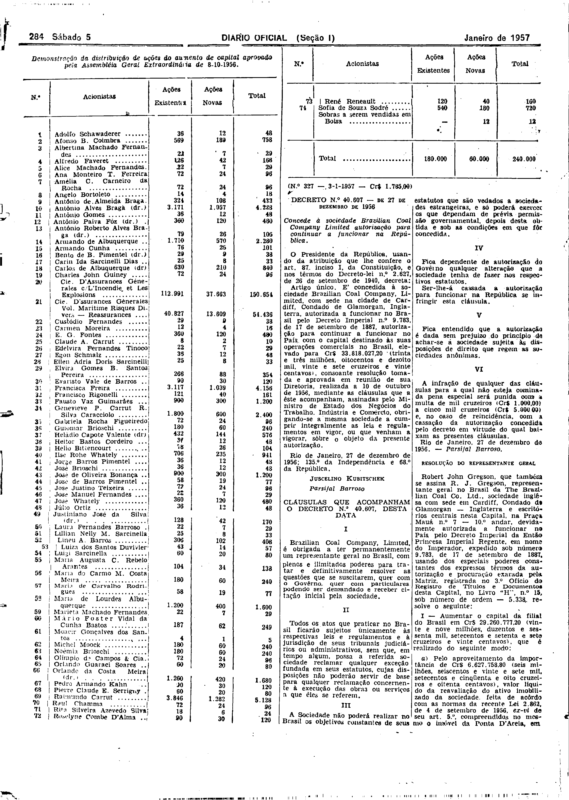

###DEC-040607-0-000-27-12-1956@@@

<strong>DECRETO Nº 40.607, DE 27 DE DEZEMBRO DE 1956.</strong>

<em><strong>Concede à sociedade Brazilian Coal Company Limited autorização para continuar a funcionar na República.</strong></em>

<strong>O PRESIDENTE DA REPÚBLICA</strong>, usando da atribuição que lhe confere o art. 87, inciso I, da Constituição, e nos têrmos do Decreto-lei nº 2.627, de 26 de setembro de 1940,

<strong>DECRETA:</strong>

Artigo único. É concedida à sociedade Brazilian Coal Company, Limited, com sede na cidade de Cardiff, Condado de Glamorgan, Inglaterra, autorizada a funcionar no Brasil pelo Decreto Imperial nº 9.783, de 17 de setembro de 1887, autorização para continuar a funcionar no País com o capital destinado às suas operações comerciais no Brasil, elevado para Cr$33.818.027,20 (trinta e três milhões, oitocentos e dezoito mil, vinte e sete cruzeiros e vinte centavos), consoante resolução tomada e aprovada em reunião de sua Diretoria, realizada a 10 de outubro de 1956, mediante as cláusulas que a êste acompanham, assinadas pelo Ministro de Estado dos Negócios do Trabalho Indústria e Comércio, obrigando-se a mesma sociedade a cumprir integralmente as leis e regulamentos em vigor, sôbre o objeto da presente autorização.

Rio de Janeiro, 27 de dezembro de 1956; 135º da Independência e 68º da República.

<strong>JUSCELINO KUBITSCHEK</strong>

Parsifal Barroso

<!-- fac-simile-oficial:inicio -->

## Fac-símile oficial: clausulas

A peça vinculada ao Decreto nº 40.607 é reproduzida nas imagens abaixo, a partir da publicação oficial da Imprensa Nacional. A reprodução é em fac-símile, sem transcrição por OCR nem reconstrução do conteúdo.

As imagens mostram páginas inteiras do Diário Oficial da União e podem conter outras matérias. Essas matérias vizinhas não são atribuídas a este decreto. A peça é identificada pelo seu título e pela referência ao ato nas páginas indicadas.

SHA-256 desta imagem: `e71456a9e27e8230666f2fdf8d5bc95bc3d5db75de6c690950c6db3e49a56ab3`.

Fontes oficiais da publicação:

- [DO_1_19570105_004.PDF](https://biblioteca.in.gov.br/documents/271518/581394/DO_1_19570105_004.PDF/5ca76aaf-da15-cc4d-d00d-fefa7ffa52ab?t=1574964718157&download=true) — SHA-256 do PDF: `e2fb27ec7cb4240470b78bc52094ff17fac1431b0507f502462654a2ec20e7a7`.

<!-- fac-simile-oficial:fim -->
