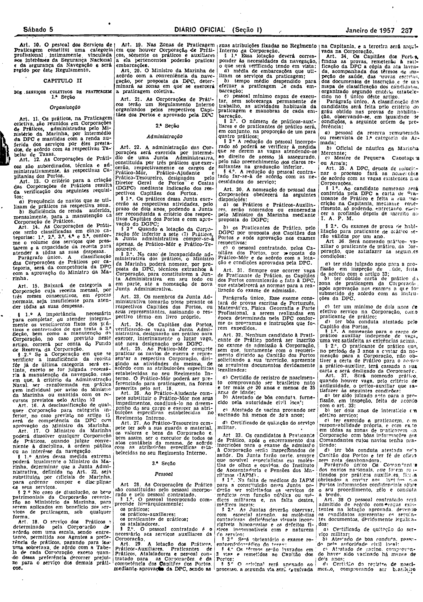
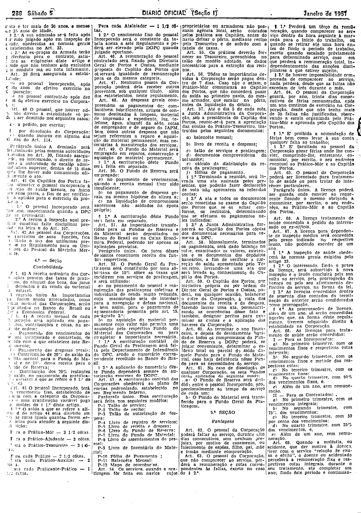
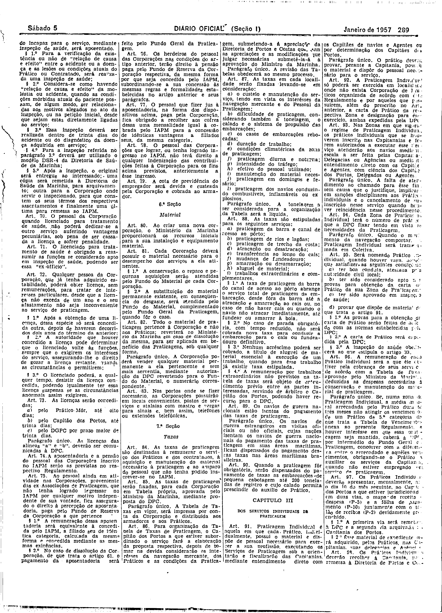
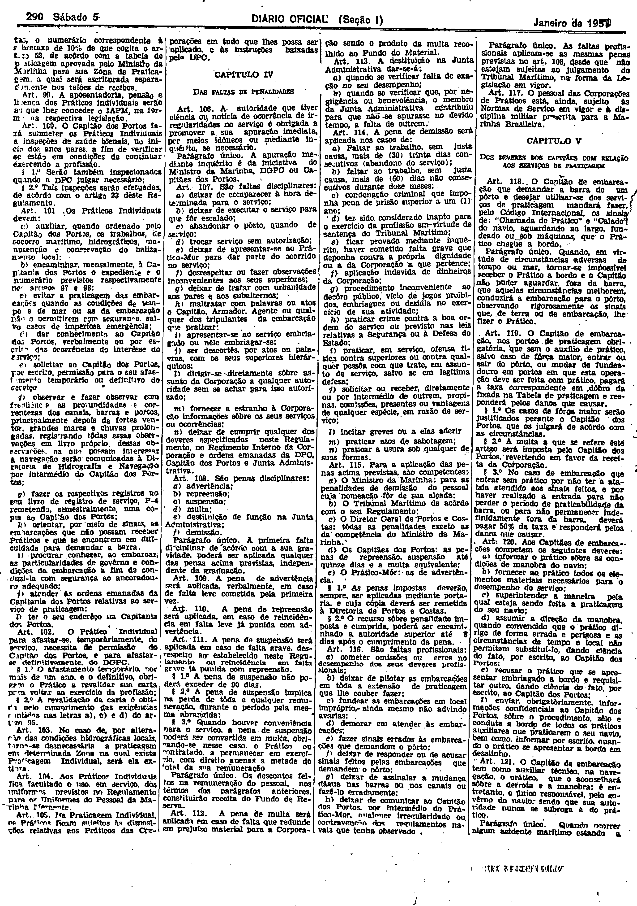
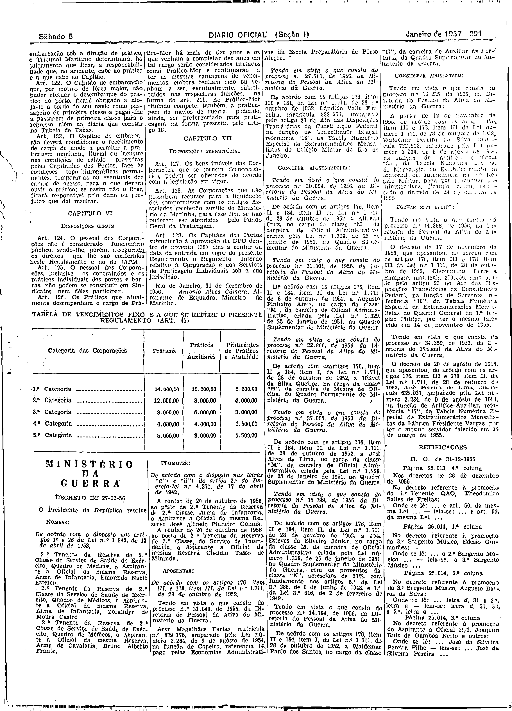

###DEC-040704-0-000-31-12-1956@@@

<strong>DECRETO Nº 40.704, DE 31 DE DEZEMBRO DE 1956.</strong>

<!-- fac-simile-oficial:inicio -->

## Fac-símile oficial do ato inteiro: Regulamento Geral dos Serviços de Praticagem (instrumento)

Esta norma é reproduzida apenas em imagem. As páginas inteiras do _Diário Oficial da União_ (Seção I) de 5 de janeiro de 1957 trazem o decreto e o instrumento que o acompanha: PDF `DO_1_19570105_004.PDF`, p.6 do PDF (impressa 286), p.7 do PDF (impressa 287), p.8 do PDF (impressa 288), p.9 do PDF (impressa 289), p.10 do PDF (impressa 290), p.11 do PDF (impressa 291).

O texto do Senado que antes constava aqui foi retirado para manter uma só versão do ato: não foi colacionado palavra a palavra com o impresso.

**Divergências constatadas entre o texto do Senado e o impresso:** A ementa do Senado vinha partida («Serviç|os»); o impresso traz «Aprovo o Regulamento Geral dos Serviços de Praticagem».

**Limites lidos nas imagens:** p.286 (PDF 6): decreto na col.3 base (JUSCELINO KUBITSCHEK / Antônio Alves Câmara) e início do Regulamento (Cap. I, Arts. 1º–9º) na col.3 base–col.4; cols.1–2 e col.3 topo são o Decreto 40.642 (rádio) — fora da peça. p.287–290 (PDF 7–10): Regulamento contínuo, 4 colunas por página (Arts. 10–121). p.291 (PDF 11): cols.1–2 Arts. 122–129 (Cap. VI e VII), «Rio de Janeiro, 31 de dezembro de 1956. — Antônio Alves Câmara, Almirante de Esquadra, Ministro da Marinha.» e «TABELA DE VENCIMENTOS FIXOS A QUE SE REFERE O PRESENTE REGULAMENTO (ART. 45)»; encerra antes de «MINISTÉRIO DA GUERRA / Decreto de 27-12-56». Colunas 3–4 da p.291 são outros atos.

**Assinatura(s):** Antônio Alves Câmara, Ministro da Marinha

As imagens são as páginas inteiras, extraídas do PDF com `pdfimages -png` (imagem JBIG2 embutida, uma por página, sem reduzir), sem recorte, sem redesenho e sem transcrição. Cada página traz também outros atos do mesmo dia; a peça está apenas no trecho indicado. O texto do ato só existe na imagem. Não há OCR validado.

Fonte: Imprensa Nacional, Biblioteca Machado de Assis, `DO_1_19570105_004.PDF` (SHA-256 `e2fb27ec7cb4240470b78bc52094ff17fac1431b0507f502462654a2ec20e7a7`). SHA-256 das imagens, na ordem: `81b5887d52425690470dcd327d18333da62833dc54e86b861330ba3e9617bfd5`, `485f32cf80602f796551e3cd6f52ab12d04f8c48de84c433858a4abc9f2ab2c5`, `41aa24aca2c6a2e4576f0236fbf4ab3132235abaeaa4c65bf804d2d44f1233e0`, `49d22cb13526d88bb062bdedcd7a3a3256c462ef6ef366067c511bb8dd9a849c`, `67d04390156a499b83b277f5f8f67c1c68332ae98dd242da2ea5797cf55e05da`, `1bfadd90911cdb7c5a5dae8367e1326b6857b70be6777a3b9c26882cab222721`.

[PDF da edição oficial](https://biblioteca.in.gov.br/documents/271518/581394/DO_1_19570105_004.PDF/5ca76aaf-da15-cc4d-d00d-fefa7ffa52ab?t=1574964718157&download=true).

<!-- fac-simile-oficial:fim -->
