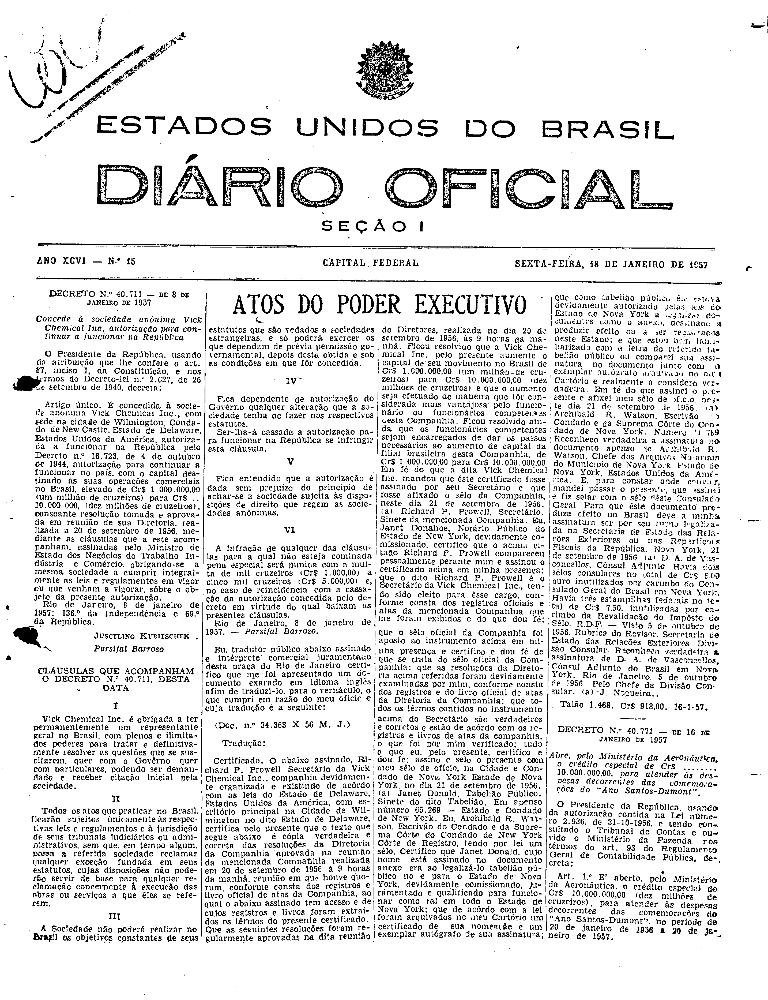

###DEC-040711-0-000-08-01-1957@@@

<strong>DECRETO N. 40.711 – DE 8 DE JANEIRO DE 1957</strong>

<em><strong>Concede à sociedade anônima Vick Chemical Inc. autorização para continuar a funcionar na República</strong></em>

O Presidente da República, usando da atribuição que lhe confere o art. 87, inciso I, da Constituição, e nos têrmos do Decreto-lei nº 2.627, de 26 de setembro de 1940,

<strong>DECRETA:</strong>

<strong>Artigo único.</strong> É concedida à sociedade anônima Vick Chemical Inc., com sede na cidade de Wilmington, Condado de New Castle, Estado de Delaware, Estados Unidos da América, autorizada a funcionar na República pelo Decreto nº 16.723, de 4 de outubro de 1944, autorização para continuar a funcionar no país, com o capital destinado às suas operações comerciais no Brasil, elevado de Cr$ 1.000.000,00 (um milhão de cruzeiros) para Cr$ .. 10.000.000, (dez milhões de cruzeiros), consoante resolução tomada e aprovada em reunião de sua Diretoria, realizada a 20 de setembro de 1956, mediante as cláusulas que a este acompanham, assinadas pelo Ministro de Estado dos Negócios do Trabalho, Indústria e Comércio, obrigando-se a mesma sociedade a cumprir integralmente as leis e regulamentos em vigor ou que venham a vigorar, sôbre o objeto da presente autorização.

Rio de Janeiro, 8 de janeiro de 1957; 136º da Independência e 69º da República.

<strong>JUSCELINO KUBITSCHEK.</strong>

Parsifal Barroso

<!-- fac-simile-oficial:inicio -->

## Fac-símile oficial: clausulas

A peça vinculada ao Decreto nº 40.711 é reproduzida nas imagens abaixo, a partir da publicação oficial da Imprensa Nacional. A reprodução é em fac-símile, sem transcrição por OCR nem reconstrução do conteúdo.

As imagens mostram páginas inteiras do Diário Oficial da União e podem conter outras matérias. Essas matérias vizinhas não são atribuídas a este decreto. A peça é identificada pelo seu título e pela referência ao ato nas páginas indicadas.

SHA-256 desta imagem: `610510ba0b6d4d877cf90f3820dba0fbec0731d19e1a410c9293ade7c13e3522`.

Fontes oficiais da publicação:

- [DO_1_19570118_015.PDF](https://biblioteca.in.gov.br/documents/271518/581394/DO_1_19570118_015.PDF/275ef1db-217c-0ca5-e7b1-9f624c9ee1ea?t=1574964804807&download=true) — SHA-256 do PDF: `496798e6a781ba1aa50d0e0bc4df1d84c51d4f31b6e62966d391a79193a0a443`.

<!-- fac-simile-oficial:fim -->
