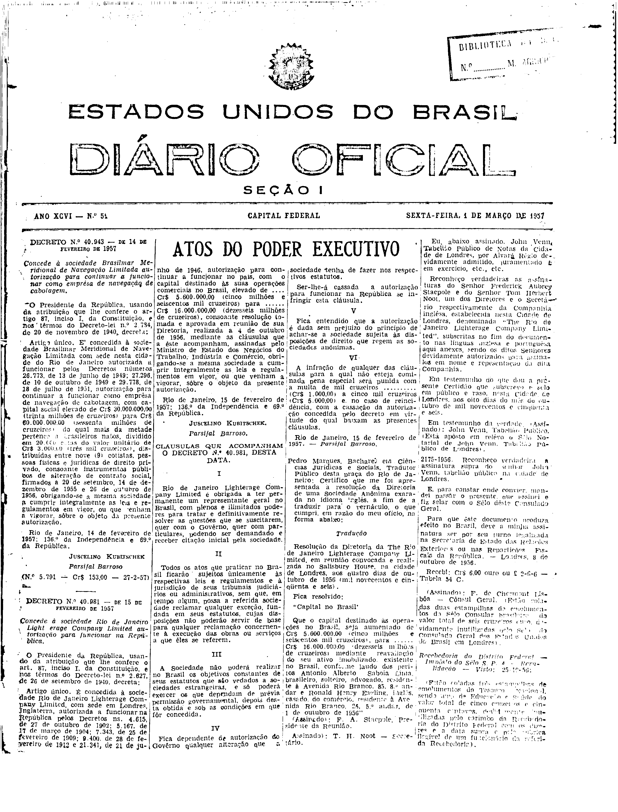

###DEC-040981-0-000-15-02-1957@@@

<strong>DECRETO Nº 40.981, DE 15 DE FEVEREIRO DE 1957.</strong>

<em><strong>Concede à sociedade Rio de Janeiro Light erage Company Limited autorização para funcionar na República.</strong></em>

<strong>O PRESIDENTE DA REPÚBLICA</strong>, usando da atribuição que lhe confere o art. 87, inciso I, da Constituição e nos têrmos do Decreto-lei nº 2.627, de 26 de setembro de 1940,

<strong>DECRETA:</strong>

Artigo único. É concedida à sociedade Rio de Janeiro <em>Light erage Company Limited</em>, com sede em Londres, Inglaterra, autoriza a funcionar na República pelos Decretos ns. 4.615, de 27 de outubro de 1902; 5.167, de 17 de Março de 1904; 7.343, de 25 de fevereiro de 1909; 9.400, de 28 de fevereiro de 1912 e 21.341, de 21 de Junho de 1946, autorização para continuar a funcionar no país, com o capital destinado às suas operações comerciais no Brasil, elevado de Cr$5.600,00 (cinco milhões e seiscentos mil cruzeiros) para Cr$16.000.000,00 (dezesseis milhões de cruzeiros), consoante resolução tomada e aprovada em reunião de sua Diretoria, realizada a 4 de outubro de 1956, mediante as cláusulas que a êste acompanham, assinadas pelo Ministro de Estado dos Negócios do Trabalho, Indústria e Comércio, obrigando-se a mesma sociedade a cumprir integralmente as leis e regulamentos em vigor, ou que venham a vigorar, sôbre a abjeto da presente autorização.

Rio de Janeiro, 15 de fevereiro de 1957; 136º da Independência e 69º da República.

<strong>JUSCELINO KUBITSCHEK</strong>

Parsifal Barroso

<!-- fac-simile-oficial:inicio -->

## Fac-símile oficial: clausulas

A peça vinculada ao Decreto nº 40.981 é reproduzida nas imagens abaixo, a partir da publicação oficial da Imprensa Nacional. A reprodução é em fac-símile, sem transcrição por OCR nem reconstrução do conteúdo.

As imagens mostram páginas inteiras do Diário Oficial da União e podem conter outras matérias. Essas matérias vizinhas não são atribuídas a este decreto. A peça é identificada pelo seu título e pela referência ao ato nas páginas indicadas.

SHA-256 desta imagem: `14e2e4fc991ffe623c4d7e73fb7090e7910182fb950f4dbbe1883ea4493bf7d2`.

Fontes oficiais da publicação:

- [DO_1_19570301_051.PDF](https://biblioteca.in.gov.br/documents/271518/581394/DO_1_19570301_051.PDF/68d7db6c-6bdc-de4a-c9b4-a9bcdffab392?t=1574962185860&download=true) — SHA-256 do PDF: `b16df59551042b70c67c82131339c13ba361f92f6126e95317518afa1382244c`.

<!-- fac-simile-oficial:fim -->
