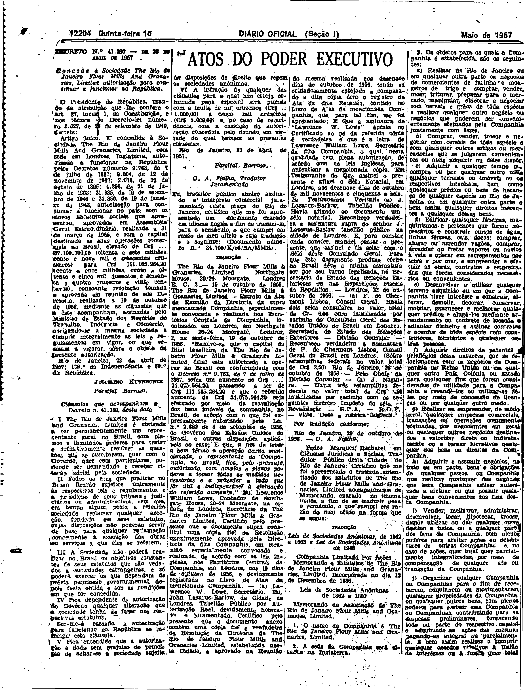

###DEC-041360-0-000-23-04-1957@@@

<strong>DECRETO Nº 41.360, DE 23 DE ABRIL DE 1957.</strong>

<em><strong>Concede à Sociedade The Rio de Janeiro Flour Mills And Granaries, Limited autorização para continuar a funcionar na República.</strong></em>

<strong>O PRESIDENTE DA REPÚBLICA</strong>, usando da atribuição que lhe confere o art. 87, inciso I, da Constituição, e nos têrmos do Decreto-lei número 2.627, de 26 de setembro de 1940,

<strong>DECRETA:</strong>

Artigo único. É concedida à Sociedade <em>The Rio de Janeiro Flour Mills And Granaries, Limited</em>, com sede em Londres, Inglaterra, autorizada a funcionar na República pelos Decretos números 9.763, de 7 de julho de 1887; 9.763, de 12 de novembro de 1887; 2.078, de 22 de agôsto de 1895; 4.898, de 21 de julho de 1903; 21.835, de 10 de setembro de 1946 e 24.350, de 19 de janeiro de 1948, autorização para continuar a funcionar no país, com os novos Estatutos sociais que apresentou, aprovados em Assembléia Geral Extraordinária, realizada a 31 de março de 1955, e com o capital destinado às suas operações comerciais no Brasil, elevado de Cr$87.109.700,00 (oitenta e sete milhões, cento e nove mil e setecentos cruzeiros) para Cr$111.185.264,20 (cento e onze milhões, cento e oitenta e cinco mil, duzentos e sessenta e quatro cruzeiros e vinte centavos), consoante resolução tomada e aprovada em reunião de sua Diretoria, realizada a 19 de outubro de 1956, mediante as cláusulas que a este acompanham, assinadas pelo Ministro de Estado dos Negócios do Trabalho, Indústria e Comércio, obrigando-se a mesma sociedade a cumprir integralmente as leis e regulamentos em vigor, ou que venham a vigorar, sôbre o objeto da presente autorização.

Rio de Janeiro, 23 de abril de 1957; 136º da Independência e 69º da República.

<strong>JUSCELINO KUBITSCHEK</strong>

Parsifal Barroso

<!-- fac-simile-oficial:inicio -->

## Fac-símile oficial: clausulas

A peça vinculada ao Decreto nº 41.360 é reproduzida nas imagens abaixo, a partir da publicação oficial da Imprensa Nacional. A reprodução é em fac-símile, sem transcrição por OCR nem reconstrução do conteúdo.

As imagens mostram páginas inteiras do Diário Oficial da União e podem conter outras matérias. Essas matérias vizinhas não são atribuídas a este decreto. A peça é identificada pelo seu título e pela referência ao ato nas páginas indicadas.

SHA-256 desta imagem: `bf9c75128899d9cb361a51227821fa961247368691e64a77cd410f1c3d73f6cc`.

Fontes oficiais da publicação:

- [DO_1_19570516_111.PDF](https://biblioteca.in.gov.br/documents/271518/581394/DO_1_19570516_111.PDF/beb3fce2-ed21-6a61-4f9a-51a05398fa29?t=1574962995940&download=true) — SHA-256 do PDF: `c7c6c2b06f44efd64aa05b440d3c2b9f21f46295972221aae2ae341de4be18c1`.

<!-- fac-simile-oficial:fim -->
