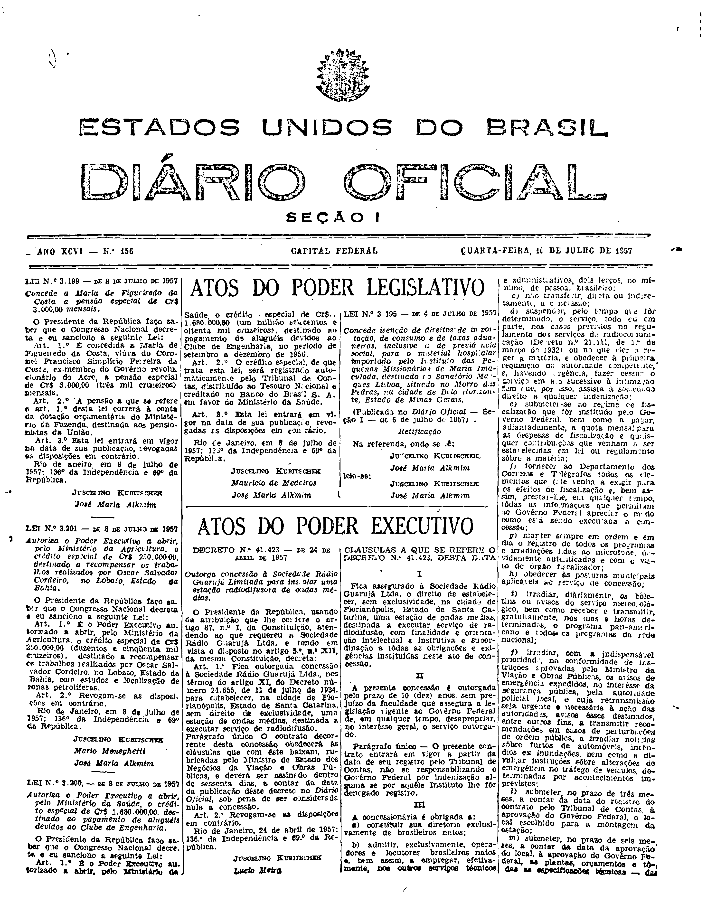
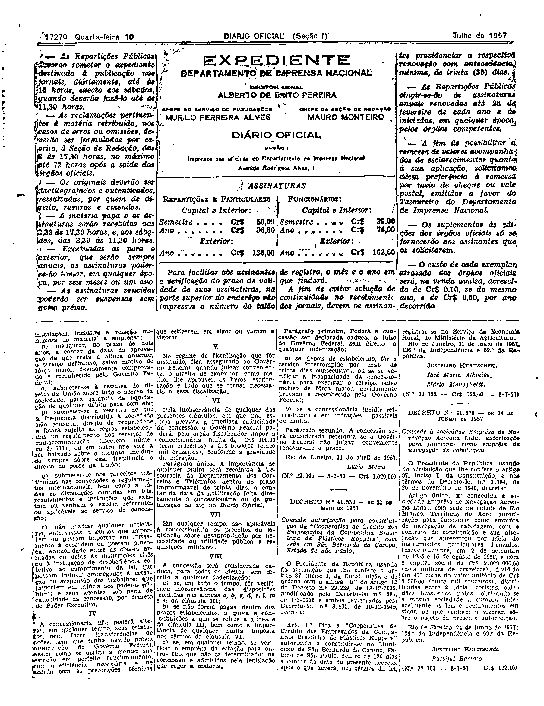

###DEC-041423-0-000-24-04-1957@@@

<strong>DECRETO Nº 41.423, DE 24 DE ABRIL DE 1957.</strong>

<em><strong>Outorgada concessão à Sociedade Rádio Guarujá Limitada para instalar uma estação radiodifusora de ondas médias.</strong></em>

<strong>O PRESIDENTE DA REPÚBLICA</strong>, usando da atribuição que lhe confere o artigo 87, nº I, da Constituição, atendendo ao que requereu a Sociedade Rádio Guarujá Ltda. e tendo em vista o disposto no art. 5º nº XII, da mesma Constituição,

<strong>DECRETA:</strong>

<strong>Art</strong>. 1º Fica outorgada concessão à Sociedade Rádio Guarujá Ltda., nos termos do artigo XI, do Decreto número 24.655, de 11 de julho de 1934, para estabelecer, na cidade de Florianópolis, Estado de Santa Catarina, sem direito de exclusividade, uma estação de ondas médias, destinada a executar serviço de radiodifusão.

Parágrafo único. O contrato decorrente desta concessão obedecerá as cláusulas que com êste baixam, rubricadas pelo Ministro de Estado dos Negócios da Viação e Obras Públicas, e deverá ser assinado dentro de sessenta dias, a contar da data da publicação dêste decreto no <em>Diário</em> <em>Oficial</em>, sob pena de ser considerada nula a concessão.

<strong>Art</strong>. 2º Revogam-se as disposições em contrário.

Rio de Janeiro, 24 de abril de 1957; 136º da Independência e 69º da República.

<strong>JUSCELINO KUBITSCHEK</strong>

Lúcio Meira

<!-- fac-simile-oficial:inicio -->

## Fac-símile oficial: cláusulas

O texto acima não inclui as cláusulas a que se refere este decreto. A publicação oficial do anexo está em imagem, nas páginas do _Diário Oficial da União_ (Seção I) de 10 de julho de 1957: página 1 do PDF (capa do caderno) (a partir de «CLÁUSULAS A QUE SE REFERE O DECRETO N.º 41.423, DESTA DATA»); página 2 do PDF (até «N.º 22.046 — 8-7-57 — Cr$ 1.020,00»).

As imagens são as páginas inteiras, tal como digitalizadas pela Imprensa Nacional, sem recorte, sem redesenho e sem transcrição. Cada página traz também outros atos do mesmo dia; a peça deste decreto está apenas no trecho indicado, e o texto do anexo só existe na imagem. Não há OCR validado.

Fonte: Imprensa Nacional, Biblioteca Machado de Assis, arquivo `DO_1_19570710_156.PDF` (SHA-256 `dcc54b3e071d48bbbdfd8f817795d1e3401893e4b8ecb906502c0232e90fe9dc`), páginas 1, 2 do PDF. SHA-256 das imagens, na ordem: `1cd515518fe9660d4154fb5307c1722d3dec882447138d8f00284db5bf6b24e5`, `4c0b824eef087cc6dd13fe2e798da5da1c3a5e10e3997562397fd857c6d45ce3`.

<!-- fac-simile-oficial:fim -->
