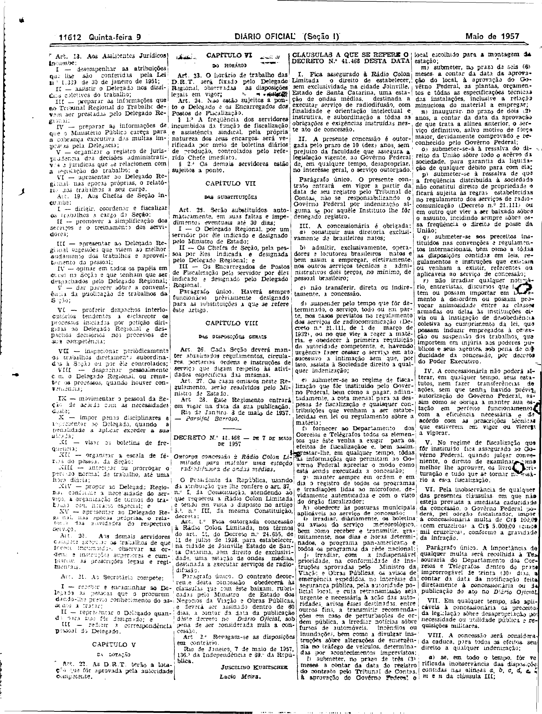
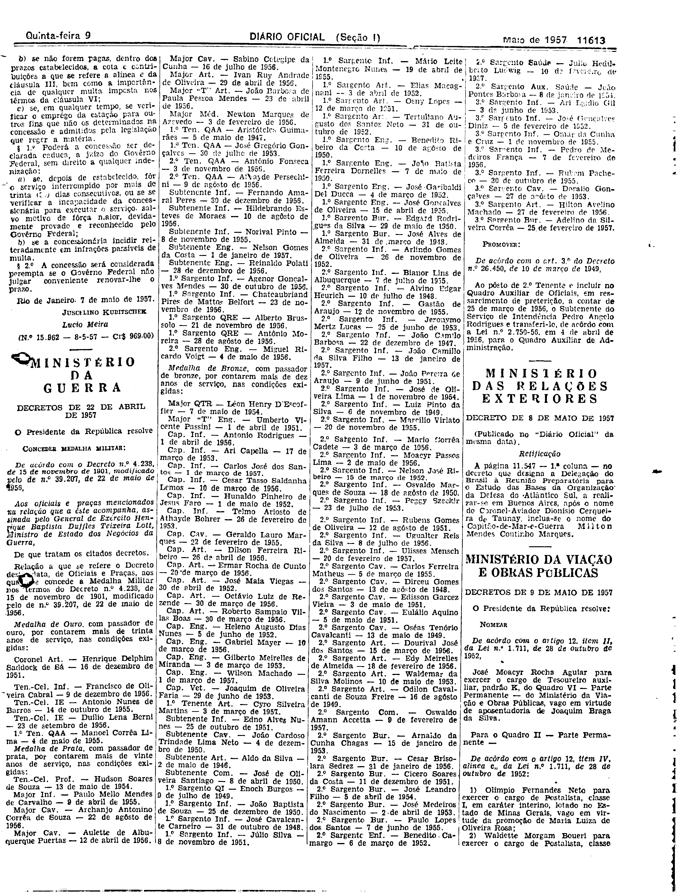

###DEC-041468-0-000-07-05-1957@@@

<strong>DECRETO Nº 41.468, DE 7 DE MAIO DE 1957.</strong>

<!-- fac-simile-oficial:inicio -->

## Fac-símile oficial do ato inteiro: cláusulas

Esta norma é reproduzida apenas em imagem. As páginas inteiras do _Diário Oficial da União_ (Seção I) de 9 de maio de 1957 trazem o decreto e o instrumento que o acompanha: PDF `DO_1_19570509_105.PDF`, p.4 do PDF (impressa 11612), p.5 do PDF (impressa 11613).

O texto do Senado que antes constava aqui foi retirado para manter uma só versão do ato: não foi colacionado palavra a palavra com o impresso.

**Limites lidos nas imagens:** p.11612 (PDF 4): decreto col.2 base (JUSCELINO KUBITSCHEK / Lucio Meira); «CLÁUSULAS A QUE SE REFERE O DECRETO N.º 41.468» col.3 topo–col.4 (I–VIII, VIII cortada). p.11613 (PDF 5): col.1 topo conclui VIII, §1º, §2º, «Rio de Janeiro, 7 de maio de 1957. JUSCELINO KUBITSCHEK / Lucio Meira (N.º 15.962 — 8-5-57 — Cr$ 969,00)», antes de «MINISTÉRIO DA GUERRA». Cols.1–2 da p.11612 são regimento de outro ato (fora da peça).

**Assinatura(s):** Juscelino Kubitschek / Lúcio Meira (Ministro da Viação e Obras Públicas)

As imagens são as páginas inteiras, extraídas do PDF com `pdfimages -png` (imagem JBIG2 embutida, uma por página, sem reduzir), sem recorte, sem redesenho e sem transcrição. Cada página traz também outros atos do mesmo dia; a peça está apenas no trecho indicado. O texto do ato só existe na imagem. Não há OCR validado.

Fonte: Imprensa Nacional, Biblioteca Machado de Assis, `DO_1_19570509_105.PDF` (SHA-256 `946272bb91b9ba06a93b2808d81d0d5c6d90cf909cce07ce7c91f40474eb4dae`). SHA-256 das imagens, na ordem: `6def2fb244ecbaff25806c05312b2ca5f9a081cd968ae150ae8af9ea5af17565`, `3f56046bc5a404bba551437c90ccf68630ad198d06ca570aa4edf14bf9142286`.

[PDF da edição oficial](https://biblioteca.in.gov.br/documents/271518/581394/DO_1_19570509_105.PDF/d3e67a7a-a38c-a0f3-fed4-43712b7f0546?t=1574962920147&download=true).

<!-- fac-simile-oficial:fim -->
