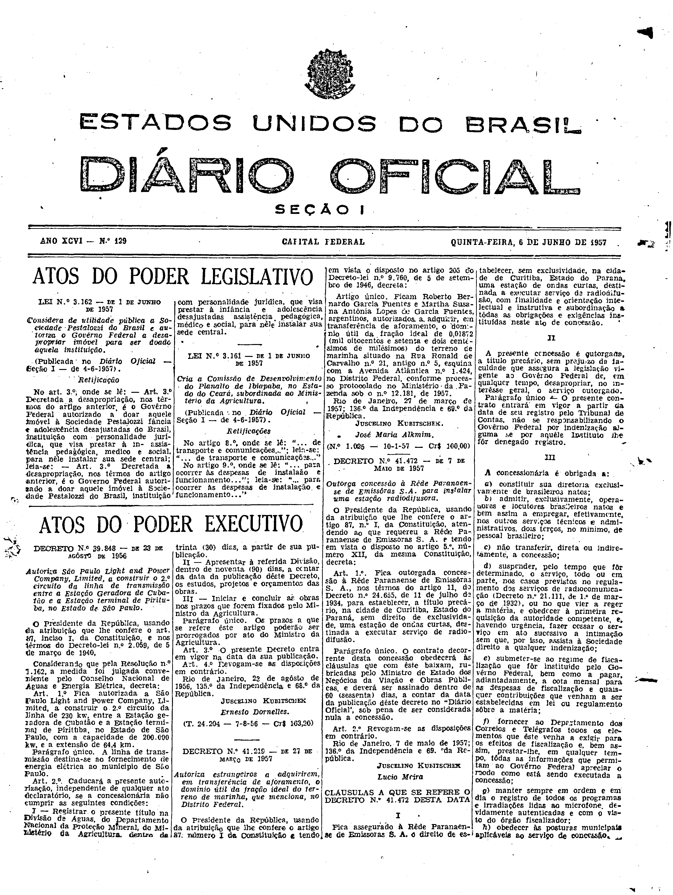
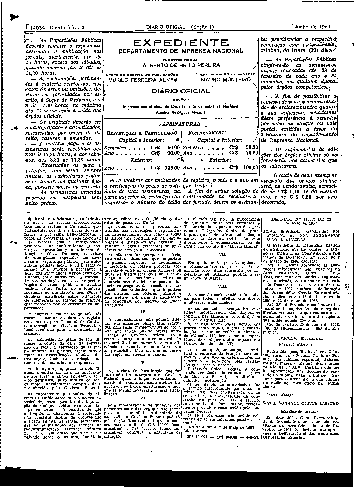

###DEC-041472-0-000-07-05-1957@@@

<strong>DECRETO Nº 41.472, DE 7 DE MAIO DE 1957.</strong>

<em><strong>Outorga concessão à Rêde Paranaense de Emissôras S.A. para instalar uma estação radiodifusora.</strong></em>

<strong>O PRESIDENTE DA REPÚBLICA</strong>, usando da atribuição que lhe confere o artigo 87, nº l, da Constituição, atendendo ao que requereu a Rêde Paranaense de Emissoras S.A. e tendo em vista o disposto no artigo 5º, número Xll, da mesma Constituição,

<strong>DECRETA:</strong>

<strong>Art</strong>. 1º Fica outorgada concessão à Rede Paranaense de Emissoras S. A., nos têrmos do artigo 11, do Decreto nº 24.655, de 11 de julho de 1934, para estabelecer, a título precário na cidade de Curitiba, Estado do Paraná, sem direito de exclusividade, uma estação de ondas curtas, destinada a executar serviço de radiodifusão.

Parágrafo único. O contrato decorrente desta concessão obedecerá às cláusulas que com êste baixam, rubricadas pelo Ministério de Estado dos Negócios da Viação e Obras Públicas, e deverá ser assinado dentro de 60 (sessenta) dias, a contar da Data da publicação dêste decreto no “<em>Diário</em> <em>Oficial</em> “, sob pena de ser considerada nula a concessão.

<strong>Art</strong>. 2º Revogam-se as disposições em contrário.

Rio de Janeiro, 7 de maio de 1957; 136º de Independência e 69º da República.

<strong>JUSCELINO KUBITSCHEK</strong>

Lúcio Meira

<!-- fac-simile-oficial:inicio -->

## Fac-símile oficial: cláusulas

O texto acima não inclui as cláusulas a que se refere este decreto. A publicação oficial do anexo está em imagem, nas páginas do _Diário Oficial da União_ (Seção I) de 6 de junho de 1957: página 1 do PDF (capa do caderno) (a partir de «CLÁUSULAS A QUE SE REFERE O DECRETO N.º 41.472 DESTA DATA»); página 2 do PDF (até «N.º 19.094 — Cr$ 969,00 — 4-6-57»).

As imagens são as páginas inteiras, tal como digitalizadas pela Imprensa Nacional, sem recorte, sem redesenho e sem transcrição. Cada página traz também outros atos do mesmo dia; a peça deste decreto está apenas no trecho indicado, e o texto do anexo só existe na imagem. Não há OCR validado.

Fonte: Imprensa Nacional, Biblioteca Machado de Assis, arquivo `DO_1_19570606_129.PDF` (SHA-256 `8eddcfbff92a23b84464a08b9b37582971ea6d928d72dbf97f128b2d1ad0ffb7`), páginas 1, 2 do PDF. SHA-256 das imagens, na ordem: `21b5d8e9792e3e4edd598e71e04f0f014ce8f23061c03bdbd1d6ed5cbeec6a27`, `39d23490b9d60ab09fe19dd3a5aa88f8280c5b93c9f1dab2241486b12762a610`.

<!-- fac-simile-oficial:fim -->
